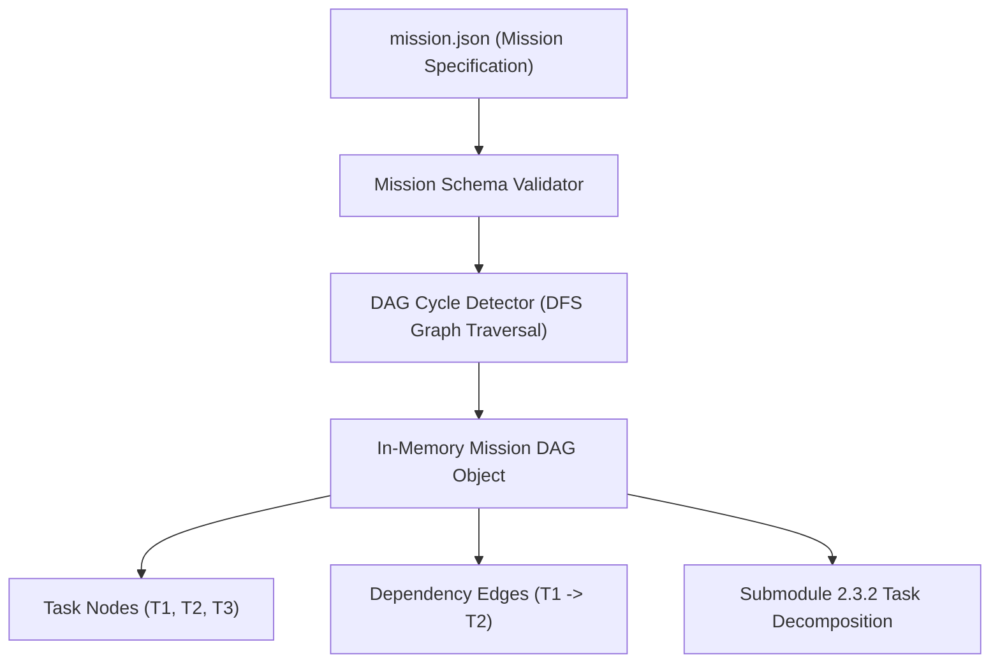

# Submodule 2.3.1: Mission Representation

## 1. Purpose
Defines the internal data structures, schemas, and serialization formats for complex multi-robot inspection missions structured as Directed Acyclic Graphs (DAGs).

## 2. Responsibility
Parse, validate, serialize, and store mission specifications containing metadata, global constraints, tasks, and dependency edges.

## 3. Scope
### In-Scope
Mission DAG data structures, JSON/YAML mission schema validation, topological cycle detection, and mission state representation.

### Out-of-Scope
Graphical mission design UI (handled by Layer 3).

## 4. System Architecture

## 5. Internal Submodules
- **Mission Graph Data Structure**: Adjacency-list graph representation storing tasks as vertices and dependencies as directed edges.
- **Topological Graph Validator**: Runs cycle-detection algorithms (Tarjan / Kahn's algorithm) to guarantee valid execution order.

## 6. Functional Requirements
- **REQ-2.3-001**: Mission representation shall support missions with up to 500 tasks and arbitrary dependency DAG topologies.
- **REQ-2.3-002**: Mission validator shall reject any mission specification containing circular dependencies ($T_A \to T_B \to T_A$).

## 7. Technical Approach
Implement DAG graph structures in modern C++ utilizing `boost::graph` or clean custom graph primitives. Validate incoming mission manifests against `docs/06_interfaces_protocols/MISSION_SCHEMA.md`.

## 8. Open-Source Resources
### Boost Graph Library (BGL)
- **What it provides**: Comprehensive graph algorithms and data structures.
- **Why it is relevant**: Standard C++ library for graph operations and cycle detection.
- **What we can reuse**: topological_sort, depth_first_search.
- **What we must develop ourselves**: Robotics mission DAG wrappers.

## 9. Prerequisites
`MISSION_SCHEMA.md`.

## 10. Dependencies
- **Upstream Dependencies**: Module 3.1 Mission Planning.
- **Downstream Dependencies**: Submodule 2.3.2 Task Decomposition, Module 2.6 State Management.
- **Interfaces with Other Modules**: JSON Schema `schemas/mission_schema.json`.

## 11. Development Phases
### Phase 1: Mission DAG Core
- **Objective**: Implement C++ MissionDAG class with cycle validation.
- **Activities**: Code graph parser, add cycle detection unit tests.
- **Required resources**: C++, GTest, Boost.
- **Input**: mission.json.
- **Output**: Validated MissionDAG object.
- **Dependencies**: None.
- **Validation**: Test DAG with intentional cycle; verify rejection.
- **Completion criteria**: Rejects cyclic graphs with informative exception.

## 12. Interfaces
### Schemas
- `interfaces/schemas/mission_schema.json`: Formal JSON schema defining mission DAGs.

## 13. Testing Strategy
Feed 5 valid complex DAGs and 5 cyclic graphs; verify 100% correct acceptance/rejection.

## 14. Known Challenges
- **Dynamic DAG Mutation**: Adding newly discovered tasks (e.g. newly discovered hot spot) to an active in-flight mission DAG without breaking existing execution leases.

## 15. Implementation Status
`PLANNED`

## 16. References
- **Kahn, Topological Sorting of Large Networks**: Communications of the ACM, 1962
