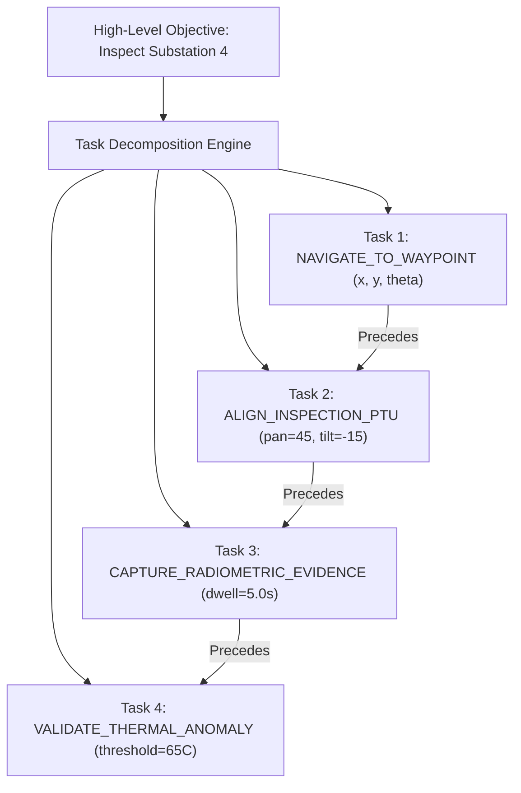

# Submodule 2.3.2: Task Decomposition

## 1. Purpose
Decomposes high-level inspection objectives into atomic, independently actionable, and verifiable robotic tasks.

## 2. Responsibility
Translate compound goals (e.g. 'Inspect Substation 4') into atomic pipeline tasks: `NAVIGATE_TO_WAYPOINT`, `ALIGN_SENSOR_PTU`, `CAPTURE_THERMAL_FRAME`, `VERIFY_TEMPERATURE`.

## 3. Scope
### In-Scope
Goal-to-task expansion rules, spatial waypoint decomposition, parameter binding, and atomic task generation.

### Out-of-Scope
Low-level trajectory interpolation (handled by Nav2).

## 4. System Architecture

## 5. Internal Submodules
- **Action Template Library**: Predefined atomic action templates parameterized by coordinates, target sensors, and tolerances.
- **Spatial Route Decomposer**: Breaks long drift inspection routes (> 50m) into sequential check-pointed waypoint tasks.

## 6. Functional Requirements
- **REQ-2.3-003**: Every decomposed task shall possess unambiguous completion criteria and verification parameters.
- **REQ-2.3-004**: Decomposition shall preserve causal dependency order between sequential operations.

## 7. Technical Approach
Deploy a rule-based decomposition engine in C++. Map domain inspection primitives into atomic task instances with unique `task_id` hashes conforming to `TASK_SCHEMA.md`.

## 8. Open-Source Resources
### BehaviorTree.CPP Concepts
- **What it provides**: Hierarchical task breakdown models.
- **Why it is relevant**: Informs atomic action sequencing and condition checking.
- **What we can reuse**: Action node taxonomy.
- **What we must develop ourselves**: Declarative task decomposition engine.

## 9. Prerequisites
Submodule 2.3.1 Mission Representation, `TASK_SCHEMA.md`.

## 10. Dependencies
- **Upstream Dependencies**: Submodule 2.3.1 Mission Representation.
- **Downstream Dependencies**: Submodule 2.3.3 Task Dependencies, Module 2.4 Task Allocation.
- **Interfaces with Other Modules**: Produces `Task` objects.

## 11. Development Phases
### Phase 1: Decomposer Implementation
- **Objective**: Implement objective decomposition pipeline.
- **Activities**: Code action templates, write parser expanding high-level inspection goals.
- **Required resources**: C++, GTest.
- **Input**: High-level goal struct.
- **Output**: Vector of atomic tasks.
- **Dependencies**: Submodule 2.3.1.
- **Validation**: Decompose complex inspection goal; verify all atomic tasks generated.
- **Completion criteria**: All generated tasks satisfy TASK_SCHEMA.

## 12. Interfaces
### Schemas
- `interfaces/schemas/task_schema.json`: Formal JSON schema defining atomic tasks.

## 13. Testing Strategy
Decompose an inspection mission with 4 target assets; verify generated tasks possess correct coordinates, sensor requirements, and dependencies.

## 14. Known Challenges
- **Granularity Balance**: Tasks that are too granular overwhelm the auction mechanism; tasks that are too coarse reduce multi-robot concurrency.

## 15. Implementation Status
`PLANNED`

## 16. References
- **Ghallab et al., Automated Planning and Acting**: Cambridge University Press
