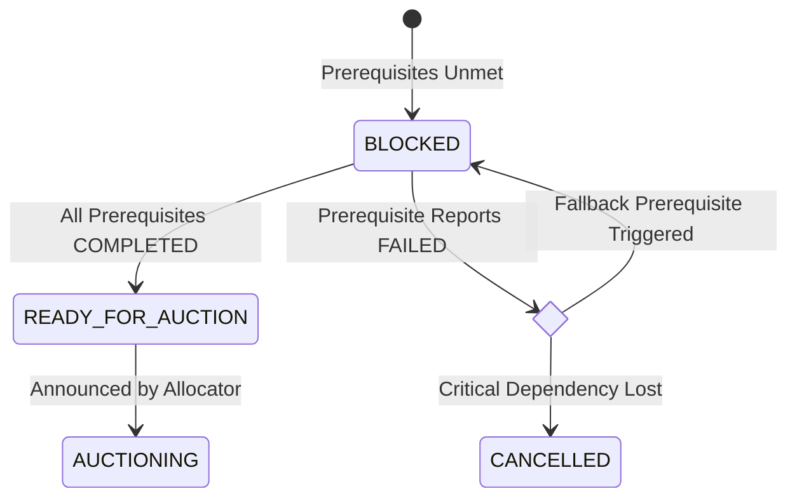

# Submodule 2.3.3: Task Dependencies

## 1. Purpose
Enforces execution order and precedence constraints across interdependent tasks within the distributed mission DAG.

## 2. Responsibility
Track prerequisite task completions, compute task eligibility, unblock downstream tasks when prerequisites succeed, and handle cascade failures.

## 3. Scope
### In-Scope
Dependency evaluation, unblocking logic, prerequisite failure handling, and readiness status updating.

### Out-of-Scope
Distributed task assignment (handled by Module 2.4).

## 4. System Architecture

## 5. Internal Submodules
- **Prerequisite Evaluator**: Monitors task DAG state; transitions tasks from `BLOCKED` to `READY_FOR_AUCTION` when all upstream tasks complete.
- **Failure Cascade Resolver**: Identifies tasks dependent on a failed task; marks them `CANCELLED` or triggers re-planning.

## 6. Functional Requirements
- **REQ-2.3-005**: A task shall not be released for auction or execution until 100% of its prerequisite parent tasks have reported `COMPLETED`.
- **REQ-2.3-006**: Dependency state evaluation shall execute in `[PROPOSED TARGET: < 1 ms]` per task state mutation.

## 7. Technical Approach
Maintain in-degree counters for each task in the DAG. When a task transitions to `COMPLETED`, decrement the in-degree of all dependent child tasks. When a child's in-degree reaches zero, flag it as `READY_FOR_AUCTION`.

## 8. Open-Source Resources
### Standard In-Degree Graph Algorithms
- **What it provides**: O(1) amortized dependency unblocking.
- **Why it is relevant**: Extremely fast runtime prerequisite tracking.
- **What we can reuse**: Algorithm concept.
- **What we must develop ourselves**: C++ thread-safe dependency state tracker.

## 9. Prerequisites
Submodule 2.3.1 Mission Representation.

## 10. Dependencies
- **Upstream Dependencies**: Submodule 2.3.1 Mission Representation.
- **Downstream Dependencies**: Module 2.4 Distributed Task Allocation.
- **Interfaces with Other Modules**: Updates task lifecycle states.

## 11. Development Phases
### Phase 1: Dependency Resolver Engine
- **Objective**: Implement in-degree dependency unblocking engine.
- **Activities**: Code tracker, test with complex diamond-shaped dependency DAGs.
- **Required resources**: C++, GTest.
- **Input**: Task state updates.
- **Output**: Unblocked task notifications.
- **Dependencies**: None.
- **Validation**: Complete parent task; verify children immediately unblock.
- **Completion criteria**: Zero premature task activations.

## 12. Interfaces
### Events
- `TaskReadyForAuction(task_id)`: Event fired when all prerequisites for a task are completed.

## 13. Testing Strategy
Build diamond DAG ($T_1 \to T_2, T_1 \to T_3, (T_2, T_3) \to T_4$); verify $T_4$ unblocks only after *both* $T_2$ and $T_3$ report completed.

## 14. Known Challenges
- **Distributed State Race**: Two robots concurrently completing prerequisites across partitioned links; resolved via CRDT state convergence in Module 2.6.

## 15. Implementation Status
`PLANNED`

## 16. References
- **Tarjan, Depth-First Search and Linear Graph Algorithms**: SIAM Journal on Computing, 1972
