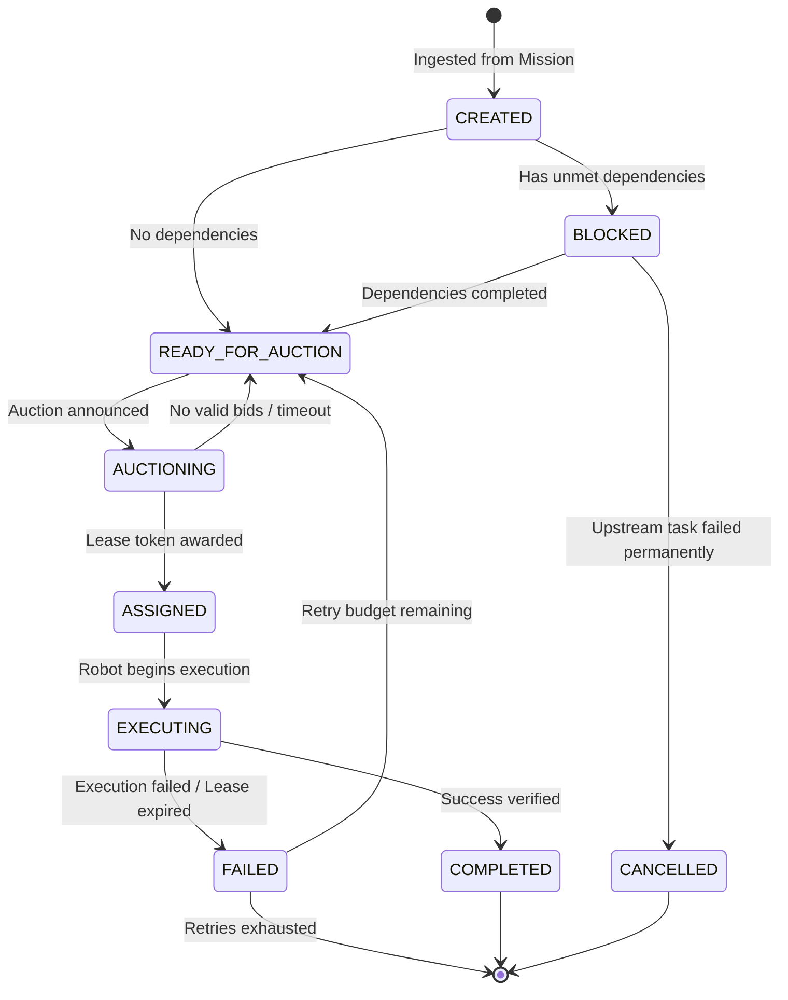

# Submodule 2.3.5: Task Lifecycle

## 1. Purpose
Defines and enforces the formal Finite State Machine (FSM) governing every task from instantiation to terminal completion or failure.

## 2. Responsibility
Enforce valid task state transitions, broadcast state mutation events, record execution audit logs, and manage terminal statuses.

## 3. Scope
### In-Scope
Task lifecycle states (`CREATED`, `BLOCKED`, `READY_FOR_AUCTION`, `AUCTIONING`, `ASSIGNED`, `EXECUTING`, `COMPLETED`, `FAILED`, `CANCELLED`), transition guards, and history tracking.

### Out-of-Scope
Distributed consensus replication (handled by Module 2.6).

## 4. System Architecture

## 5. Internal Submodules
- **Lifecycle FSM Guard**: Rejects illegal state transitions (e.g. transitioning directly from `CREATED` to `EXECUTING`).
- **Task History Ledger**: Maintains timestamped log of all transitions, assigned robot UUID, and failure error codes.

## 6. Functional Requirements
- **REQ-2.3-009**: Every task state mutation shall be recorded with monotonic timestamp, causal vector clock, and actor robot UUID.
- **REQ-2.3-010**: A task may be retried a maximum of 3 times upon failure before transitioning to permanently `FAILED`.

## 7. Technical Approach
Implement formal FSM pattern in C++. Ensure all state mutations emit events consumed by the CRDT state engine (Module 2.6) for cluster-wide replication.

## 8. Open-Source Resources
### Modern C++ State Machine (boost::sml)
- **What it provides**: Fast, type-safe compile-time state machines.
- **Why it is relevant**: Enforces formal transition rules with zero runtime overhead.
- **What we can reuse**: State machine transition definitions.
- **What we must develop ourselves**: Task lifecycle transition table.

## 9. Prerequisites
Submodule 2.3.2 Task Decomposition.

## 10. Dependencies
- **Upstream Dependencies**: Submodule 2.3.2 Task Decomposition.
- **Downstream Dependencies**: Module 2.4 Task Allocation, Module 2.6 State Management.
- **Interfaces with Other Modules**: Publishes task state transition events.

## 11. Development Phases
### Phase 1: Task FSM Implementation
- **Objective**: Implement state machine and transition ledger.
- **Activities**: Code state transitions, write comprehensive transition test suite.
- **Required resources**: C++, GTest.
- **Input**: Task transition commands.
- **Output**: Validated task state.
- **Dependencies**: None.
- **Validation**: Test all valid transitions and 20 illegal transitions.
- **Completion criteria**: All illegal transitions rejected with specific error.

## 12. Interfaces
### Enums
- `TaskState::{CREATED, BLOCKED, READY, AUCTIONING, ASSIGNED, EXECUTING, COMPLETED, FAILED, CANCELLED}`: Formal task state enum.

## 13. Testing Strategy
Execute complete lifecycle: CREATED -> READY -> AUCTIONING -> ASSIGNED -> EXECUTING -> COMPLETED; verify state history contains all 6 transitions.

## 14. Known Challenges
- **Concurrent State Transitions**: Two partitioned robots could attempt concurrent conflicting transitions; resolved by CRDT Last-Write-Wins and lease locks.

## 15. Implementation Status
`PLANNED`

## 16. References
- **State Pattern in Distributed Systems**: Gamma et al., Design Patterns
