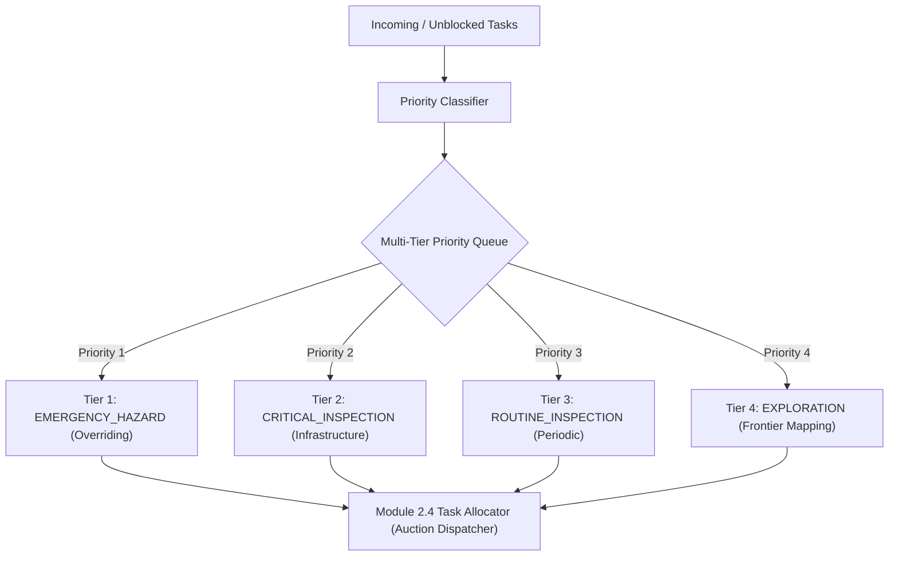

# Submodule 2.3.4: Task Priority

## 1. Purpose
Manages task prioritization, scheduling tiers, preemption policies, and emergency hazard response across the multi-robot fleet.

## 2. Responsibility
Assign numerical priorities to tasks based on operational criticality, order auction queues, and arbitrate preemption of low-priority tasks.

## 3. Scope
### In-Scope
Priority tier enumeration (`EMERGENCY_HAZARD`, `CRITICAL_INSPECTION`, `ROUTINE_INSPECTION`, `EXPLORATION`), priority queue management, and preemption policies.

### Out-of-Scope
Local motor control velocity arbitration.

## 4. System Architecture

## 5. Internal Submodules
- **Multi-Tier Priority Queue**: Thread-safe priority queue sorting available tasks by numerical priority and age.
- **Preemption Arbitrator**: Determines if an active low-priority task should be paused to service a newly detected emergency hazard.

## 6. Functional Requirements
- **REQ-2.3-007**: Emergency hazard tasks shall preempt active exploration tasks within `[PROPOSED TARGET: < 500 ms]` of injection.
- **REQ-2.3-008**: Task queues shall implement aging mechanisms to prevent starvation of routine inspection tasks.

## 7. Technical Approach
Implement a multi-level priority queue with configurable preemption thresholds. If an emergency task ($P=1$) arrives while a robot is executing an exploration task ($P=4$), send a preemption cancellation to the active task and re-auction it.

## 8. Open-Source Resources
### std::priority_queue
- **What it provides**: C++ standard heap-based priority queue.
- **Why it is relevant**: Efficient task sorting by priority.
- **What we can reuse**: std::priority_queue container.
- **What we must develop ourselves**: Aging and preemption comparator.

## 9. Prerequisites
Submodule 2.3.2 Task Decomposition.

## 10. Dependencies
- **Upstream Dependencies**: Submodule 2.3.2 Task Decomposition.
- **Downstream Dependencies**: Module 2.4 Distributed Task Allocation.
- **Interfaces with Other Modules**: Priority queue container API.

## 11. Development Phases
### Phase 1: Priority Scheduler
- **Objective**: Implement priority queue with preemption logic.
- **Activities**: Code queue, benchmark scheduling latency, test preemption trigger.
- **Required resources**: C++, GTest.
- **Input**: Prioritized tasks.
- **Output**: Scheduled task sequence.
- **Dependencies**: None.
- **Validation**: Inject emergency task during exploration; verify preemption event.
- **Completion criteria**: Preemption triggered within 500 ms.

## 12. Interfaces
### Data Types
- `TaskPriority::EMERGENCY (100) ... TaskPriority::EXPLORATION (10)`: Priority level enum.

## 13. Testing Strategy
Queue 10 routine tasks and 1 emergency task; verify emergency task is selected first regardless of insertion order.

## 14. Known Challenges
- **Thrashing Preemptions**: Frequent switching between comparable priority tasks wastes battery; requires hysteresis preemption threshold.

## 15. Implementation Status
`PLANNED`

## 16. References
- **Real-Time Queueing and Priority Scheduling**: IEEE Transactions on Computers
