# Module 2.4: Distributed Task Allocation

## 1. Module Overview
Module 2.4 provides a decentralized, peer-to-peer task allocation engine for autonomous multi-robot subterranean mine inspection. Operating without a permanent central master or dispatcher, it deploys a candidate Contract Net Protocol (CNP) baseline (`PROPOSED / UNDER EVALUATION`) designed to function deterministically across lossy wireless mesh links, transient communication drops, and full network partitions.

```mermaid
flowchart TD
    subgraph AllocationLifecycle["Decentralized Task Allocation Lifecycle"]
        DAG["Unblocked Task in Mission DAG"] --> AuctioneerSelect["1. Ephemeral Auctioneer Selection"]
        AuctioneerSelect --> Announce["2. Task Announcement (Zenoh Broadcast)"]
        Announce --> Bidding["3. Multi-Factor Cost Bidding (All Capable Peers)"]
        Bidding --> Clearance["4. Auction Clearance & Tie-Breaking (Auctioneer)"]
        Clearance --> Handshake["5. Two-Phase Commitment (Award <-> Ack)"]
        Handshake --> Lease["6. Time-Bounded Lease Granted & CRDT Sync"]
        Lease --> Exec["7. Task Execution with Heartbeat Renewals"]
    end
```

---

## 2. Core Architectural Pillars

### 2.1 Ephemeral Auctioneer Selection
In a decentralized subterranean environment, no permanent central auctioneer exists:
1. **Per-Task Ephemeral Auctioneer**: Any robot that identifies an unassigned task with all prerequisites satisfied (either from its local mission DAG view or through runtime environmental perception, such as hazard discovery) can initiate an auction for that task.
2. **Concurrent Auctioneer Deconfliction**: If two robots simultaneously announce an auction for the same `task_id`:
   - Both announcements carry the initiator's `robot_id` (UUIDv4) and local monotonic timestamp.
   - All peers (including the initiators) evaluate the deterministic rule:
     $$\text{Authoritative Auctioneer} = \arg\min_{r \in \{\text{initiators}\}} \text{SHA256}(r.\text{robot\_id} \mathbin{\Vert} \text{task\_id})$$
   - The robot with the lower hash continues as the authoritative auctioneer; the competing robot immediately steps down to a bidder or observer role with zero additional network overhead.
3. **Batch Auction Coordination**: For synchronized multi-task phases, the temporary cluster coordinator (elected via Submodule 2.5.2) serves as the batch auctioneer for the duration of that mission epoch.

### 2.2 Temporary Coordinator Failure Handling
If an auctioneer or temporary coordinator fails (due to crash, hardware fault, or sudden RF loss) during an ongoing allocation:
1. **Auction Window Timeout**: Every candidate bidder sets an auction timeout watchdog:
   $$T_{\text{timeout}} = T_{\text{window}} + \Delta_{\text{guard}} \quad (\text{e.g., } 400\text{ ms} + 200\text{ ms} = 600\text{ ms})$$
   If the auctioneer does not broadcast `TaskAward` before $T_{\text{timeout}}$ expires, the pending auction is marked `ABORTED_COORDINATOR_TIMEOUT`.
2. **Uncommitted Lease Invalidation**: If the coordinator crashes after selecting a winner but before committing the lease to the distributed CRDT state log, the unacknowledged lease is discarded. Bidders do not initiate execution without a confirmed, two-phase committed lease token.
3. **Re-Auction Backoff & Succession**: Following an aborted auction, candidate robots initiate a randomized exponential backoff:
   $$T_{\text{backoff}} = \text{Uniform}(100, 300) \times 2^{\text{retry\_count}}\text{ ms}$$
   The first robot to expire its backoff re-announces the auction under an incremented auction term epoch (`auction_epoch = epoch + 1`), ensuring forward progress without deadlock.

### 2.3 Duplicate Assignment Prevention
Subterranean operations must guarantee mutual exclusion: under no circumstances may two robots concurrently execute or claim the same physical inspection waypoint.
1. **Cryptographic Time-Bounded Leases**: Every task assignment grants a signed lease token:
   $$\text{LeaseToken} = \langle \text{task\_id}, \text{robot\_id}, \text{term\_epoch}, T_{\text{granted}}, T_{\text{expire}}, \text{Signature} \rangle$$
   A robot is strictly prohibited from actuating motors or executing sensor routines for a task without holding an active, unexpired lease token.
2. **Two-Phase Commit (2PC) Handshake**:
   - **Phase 1 (Award & Ack)**: Auctioneer broadcasts `TaskAward(task_id, winner_uuid, lease_token)`. The winner responds with `TaskAcceptAck(task_id, winner_uuid, lease_token)`.
   - **Phase 2 (Commit)**: Auctioneer commits the lease into the distributed CRDT registry and broadcasts `LeaseCommit(task_id, winner_uuid)`. Only upon receiving `LeaseCommit` does the winner dispatch the action goal to its Layer 1 `ExecuteTask.action` server.
3. **Continuous Heartbeat Renewals**: Leases have a default duration of $T_{\text{lease}} = 30\text{ s}$. The executing robot must renew its lease at $T_{\text{renew}} = T_{\text{lease}} / 2 = 15\text{ s}$ via periodic telemetry heartbeats. If a robot crashes, its lease expires automatically, allowing autonomous reassignment without distributed locks stalling.
4. **Deterministic CRDT Arbitrament**: If network anomalies produce duplicate lease claims in the distributed state engine, the Conflict-Free Replicated Data Type (LWW-Element-Set) resolves the conflict deterministically using the monotonic epoch timestamp, breaking equal timestamp ties via lowest UUID hash.

### 2.4 Network Partitions & Split-Brain Mitigation
Subterranean rock structures cause frequent, prolonged RF blackouts and topological graph partitions:
1. **Topological Graph Scoping**: When the fleet is partitioned into disconnected sub-clusters (e.g., Cluster A in Drift 1, Cluster B in Drift 2):
   - Robots in each cluster only bid on and auction tasks whose spatial locations and dependencies fall within their reachable topological sub-map.
   - Tasks requiring capabilities present only in the disconnected partition remain pending in `READY_UNASSIGNED` state until connectivity is restored.
2. **Bounded Disconnected Execution**: A robot holding an active lease when disconnected from the cluster continues executing its committed task until completion or lease expiration. It stores all inspection evidence and telemetry in local non-volatile WAL storage.
3. **Anti-Entropy Reconciliation on Reconnection**: When partitioned robots regain radio contact:
   - Module 2.6 initiates delta-CRDT exchange via causal vector clocks.
   - If a task was completed during the partition, the `COMPLETED` state (with cryptographic evidence hash) is a terminal state in the task FSM and supersedes any re-auction attempts made in other partitions.
   - If duplicate work was initiated due to lease expiration across a prolonged partition, the CRDT merge engine preserves all unique inspection evidence records, flags an audit notice, and safely cancels the redundant active goal via Layer 1 action preemption.

---

## 3. Submodule Index

- [2.4.1 Task Bidding](task_bidding.md): Contract Net Protocol announcement schemas, bidder qualification, and bid dispatch.
- [2.4.2 Cost Evaluation](cost_evaluation.md): Multi-factor cost function ($D_{\text{travel}}, E_{\text{battery}}, T_{\text{risk}}, C_{\text{fit}}$).
- [2.4.3 Task Negotiation](task_negotiation.md): Ephemeral auctioneer clearance, bid ranking, deterministic tie-breaking, and coordinator failure watchdogs.
- [2.4.4 Assignment Confirmation](assignment_confirmation.md): Two-phase commit protocol, lease issuance, and acknowledgment handshakes.
- [2.4.5 Duplicate Assignment Prevention](duplicate_assignment_prevention.md): Time-bounded lease locks, CRDT mutual exclusion, partition mitigation, and lease renewal watchdogs.
