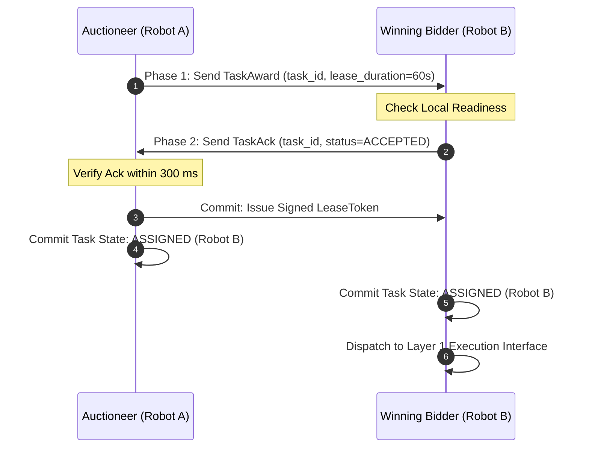

# Submodule 2.4.4: Assignment Confirmation

## 1. Purpose
Executes a resilient two-phase commitment protocol to confirm task assignments between auctioneer and winning robot before execution begins.

## 2. Responsibility
Transmit Task Award -> Receive Task Acknowledgment -> Issue Active Task Lease Token -> Commit Assignment to local replicated state.

## 3. Scope
### In-Scope
Two-phase handshake protocol, award timeout handling, acknowledgment retries, and atomic commitment.

### Out-of-Scope
CRDT state replication to non-participating peers (handled by Module 2.6).

## 4. System Architecture

## 5. Internal Submodules
- **Two-Phase Handshake Manager**: Coordinates Award -> Ack -> Lease sequence with automatic retry timeouts.
- **Lease Token Generator**: Generates signed cryptographic lease tokens containing task ID, owner UUID, and expiration epoch.

## 6. Functional Requirements
- **REQ-2.4-007**: Assignment confirmation handshake shall complete within `[PROPOSED TARGET: < 500 ms]` over nominal mesh links.
- **REQ-2.4-008**: If winning bidder fails to acknowledge award within 500 ms, auctioneer shall revoke award and re-open auction.

## 7. Technical Approach
Deploy a two-phase commit (2PC) FSM. If the winner fails to reply with `TaskAck` before timeout, the auctioneer immediately falls back to the runner-up bidder without re-running the entire auction.

## 8. Open-Source Resources
### Two-Phase Commit (2PC) Protocols
- **What it provides**: Atomic transaction commitment in distributed systems.
- **Why it is relevant**: Prevents phantom task assignments where neither robot executes the task.
- **What we can reuse**: 2PC state machine design.
- **What we must develop ourselves**: Lightweight wireless robotics implementation.

## 9. Prerequisites
Submodule 2.4.3 Task Negotiation.

## 10. Dependencies
- **Upstream Dependencies**: Submodule 2.4.3 Task Negotiation.
- **Downstream Dependencies**: Submodule 2.4.5 Duplicate Prevention, Submodule 1.5.4 Task Execution.
- **Interfaces with Other Modules**: Zenoh topics `mine/auctions/<task_id>/ack` and `/lease`.

## 11. Development Phases
### Phase 1: 2PC Confirmation Engine
- **Objective**: Implement 2PC handshake for task assignment.
- **Activities**: Code award/ack state machine, test timeout fallback to runner-up.
- **Required resources**: C++, Zenoh.
- **Input**: Task award.
- **Output**: Committed lease.
- **Dependencies**: None.
- **Validation**: Drop winner Ack; verify fallback to runner-up within 500 ms.
- **Completion criteria**: Runner-up awarded task on winner timeout.

## 12. Interfaces
### Topics
- `mine/auctions/{task_id}/ack`: Custom TaskAck message confirming task acceptance.
- `mine/auctions/{task_id}/lease`: Custom LeaseToken message authorizing execution.

## 13. Testing Strategy
Simulate winner acknowledging successfully; verify both robots record task as ASSIGNED with matching lease tokens.

## 14. Known Challenges
- **Split-Brain Acknowledgment**: Winner sends Ack but message is dropped on return path; auctioneer assumes timeout while winner assumes ownership; resolved via Lease Token verification.

## 15. Implementation Status
`PLANNED`

## 16. References
- **Gray, Notes on Data Base Operating Systems**: Springer, 1978
