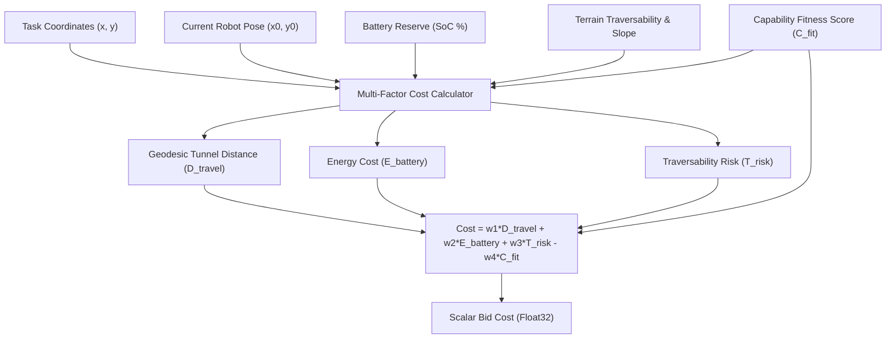

# Submodule 2.4.2: Cost Evaluation

## 1. Purpose
Computes the scalar cost value of a prospective task bid by evaluating travel distance, energy expenditure, terrain traversability risk, and sensor fitness.

## 2. Responsibility
Execute multi-factor cost function calculations, estimate geodesic path distances through tunnels, and penalize high-risk or low-battery conditions.

## 3. Scope
### In-Scope
Cost function implementation: $Cost = w_1 D_{travel} + w_2 E_{battery} + w_3 T_{risk} - w_4 C_{fit}$, path distance estimation, and weight tuning.

### Out-of-Scope
Full global path trajectory generation (uses topological distance heuristics).

## 4. System Architecture

## 5. Internal Submodules
- **Geodesic Distance Estimator**: Estimates path distance along tunnel topological graph rather than Euclidean straight-line distance.
- **Battery Depletion Modeler**: Scales cost exponentially as battery approaches the 20% reserve threshold ($w_2 \propto \frac{1}{SoC - 0.2}$).

## 6. Functional Requirements
- **REQ-2.4-003**: Cost evaluation shall compute scalar cost within `[PROPOSED TARGET: < 10 ms]` per task query.
- **REQ-2.4-004**: Robots closer to the task goal with higher battery shall produce strictly lower cost bids under identical capability scores.

## 7. Technical Approach
Implement cost calculation in C++. Use A* on a reduced topological roadmap of mine drifts to estimate travel distance $D_{travel}$ without full Nav2 global costmap overhead. Normalize all cost components to $[0, 1]$ before applying weights.

## 8. Open-Source Resources
### Multi-Criteria Decision Making (MCDM)
- **What it provides**: Mathematical weighting models.
- **Why it is relevant**: Balancing competing objectives (time, energy, risk).
- **What we can reuse**: Weighted sum model.
- **What we must develop ourselves**: Subterranean mine-specific penalty factors.

## 9. Prerequisites
Submodule 1.3.5 Localization, Submodule 2.2.4 Resource Availability.

## 10. Dependencies
- **Upstream Dependencies**: Submodule 1.3.5 Localization, Submodule 2.2.4 Resource Availability.
- **Downstream Dependencies**: Submodule 2.4.1 Task Bidding.
- **Interfaces with Other Modules**: C++ API `float calculate_bid_cost(Task, RobotState)`.

## 11. Development Phases
### Phase 1: Cost Engine Implementation
- **Objective**: Implement cost formula and topological distance estimator.
- **Activities**: Code formula, write unit tests verifying monotonic cost behavior.
- **Required resources**: C++, GTest.
- **Input**: Task, robot pose, battery.
- **Output**: Scalar cost float.
- **Dependencies**: None.
- **Validation**: Test robot at 10m vs 50m distance; verify cost increases monotonically.
- **Completion criteria**: 10m cost < 50m cost under identical conditions.

## 12. Interfaces
### APIs
- `cost_evaluator::compute_cost(task, state, weights)`: Returns scalar float cost for task.

## 13. Testing Strategy
Evaluate cost for robot at 80% battery vs 25% battery; verify low battery robot generates significantly higher cost, favoring the high-battery peer.

## 14. Known Challenges
- **Euclidean vs Geodesic Disparity**: Two points separated by a solid rock pillar may be 5m Euclidean distance but 150m walking distance around drifts; Euclidean distance produces invalid bids.

## 15. Implementation Status
`PLANNED`

## 16. References
- **Dias et al., Market-Based Multirobot Coordination: A Survey and Analysis**: Proc. IEEE, 2006
