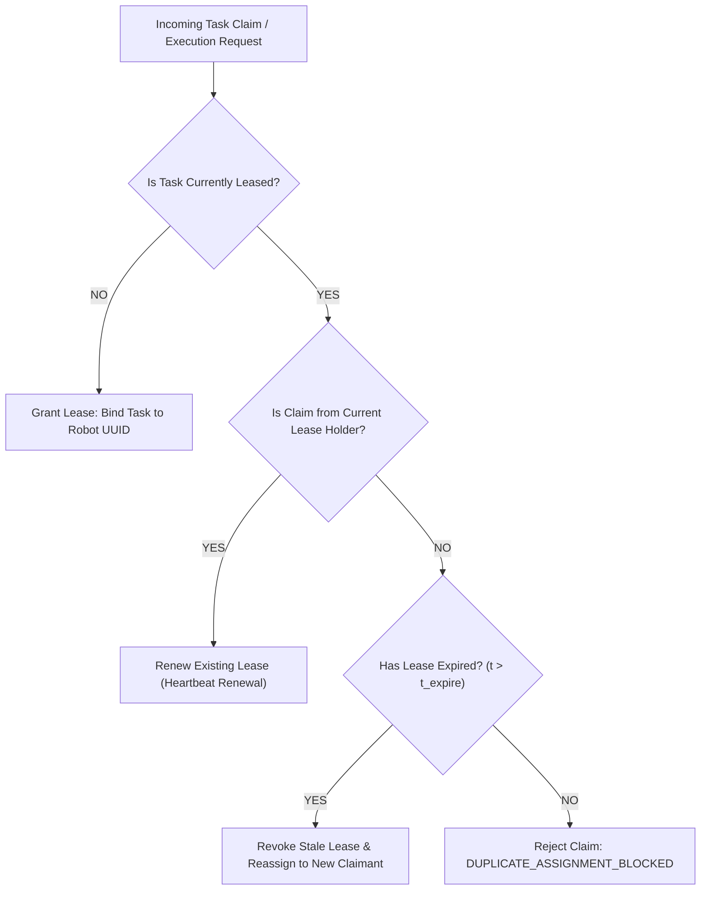

# Submodule 2.4.5: Duplicate Assignment Prevention

## 1. Purpose
Guarantees distributed mutual exclusion so that no two robots concurrently execute or claim the same inspection task.

## 2. Responsibility
Enforce exclusive task ownership through time-bounded lease tokens, idempotent task claims, and distributed lock validation.

## 3. Scope
### In-Scope
Distributed lease locking, idempotent claim deduplication, conflict detection on concurrent claims, and lease preemption rules.

### Out-of-Scope
Physical tunnel collision deconfliction (handled by Module 2.5).

## 4. System Architecture

## 5. Internal Submodules
- **Lease Lock Registry**: In-memory distributed lock table mapping active task IDs to owner UUIDs and expiration deadlines.
- **Idempotency Filter**: Discards duplicate award and execution messages caused by mesh network re-transmissions.

## 6. Functional Requirements
- **REQ-2.4-009**: Zero duplicate concurrent executions: No two robots shall possess active valid leases for the same task simultaneously.
- **REQ-2.4-010**: Lease renewals shall occur every $T_{renew} = T_{lease} / 2$ to maintain continuous ownership.

## 7. Technical Approach
Utilize time-bounded lease locks (Chubby/Raft style). Each lease contains an absolute expiration epoch $T_{expire}$. A robot cannot execute a task without an unexpired lease. If communication is cut, the lease expires automatically after 60 seconds, freeing the task.

## 8. Open-Source Resources
### Google Chubby Lock Architecture Principles
- **What it provides**: Coarse-grained distributed locking patterns.
- **Why it is relevant**: Safe resource locking over unreliable networks.
- **What we can reuse**: Time-bounded lease design.
- **What we must develop ourselves**: Decentralized P2P lease table without central Chubby cells.

## 9. Prerequisites
Submodule 2.4.4 Assignment Confirmation.

## 10. Dependencies
- **Upstream Dependencies**: Submodule 2.4.4 Assignment Confirmation.
- **Downstream Dependencies**: Module 2.6 Distributed State Management, Module 2.7 Fault Tolerance.
- **Interfaces with Other Modules**: Internal lease registry API.

## 11. Development Phases
### Phase 1: Lease Lock Registry
- **Objective**: Implement thread-safe distributed lease registry.
- **Activities**: Code lock table, lease renewal heartbeat, expiration watchdog.
- **Required resources**: C++, GTest.
- **Input**: Lease requests.
- **Output**: Lock grant/reject.
- **Dependencies**: None.
- **Validation**: Simulate simultaneous claim of Task 1 by Robot A and B; verify one succeeds and one is rejected.
- **Completion criteria**: Exactly one lease granted.

## 12. Interfaces
### APIs
- `lease_registry::acquire_lease(task_id, robot_id, duration)`: Attempts atomic lease lock.

## 13. Testing Strategy
Simulate concurrent auction awards for Task 5 on both robots; verify lease lock resolves race deterministically and prevents duplicate execution.

## 14. Known Challenges
- **Clock Skew Across Desynchronized Robots**: Differences in local clocks could cause Robot B to believe a lease expired while Robot A believes it is still valid; requires conservative expiration buffers.

## 15. Implementation Status
`PLANNED`

## 16. References
- **Burrows, The Chubby Lock Service for Loosely-Coupled Distributed Systems**: USENIX OSDI 2006
