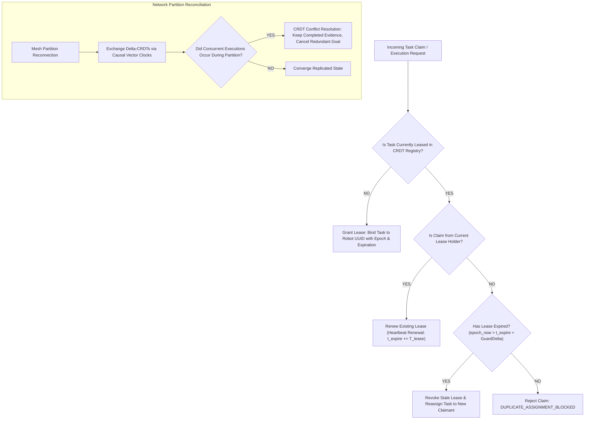

# Submodule 2.4.5: Duplicate Assignment Prevention

## 1. Purpose
Guarantees distributed mutual exclusion so that no two robots concurrently execute or claim the same inspection task, even during transient communication drops, message reordering, or extended subterranean network partitions.

## 2. Responsibility
Enforce exclusive task ownership through time-bounded cryptographic lease tokens, idempotent task claims, distributed CRDT lock validation, and partition-tolerant conflict reconciliation.

## 3. Scope
### In-Scope
Distributed lease locking, cryptographic token verification, idempotent claim deduplication, conflict resolution across network partitions, lease preemption, and clock-skew guard intervals.

### Out-of-Scope
Physical tunnel collision deconfliction (handled by Module 2.5).

## 4. System Architecture

## 5. Internal Submodules
- **Lease Lock Registry**: In-memory distributed lock table mapping active task IDs to owner UUIDs, term epochs, and expiration deadlines.
- **Idempotency Filter**: Discards duplicate award and execution messages caused by mesh network re-transmissions using unique nonce tracking.
- **Partition Conflict Resolver**: Leverages CRDT LWW-Element-Set and causal vector clocks to resolve split-brain duplicate claims deterministically upon mesh reconnection.

## 6. Functional Requirements
- **REQ-2.4-009**: Zero duplicate concurrent executions: No two robots shall possess active valid leases for the same task simultaneously within connected clusters.
- **REQ-2.4-010**: Lease renewals shall occur every $T_{\text{renew}} = T_{\text{lease}} / 2$ (e.g., every 15 seconds for a 30-second lease) to maintain continuous ownership.
- **REQ-2.4-011**: Clock-skew protection: Expiration checks shall apply a conservative guard interval $\Delta_{\text{guard}} = 5.0\text{ s}$ to tolerate monotonic clock drift across desynchronized robots.

## 7. Technical Approach
1. **Cryptographic Time-Bounded Leases**: Every lease embeds $\langle \text{task\_id}, \text{robot\_id}, \text{epoch}, T_{\text{expire}} \rangle$. Layer 1 task execution servers strictly refuse execution without a cryptographically valid, unexpired token.
2. **Lease Renewals via Telemetry Heartbeats**: Active workers refresh leases via 5 Hz telemetry pings. If an uncommunicative robot exceeds $T_{\text{expire}} + \Delta_{\text{guard}}$, the lease is automatically revoked by cluster consensus.
3. **Partition Tolerance**: During a network partition, a robot executing a task continues to finish its committed waypoint. If a partitioned cluster re-auctions the task after lease expiration, reconnection triggers an anti-entropy merge where the completed evidence record deterministically wins, and the redundant active task is preempted safely.

## 8. Open-Source Resources
### Google Chubby Lock Architecture Principles
- **What it provides**: Coarse-grained distributed locking patterns and lease timeouts.
- **Why it is relevant**: Safe resource locking over unreliable networks.
- **What we can reuse**: Time-bounded lease design and monotonic expiration guards.
- **What we must develop ourselves**: Decentralized P2P lease table integrated with CRDT state synchronization without central Chubby cell masters.

## 9. Prerequisites
Submodule 2.4.4 Assignment Confirmation.

## 10. Dependencies
- **Upstream Dependencies**: Submodule 2.4.4 Assignment Confirmation.
- **Downstream Dependencies**: Module 2.6 Distributed State Management, Module 2.7 Fault Tolerance & Recovery.
- **Interfaces with Other Modules**: Internal lease registry API; CRDT key-value store.

## 11. Development Phases
### Phase 1: Lease Lock Registry
- **Objective**: Implement thread-safe distributed lease registry with clock-skew protection.
- **Activities**: Code lock table, lease renewal heartbeat, expiration watchdog, and partition merge resolver.
- **Required resources**: C++, GTest.
- **Input**: Lease requests.
- **Output**: Lock grant/reject decisions.
- **Dependencies**: None.
- **Validation**: Simulate simultaneous claim of Task 1 by Robot A and B; verify one succeeds and one is rejected.
- **Completion criteria**: Exactly one lease granted; zero concurrent active leases.

## 12. Interfaces
### APIs
- `lease_registry::acquire_lease(task_id, robot_id, duration)`: Attempts atomic lease lock.
- `lease_registry::renew_lease(task_id, robot_id, lease_token)`: Refreshes expiration epoch.
- `lease_registry::validate_lease(task_id, robot_id)`: Checks validity against monotonic clock and guard delta.

## 13. Testing Strategy
1. **Concurrent Claim Race Test**: Trigger simultaneous claims for Task 5 on Robot A and Robot B; verify lease lock resolves race deterministically and prevents duplicate execution.
2. **Partition & Reconnection Test**: Simulate 60-second RF blackout where Robot A completes task and Robot B re-claims upon lease expiration; verify anti-entropy merge preserves completed evidence without state corruption.

## 14. Known Challenges
- **Clock Skew Across Desynchronized Robots**: Differences in local clocks could cause Robot B to believe a lease expired while Robot A believes it is still valid; resolved through conservative monotonic guard intervals ($\Delta_{\text{guard}} = 5.0\text{ s}$) and PTP/gPTP time sync when available.
- **Split-Brain during Extended Partition**: Partitioned sub-clusters isolated for hours; resolved by scoping task availability strictly to topologically reachable graph nodes.

## 15. Implementation Status
`PLANNED`

## 16. References
- **Burrows, The Chubby Lock Service for Loosely-Coupled Distributed Systems**: USENIX OSDI 2006
- **Shapiro et al., Conflict-Free Replicated Data Types**: INRIA Research Report 7687, 2011
