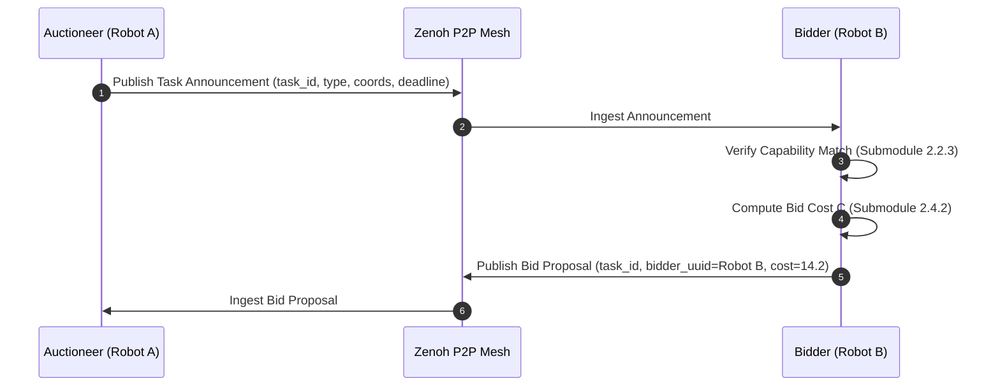

# Submodule 2.4.1: Task Bidding

## 1. Purpose
Implements the bidder role within the distributed Contract Net Protocol (CNP), ingesting task announcements, computing bids, and submitting proposals.

## 2. Responsibility
Listen for auction announcements on the P2P mesh, verify capability match and resource availability, compute scalar bid cost, and publish bid messages within auction deadlines.

## 3. Scope
### In-Scope
Auction announcement listener, bidding window timer (200-500 ms), bid formatting, and transmission.

### Out-of-Scope
Cost evaluation mathematical formulation (handled by Submodule 2.4.2).

## 4. System Architecture

## 5. Internal Submodules
- **Auction Announcement Ingestion**: Parses incoming task announcements and triggers capability verification.
- **Bidding Window Manager**: Schedules bid computation and ensures bid transmission before the announced deadline expires.

## 6. Functional Requirements
- **REQ-2.4-001**: Bidder shall compute and submit bid proposals within `[PROPOSED TARGET: < 200 ms]` of announcement receipt.
- **REQ-2.4-002**: Bid proposals shall include bidder UUID, task ID, calculated cost float, and capability match score.

## 7. Technical Approach
Deploy asynchronous event-driven worker in C++/Python. Subscribe to Zenoh key expression `mine/auctions/*/announce`. Use high-resolution timers to dispatch bids within the bidding window.

## 8. Open-Source Resources
### Contract Net Protocol Specification (FIPA)
- **What it provides**: Standardized multi-agent negotiation protocols.
- **Why it is relevant**: Established framework for distributed task allocation.
- **What we can reuse**: Protocol state transitions and message semantics.
- **What we must develop ourselves**: Robotics-optimized binary serialization.

## 9. Prerequisites
Submodule 2.2.3 Capability Matching, Submodule 2.4.2 Cost Evaluation.

## 10. Dependencies
- **Upstream Dependencies**: Submodule 2.2.3 Capability Matching, Submodule 2.4.2 Cost Evaluation.
- **Downstream Dependencies**: Submodule 2.4.3 Task Negotiation.
- **Interfaces with Other Modules**: Zenoh topic `mine/auctions/<task_id>/bid`.

## 11. Development Phases
### Phase 1: Bidder Node Implementation
- **Objective**: Implement CNP bidder listener and proposal publisher.
- **Activities**: Code bidder logic, test with mock auction announcements.
- **Required resources**: C++, Zenoh.
- **Input**: Task announcement.
- **Output**: Bid proposal.
- **Dependencies**: None.
- **Validation**: Send announcement; measure bid arrival time at auctioneer.
- **Completion criteria**: Bid arrives within 200 ms.

## 12. Interfaces
### Topics
- `mine/auctions/{task_id}/bid`: Custom BidProposal message published by candidate robots.

## 13. Testing Strategy
Broadcast mock task auction for thermal inspection; verify Robot B submits bid while Robot A (lacking thermal sensor) submits no bid or infinite cost.

## 14. Known Challenges
- **Packet Loss During Bidding**: A dropped bid packet could exclude the optimal robot; solved by auctioneer retry announcements if zero bids are received.

## 15. Implementation Status
`PLANNED`

## 16. References
- **Smith, The Contract Net Protocol: High-Level Communication and Control in a Distributed Problem Solver**: IEEE Transactions on Computers, 1980
