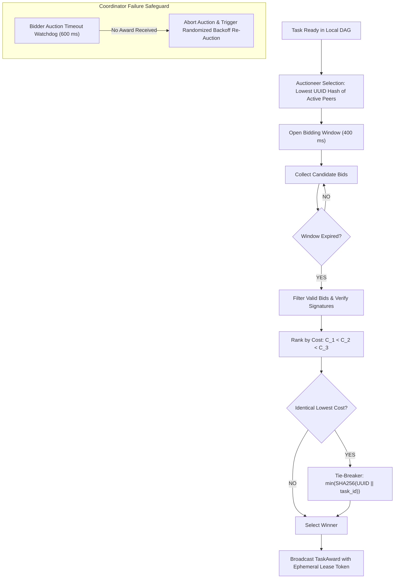

# Submodule 2.4.3: Task Negotiation

## 1. Purpose
Clears distributed task auctions, selects the lowest-cost capable bidder, resolves bid ties deterministically, handles temporary coordinator failures, and issues task awards without a centralized clearing house.

## 2. Responsibility
Act as an ephemeral auctioneer: collect submitted bids, enforce auction timeouts, rank valid bids, resolve ties deterministically, handle sudden coordinator failure or disconnects, and broadcast verified task awards.

## 3. Scope
### In-Scope
Ephemeral auctioneer selection, auction collection window logic ($400\text{ ms}$), lowest-bid selection, deterministic SHA-256 tie-breaking, coordinator failure watchdog timers, and award message broadcasting.

### Out-of-Scope
Two-phase commitment acknowledgment and lease registration (handled by Submodule 2.4.4 and Submodule 2.4.5).

## 4. System Architecture

## 5. Internal Submodules
- **Ephemeral Auctioneer Selector**: Elects the task auctioneer deterministically based on SHA-256 hash ranking among peers discovering an unassigned task.
- **Auction Clearing Engine**: Gathers incoming bids over Zenoh, filters expired or malformed payloads, and identifies the lowest cost bidder.
- **Deterministic Tie-Breaker**: Compares SHA-256 hashes of candidate robot UUIDs to break identical cost ties without network round trips.
- **Coordinator Failure Watchdog**: Detects auctioneer stalls or disconnects and safely aborts dangling auctions.

## 6. Functional Requirements
- **REQ-2.4-005**: Auction clearance shall execute within `[PROPOSED TARGET: < 50 ms]` after bidding window closes.
- **REQ-2.4-006**: Tie-breaking shall be 100% deterministic such that all peers independently computing the winner arrive at identical results.
- **REQ-2.4-007**: Bidders shall abort pending auction state if no award is broadcast within `[PROPOSED TARGET: < 600 ms]`.

## 7. Technical Approach
1. **Auctioneer Selection**: The peer discovering an unassigned task initiates the auction. If multiple peers initiate simultaneously, the peer with $\min(\text{SHA256}(\text{robot\_id} \mathbin{\Vert} \text{task\_id}))$ is recognized as authoritative auctioneer; others step down.
2. **Auction Collection**: Open a bounded auction window ($T_{\text{window}} = 400\text{ ms}$). Gather bids arriving over Zenoh topic `mine/auctions/{task_id}/bid`.
3. **Winner Selection & Tie-Breaking**: Sort bids by scalar cost. In case of equal costs, compute deterministic tie-breaker hash.
4. **Coordinator Failure Handling**: If the auctioneer fails mid-auction, bidders trigger a local timeout ($600\text{ ms}$), discard their submitted bids, and initiate a randomized backoff ($100\text{--}300\text{ ms}$) before attempting to re-auction under an incremented auction epoch.

## 8. Open-Source Resources
### Deterministic Hash Tie-Breaking
- **What it provides**: Distributed consensus without extra messaging.
- **Why it is relevant**: Resolves ties locally across all nodes.
- **What we can reuse**: OpenSSL SHA-256 / std::hash.
- **What we must develop ourselves**: UUID hash tie-breaker comparator and auctioneer watchdog state machine.

## 9. Prerequisites
Submodule 2.4.1 Task Bidding.

## 10. Dependencies
- **Upstream Dependencies**: Submodule 2.4.1 Task Bidding, Submodule 2.5.2 Temporary Coordinator Election.
- **Downstream Dependencies**: Submodule 2.4.4 Assignment Confirmation.
- **Interfaces with Other Modules**: Zenoh topic `mine/auctions/{task_id}/award`.

## 11. Development Phases
### Phase 1: Auctioneer Clearing Engine
- **Objective**: Implement auctioneer collection, tie-breaking, and failure recovery logic.
- **Activities**: Code clearing loop, test multi-bid scenarios, verify tie-breaking, test auctioneer crash injection.
- **Required resources**: C++, Zenoh.
- **Input**: Bids collection.
- **Output**: TaskAward message.
- **Dependencies**: None.
- **Validation**: Submit identical bids from 2 robots; verify lowest UUID hash wins. Inject auctioneer SIGKILL; verify bidders recover within 600 ms.
- **Completion criteria**: Winner chosen deterministically; auctioneer crash handled cleanly.

## 12. Interfaces
### Topics
- `mine/auctions/{task_id}/bid`: Incoming bid submissions from candidate robots.
- `mine/auctions/{task_id}/award`: Custom TaskAward message naming winner robot and issuing lease token.

## 13. Testing Strategy
Simulate auction with Robot A ($Cost=15.5$) and Robot B ($Cost=11.2$); verify Robot B is awarded task. Inject crash on auctioneer node; verify peer detects missing award and initiates clean re-auction.

## 14. Known Challenges
- **Straggler Bids over High-Jitter Links**: A better bid arriving 10 ms after window closes; requires balance between auction speed and waiting for delayed mesh packets.
- **Temporary Coordinator Departure**: Transient RF shadow causing auctioneer to disconnect during bid collection; resolved by bidder timeout and randomized re-auction backoff.

## 15. Implementation Status
`PLANNED`

## 16. References
- **Bertsekas, Auction Algorithms for Network Flow Problems**: Laboratory for Information and Decision Systems, MIT, 1990
- **Smith, The Contract Net Protocol: High-Level Communication and Control in a Distributed Problem Solver**: IEEE Transactions on Computers, 1980
