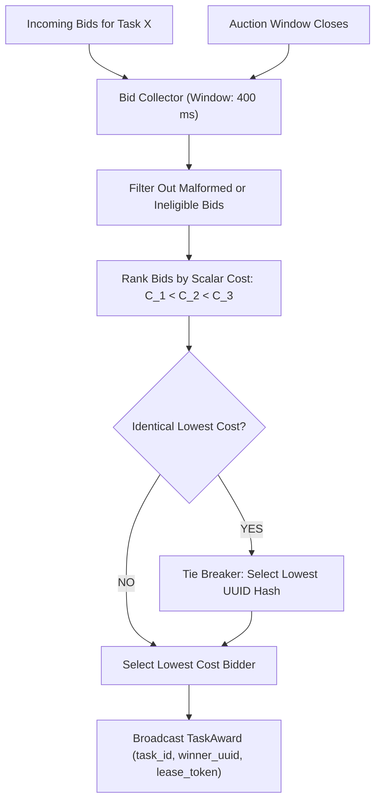

# Submodule 2.4.3: Task Negotiation

## 1. Purpose
Clears distributed task auctions, selects the lowest-cost capable bidder, resolves bid ties, and issues task awards without a centralized clearing house.

## 2. Responsibility
Act as ephemeral auctioneer: collect submitted bids, close auction when window expires, rank valid bids, resolve ties deterministically, and issue Task Award.

## 3. Scope
### In-Scope
Auction closing logic, lowest-bid selection, deterministic tie-breaking (lowest UUID hash), and award message broadcasting.

### Out-of-Scope
Two-phase commitment acknowledgment (handled by Submodule 2.4.4).

## 4. System Architecture

## 5. Internal Submodules
- **Auction Clearing Engine**: Gathers bids, filters expired timestamps, and identifies lowest cost.
- **Deterministic Tie-Breaker**: Compares SHA-256 hashes of robot UUIDs to break identical cost ties with zero network round trips.

## 6. Functional Requirements
- **REQ-2.4-005**: Auction clearance shall execute within `[PROPOSED TARGET: < 50 ms]` after bidding window closes.
- **REQ-2.4-006**: Tie-breaking shall be 100% deterministic such that all peers computing the winner arrive at identical results.

## 7. Technical Approach
Implement auctioneer state machine in C++. Open auction window ($T_{window} = 400$ ms). Upon timer expiration, sort bids using `std::min_element` with custom comparator. Publish award to Zenoh topic.

## 8. Open-Source Resources
### Deterministic Hash Tie-Breaking
- **What it provides**: Distributed consensus without extra messaging.
- **Why it is relevant**: Resolves ties locally across all nodes.
- **What we can reuse**: SHA-256 / std::hash.
- **What we must develop ourselves**: UUID hash tie-breaker comparator.

## 9. Prerequisites
Submodule 2.4.1 Task Bidding.

## 10. Dependencies
- **Upstream Dependencies**: Submodule 2.4.1 Task Bidding.
- **Downstream Dependencies**: Submodule 2.4.4 Assignment Confirmation.
- **Interfaces with Other Modules**: Zenoh topic `mine/auctions/<task_id>/award`.

## 11. Development Phases
### Phase 1: Auctioneer Clearing Engine
- **Objective**: Implement auctioneer collection and award logic.
- **Activities**: Code clearing loop, test multi-bid scenarios, verify tie-breaking.
- **Required resources**: C++, Zenoh.
- **Input**: Bids collection.
- **Output**: TaskAward message.
- **Dependencies**: None.
- **Validation**: Submit identical bids from 2 robots; verify lowest UUID wins.
- **Completion criteria**: Winner chosen deterministically.

## 12. Interfaces
### Topics
- `mine/auctions/{task_id}/award`: Custom TaskAward message naming winner robot and issuing lease token.

## 13. Testing Strategy
Simulate auction with Robot A ($Cost=15.5$) and Robot B ($Cost=11.2$); verify Robot B is awarded task.

## 14. Known Challenges
- **Straggler Bids over High-Jitter Links**: A better bid arriving 10 ms after window closes; requires balance between auction speed and waiting for delayed mesh packets.

## 15. Implementation Status
`PLANNED`

## 16. References
- **Bertsekas, Auction Algorithms for Network Flow Problems**: Laboratory for Information and Decision Systems, MIT, 1990
