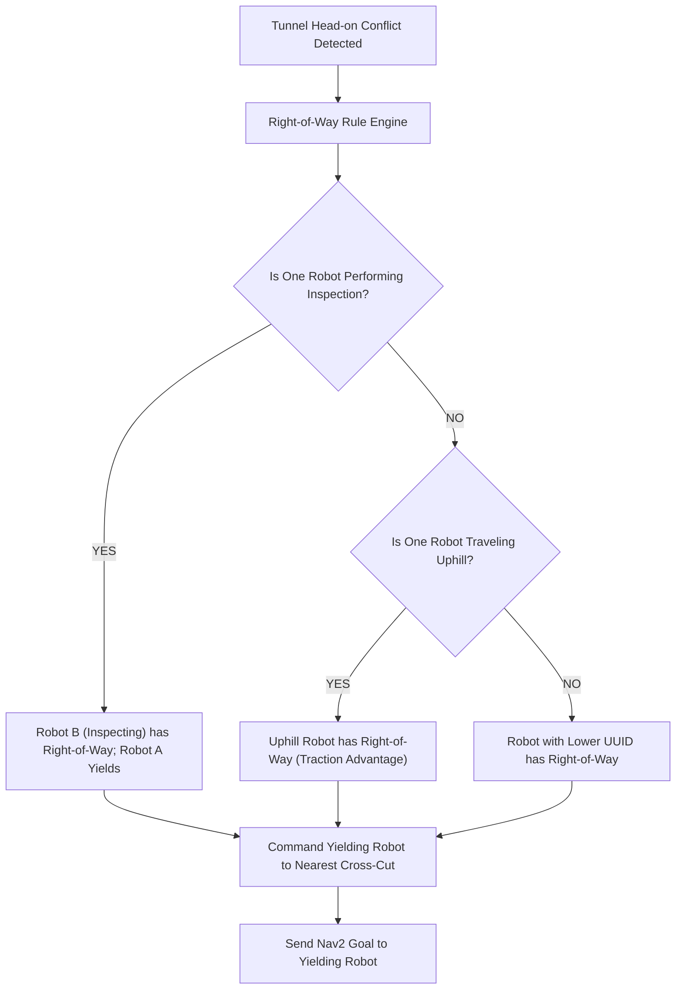

# Submodule 2.5.3: Conflict Resolution

## 1. Purpose
Enforces unambiguous right-of-way rules and yielding protocols when two robots encounter each other in narrow, single-lane underground mine drifts.

## 2. Responsibility
Evaluate conflicting spatial trajectories, determine which robot holds right-of-way based on mission priority, and command the yielding robot to maneuver into a designated cross-cut or lay-by.

## 3. Scope
### In-Scope
Right-of-way rule evaluation, lay-by / cross-cut identification from topological map, yield trajectory negotiation, and transit handshake.

### Out-of-Scope
Full vehicle chassis physical pushing.

## 4. System Architecture

## 5. Internal Submodules
- **Right-of-Way Arbiter**: Evaluates hierarchical rules: Active Inspection > Uphill Incline > Lower Task Priority > Tie-Breaker UUID.
- **Lay-by & Cross-cut Finder**: Queries topological mine map for nearest safe pull-out bay within 20m of conflict location.

## 6. Functional Requirements
- **REQ-2.5-005**: In a tunnel conflict between Robot A (exploring) and Robot B (carrying active thermal inspection payload), Robot A shall yield.
- **REQ-2.5-006**: Conflict resolution negotiation shall resolve and issue yield trajectories within `[PROPOSED TARGET: < 3.0 s]`.

## 7. Technical Approach
Deploy a deterministic rule-based arbitration engine. When a tunnel conflict is flagged by Submodule 2.5.1, both robots run identical right-of-way logic. The yielding robot automatically identifies the nearest topological cross-cut and issues a temporary reroute goal.

## 8. Open-Source Resources
### Industrial Underground Traffic Rules
- **What it provides**: Mining haulage right-of-way standards.
- **Why it is relevant**: Loaded vehicles and steep uphill haulers hold standard priority.
- **What we can reuse**: Domain rules.
- **What we must develop ourselves**: Multi-robot autonomous yield trajectory engine.

## 9. Prerequisites
Submodule 2.5.1 P2P Coordination, Submodule 1.4.1 Map Management.

## 10. Dependencies
- **Upstream Dependencies**: Submodule 2.5.1 Peer-to-Peer Coordination.
- **Downstream Dependencies**: Submodule 1.4.2 Global Planning.
- **Interfaces with Other Modules**: Zenoh topic `mine/coordination/yield`.

## 11. Development Phases
### Phase 1: Right-of-Way Logic
- **Objective**: Implement right-of-way evaluation and lay-by selection.
- **Activities**: Code rule engine, test tunnel face-off scenario in Gazebo.
- **Required resources**: C++, Nav2.
- **Input**: Robot states and map.
- **Output**: Yield maneuver.
- **Dependencies**: None.
- **Validation**: Trigger head-on meeting in 2.5m tunnel; verify Robot A pulls into cross-cut.
- **Completion criteria**: Zero head-on deadlocks.

## 12. Interfaces
### Topics
- `mine/coordination/yield_agreement`: Custom YieldAgreement message specifying yielding robot and designated lay-by.

## 13. Testing Strategy
Drive Robot A and B head-on in a single-lane drift in Gazebo; verify Robot A reverses/pulls into cross-cut and allows Robot B to pass cleanly.

## 14. Known Challenges
- **Absence of Nearby Lay-bys**: If no cross-cut exists for 100 meters, one robot must reverse significant distances along curved drifts; requires robust reverse path tracking.

## 15. Implementation Status
`PLANNED`

## 16. References
- [MSHA Underground Traffic Safety Protocols](https://www.msha.gov)
