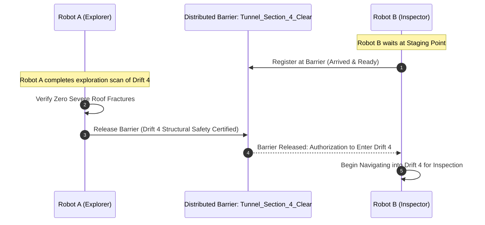

# Submodule 2.5.4: Mission Synchronization

## 1. Purpose
Provides distributed barrier synchronization, rendezvous checkpoints, and collaborative phase gates between heterogeneous robots.

## 2. Responsibility
Coordinate multi-robot collaborative prerequisites: ensure Robot A confirms structural tunnel safety before Robot B enters, and manage rendezvous re-grouping.

## 3. Scope
### In-Scope
Distributed barrier primitives, multi-agent checkpoint validation, rendezvous point sequencing, and barrier timeout policies.

### Out-of-Scope
Continuous low-level formation control.

## 4. System Architecture

## 5. Internal Submodules
- **Distributed Barrier Manager**: Maintains barrier token states across participating robots.
- **Rendezvous Scheduler**: Coordinates scheduled re-grouping at designated radio-hotspot tunnel junctions.

## 6. Functional Requirements
- **REQ-2.5-007**: Barrier synchronization shall prevent downstream robot entry until 100% of barrier condition criteria are validated.
- **REQ-2.5-008**: If a required robot fails to reach a barrier within timeout (e.g. 10 minutes), an alert event shall be triggered.

## 7. Technical Approach
Implement barrier tokens replicated via the CRDT state engine (Module 2.6). A barrier consists of a set of required participant signatures. Once all signatures are registered, the barrier condition evaluates to TRUE.

## 8. Open-Source Resources
### Distributed Barrier Algorithms
- **What it provides**: Parallel synchronization constructs.
- **Why it is relevant**: Standard distributed systems synchronization.
- **What we can reuse**: Barrier state semantics.
- **What we must develop ourselves**: CRDT-replicated barrier token implementation.

## 9. Prerequisites
Submodule 2.3.3 Task Dependencies, Module 2.6 State Management.

## 10. Dependencies
- **Upstream Dependencies**: Submodule 2.3.3 Task Dependencies.
- **Downstream Dependencies**: Module 2.6 Distributed State Management.
- **Interfaces with Other Modules**: Replicated CRDT barrier tokens.

## 11. Development Phases
### Phase 1: Barrier Token Engine
- **Objective**: Implement CRDT-backed barrier synchronization.
- **Activities**: Code barrier class, test multi-robot arrival synchronization.
- **Required resources**: C++, GTest.
- **Input**: Barrier definitions.
- **Output**: Barrier release events.
- **Dependencies**: None.
- **Validation**: Robot B waits for Robot A signature; verify release upon signature arrival.
- **Completion criteria**: Zero barrier violations.

## 12. Interfaces
### Topics
- `mine/sync/barriers/{barrier_id}`: Custom BarrierToken status topic.

## 13. Testing Strategy
Set up collaborative inspection scenario; verify Robot B remains stationary until Robot A finishes mapping and signs the clearance barrier.

## 14. Known Challenges
- **Permanent Stall on Lost Peer**: If Robot A crashes while Robot B waits at a barrier, Robot B could stall forever; requires timeout fallback to abort or investigate.

## 15. Implementation Status
`PLANNED`

## 16. References
- **Distributed Barrier Synchronization**: ACM Computing Surveys
