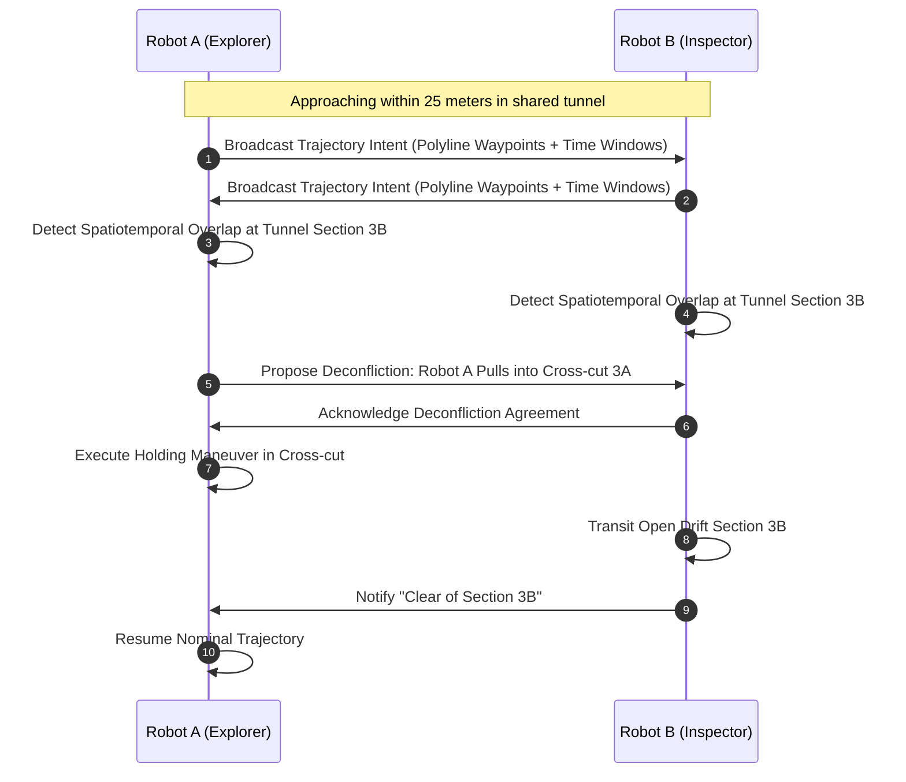

# Submodule 2.5.1: Peer-to-Peer Coordination

## 1. Purpose
Facilitates direct robot-to-robot trajectory intent sharing, mutual spatial awareness, and rendezvous maneuvers in subterranean drifts.

## 2. Responsibility
Exchange prospective 30-second trajectory footprints between approaching robots, calculate spatial intersection conflicts, and coordinate planned meeting points.

## 3. Scope
### In-Scope
Spatiotemporal trajectory intent broadcasting, bounding box intersection checking, and planned rendezvous negotiation.

### Out-of-Scope
Local real-time reactive obstacle avoidance (handled by Layer 1 Nav2).

## 4. System Architecture

## 5. Internal Submodules
- **Trajectory Intent Broadcaster**: Publishes 4D spatiotemporal polyline $(x, y, z, t)$ of planned path over next 30 seconds.
- **Spatiotemporal Intersection Detector**: Calculates bounding box collisions between peer trajectory polylines.

## 6. Functional Requirements
- **REQ-2.5-001**: Robots entering shared tunnel segments shall broadcast trajectory intent at >= 1 Hz.
- **REQ-2.5-002**: Spatiotemporal conflicts shall be detected with minimum lookahead time of 15.0 seconds.

## 7. Technical Approach
Robots broadcast serialized polyline waypoints over Zenoh topic `mine/coordination/intent`. Bounding cylinder sweeps are tested for intersection using fast vector geometry.

## 8. Open-Source Resources
### Open-RMF Spatiotemporal Collision Models
- **What it provides**: Mathematical models for trajectory reservation in corridors.
- **Why it is relevant**: Provides algorithms for corridor conflict detection.
- **What we can reuse**: Trajectory representation math.
- **What we must develop ourselves**: Decentralized P2P negotiation without central RMF traffic schedule.

## 9. Prerequisites
Submodule 1.4.2 Global Planning, Module 2.1 Robot Discovery.

## 10. Dependencies
- **Upstream Dependencies**: Submodule 1.4.2 Global Planning, Module 2.1 Robot Discovery.
- **Downstream Dependencies**: Submodule 2.5.3 Conflict Resolution.
- **Interfaces with Other Modules**: Zenoh topic `mine/coordination/intent`.

## 11. Development Phases
### Phase 1: Intent Sharing Node
- **Objective**: Implement trajectory intent publisher and collision checker.
- **Activities**: Code intent serialization, write 4D collision test.
- **Required resources**: C++, Zenoh.
- **Input**: Nav2 global path.
- **Output**: Intent topic.
- **Dependencies**: None.
- **Validation**: Publish intersecting paths; verify collision detected at correct timestamp.
- **Completion criteria**: Intersection detected 15s before physical collision.

## 12. Interfaces
### Topics
- `mine/coordination/intent`: Custom TrajectoryIntent message with timestamped waypoints.

## 13. Testing Strategy
Drive Robot A and B toward each other in a 3.0m wide tunnel; verify intent exchange triggers deconfliction 20 meters before physical encounter.

## 14. Known Challenges
- **Bandwidth of Continuous Path Intent**: Publishing full dense paths wastes RF bandwidth; requires Douglas-Peucker waypoint compression before transmission.

## 15. Implementation Status
`PLANNED`

## 16. References
- [Open-RMF Traffic Management](https://osrf.github.io/ros2multirobotbook/traffic.html)
