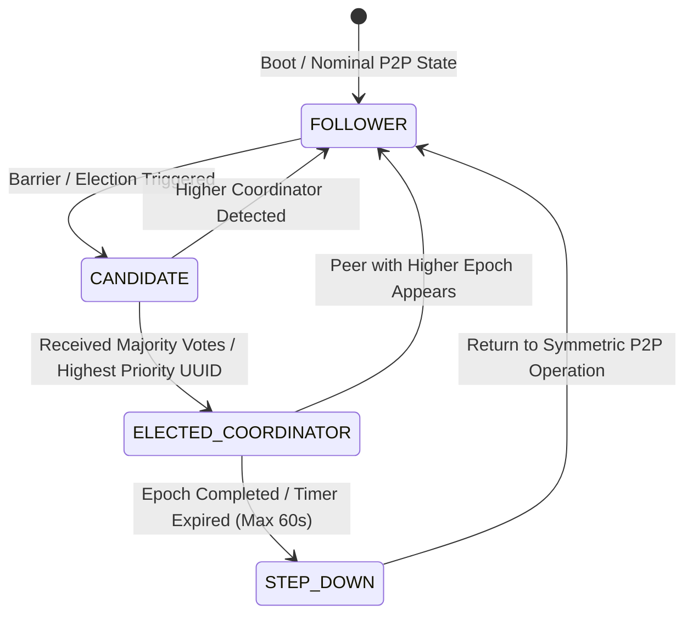

# Submodule 2.5.2: Temporary Coordinator Election

## 1. Purpose
Elects an ephemeral, temporary coordinator agent for complex synchronization barriers or batch auctions without creating a permanent central master.

## 2. Responsibility
Execute lightweight leader election when coordination consensus is required, bound coordinator tenure to specific mission epochs, and handle coordinator departure.

## 3. Scope
### In-Scope
Bully election algorithm / Raft leader election variant, term epoch tracking, heartbeat leases, and automatic coordinator step-down.

### Out-of-Scope
Permanent cluster master nodes (strictly prohibited by architecture).

## 4. System Architecture

## 5. Internal Submodules
- **Election State Machine**: Governs candidate transitions, vote collection, and election timeouts (200 ms).
- **Tenure Watchdog**: Enforces maximum coordinator duration (60 seconds) to guarantee the role remains temporary.

## 6. Functional Requirements
- **REQ-2.5-003**: Coordinator election shall converge within `[PROPOSED TARGET: < 300 ms]` in a 2-robot network.
- **REQ-2.5-004**: Coordinator tenure shall be bounded by a maximum lease of `[PROPOSED TARGET: 60 seconds]` unless renewed by cluster consensus.
- **REQ-2.5-005**: If the elected coordinator ceases broadcasting heartbeats for `[PROPOSED TARGET: > 1.0 s]`, peers shall declare coordinator failure and trigger an immediate re-election under an incremented term epoch.

## 7. Technical Approach
Deploy a modified Bully algorithm optimized for small mobile networks ($N \le 10$) with Raft-style term epochs. The temporary coordinator must broadcast a heartbeat beacon at `[PROPOSED TARGET: 5 Hz]`. The robot with the highest operational score ($S = w_b \cdot SoC + w_c \cdot Compute$) or lowest deterministic UUID becomes the temporary coordinator for that specific epoch. If the coordinator drops offline or crashes, the $\phi$-accrual failure detector expires the lease, increments `term_epoch = epoch + 1`, and triggers a new election.

## 8. Open-Source Resources
### Raft Consensus Algorithm Concepts
- **What it provides**: Term epochs and leader election safety proofs.
- **Why it is relevant**: Guarantees at most one coordinator per term epoch.
- **What we can reuse**: Term and randomized election timer principles.
- **What we must develop ourselves**: Resource-weighted score election for heterogeneous robots.

## 9. Prerequisites
Module 2.1 Robot Discovery.

## 10. Dependencies
- **Upstream Dependencies**: Module 2.1 Robot Discovery.
- **Downstream Dependencies**: Submodule 2.5.4 Mission Synchronization, Module 2.4 Task Allocation.
- **Interfaces with Other Modules**: Zenoh topics `mine/election/vote` and `/coordinator`.

## 11. Development Phases
### Phase 1: Election Protocol Implementation
- **Objective**: Implement Bully election state machine.
- **Activities**: Code election messages, test concurrent election triggers.
- **Required resources**: C++, Zenoh.
- **Input**: Election trigger.
- **Output**: Elected coordinator ID.
- **Dependencies**: None.
- **Validation**: Trigger simultaneous election on Robot A and B; verify single winner.
- **Completion criteria**: Single coordinator elected within 300 ms.

## 12. Interfaces
### Topics
- `mine/election/vote`: Custom ElectionVote message.
- `mine/election/coordinator`: Custom CoordinatorBeacon declaring current term leader.

## 13. Testing Strategy
Simulate crash of active coordinator; verify remaining peer detects missing beacon and successfully elects itself coordinator within 1.0 second.

## 14. Known Challenges
- **Split-Brain During Partition**: Partitioned sub-clusters will elect independent coordinators; resolved by bounding coordinator scope strictly to local sub-graph.

## 15. Implementation Status
`PLANNED`

## 16. References
- **Ongaro & Ousterhout, In Search of an Understandable Consensus Algorithm (Raft)**: USENIX ATC 2014
