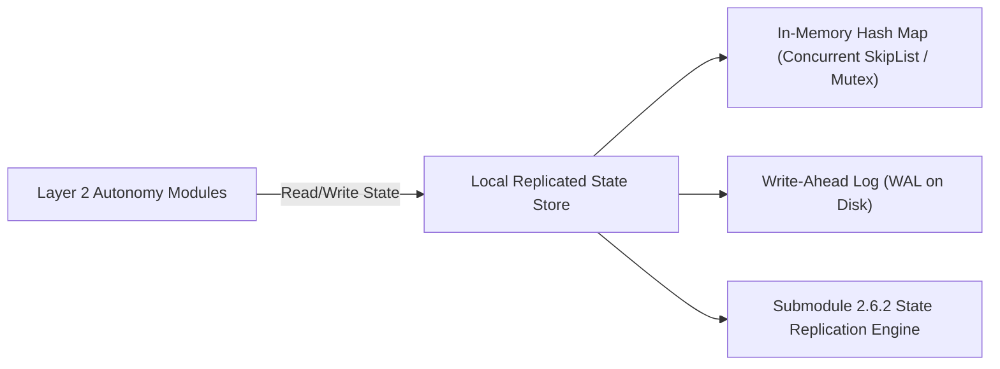

# Submodule 2.6.1: Local Mission State

## 1. Purpose
Maintains an in-memory, thread-safe, and crash-resilient local replicated database storing the entire cluster's mission, task, and robot states.

## 2. Responsibility
Store local and remote task states, lease tokens, robot telemetry vectors, and world milestones with millisecond-resolution access times.

## 3. Scope
### In-Scope
In-memory key-value state store, snapshot persistence to local NVMe, atomic read/write transactions, and state query APIs.

### Out-of-Scope
Centralized cloud database clustering.

## 4. System Architecture

## 5. Internal Submodules
- **In-Memory State Cache**: Thread-safe associative map storing key-value pairs representing tasks, leases, and robot states.
- **Write-Ahead Log (WAL)**: Appends state mutations to flash storage to guarantee persistence across unexpected robot power cuts.

## 6. Functional Requirements
- **REQ-2.6-001**: State read operations shall execute in `[PROPOSED TARGET: < 100 microseconds]`.
- **REQ-2.6-002**: State store shall survive sudden process kill and recover consistent state from WAL on reboot.

## 7. Technical Approach
Implement a lightweight C++ key-value engine using `std::shared_mutex` for readers-writer concurrency. Persist transactions to an append-only WAL file before updating in-memory state.

## 8. Open-Source Resources
### SQLite / RocksDB Architecture Principles
- **What it provides**: Embedded storage patterns and WAL designs.
- **Why it is relevant**: Robust local persistence for edge robotics.
- **What we can reuse**: WAL design concepts.
- **What we must develop ourselves**: Robotics-optimized CRDT memory store.

## 9. Prerequisites
Modern C++17.

## 10. Dependencies
- **Upstream Dependencies**: None.
- **Downstream Dependencies**: All Layer 2 modules, Submodule 2.6.2 State Replication.
- **Interfaces with Other Modules**: C++ API `state_store::get(key)`, `state_store::put(key, val)`.

## 11. Development Phases
### Phase 1: State Store Implementation
- **Objective**: Implement thread-safe key-value store with WAL.
- **Activities**: Code concurrent store, write WAL recovery test.
- **Required resources**: C++, GTest.
- **Input**: State mutations.
- **Output**: Recoverable state store.
- **Dependencies**: None.
- **Validation**: Mutate 10,000 keys; kill process; verify 100% recovery from WAL.
- **Completion criteria**: Zero data loss on simulated crash.

## 12. Interfaces
### APIs
- `mission_state::get_task_state(task_id)`: Returns current replicated task state struct.

## 13. Testing Strategy
Execute 50,000 concurrent reads and writes from 8 worker threads; verify zero memory corruption or race conditions.

## 14. Known Challenges
- **Memory Footprint Growth**: Storing unbounded historical mutation logs can exhaust RAM on edge computers; requires periodic checkpoint compaction.

## 15. Implementation Status
`PLANNED`

## 16. References
- **Kleppmann, Designing Data-Intensive Applications**: O'Reilly Media
