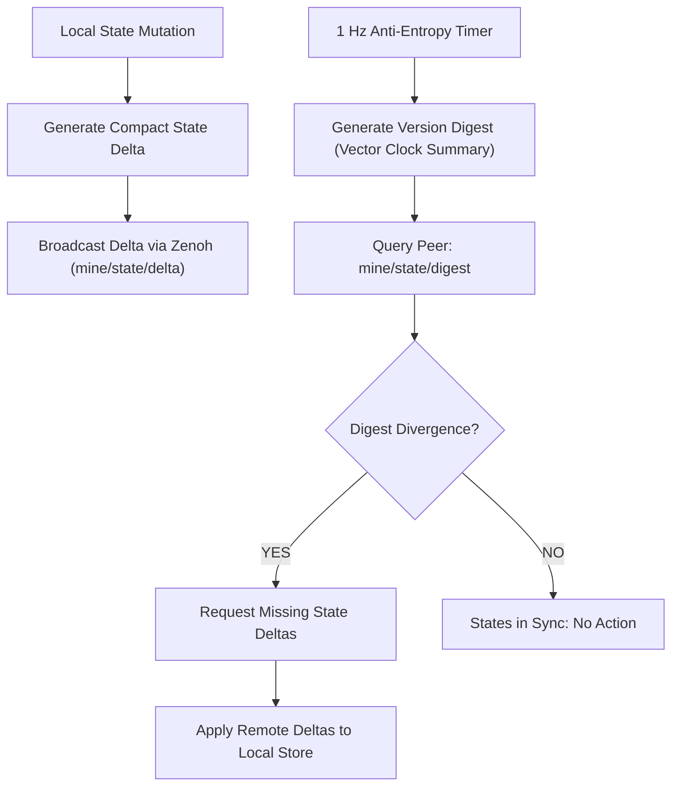

# Submodule 2.6.2: State Replication

## 1. Purpose
Replicates state updates across all currently connected robot peers using gossip-based anti-entropy protocols and compact delta exchanges.

## 2. Responsibility
Publish state mutation deltas when local state changes, periodically exchange version summaries with connected peers, and transmit missing deltas.

## 3. Scope
### In-Scope
Delta generation, gossip protocol scheduling (1 Hz), anti-entropy message formatting, and delta ingestion.

### Out-of-Scope
Physical network packet routing (handled by Zenoh).

## 4. System Architecture

## 5. Internal Submodules
- **Delta Change Capture**: Captures mutations and queues compact delta messages ($Key, Value, Timestamp, VectorClock$).
- **Anti-Entropy Gossip Scheduler**: Runs periodic reconciliation rounds to ensure silent peers converge on identical state.

## 6. Functional Requirements
- **REQ-2.6-003**: State mutations shall propagate to connected peers within `[PROPOSED TARGET: < 300 ms]` over nominal mesh links.
- **REQ-2.6-004**: Delta packets shall not exceed 256 bytes per single task state mutation.

## 7. Technical Approach
Deploy state-based and delta-state CRDT replication over Zenoh. On state change, immediately publish delta. Concurrently, run an anti-entropy gossip loop every 1.0 second exchanging lightweight version digests.

## 8. Open-Source Resources
### Delta State Replicated Data Types (Almeida et al.)
- **What it provides**: Efficient CRDT delta replication math.
- **Why it is relevant**: Dramatically reduces bandwidth compared to full-state CRDTs.
- **What we can reuse**: Delta-CRDT mathematical specifications.
- **What we must develop ourselves**: C++ implementation over Zenoh.

## 9. Prerequisites
Submodule 2.6.1 Local Mission State, Module 2.1 Robot Discovery.

## 10. Dependencies
- **Upstream Dependencies**: Submodule 2.6.1 Local Mission State.
- **Downstream Dependencies**: Submodule 2.6.3 Version Management, Submodule 2.6.5 Reconciliation.
- **Interfaces with Other Modules**: Zenoh topic `mine/state/delta` and queryable `mine/state/digest`.

## 11. Development Phases
### Phase 1: Delta Gossip Protocol
- **Objective**: Implement delta publishing and anti-entropy digest.
- **Activities**: Code delta serialization, benchmark bandwidth consumption.
- **Required resources**: C++, Zenoh.
- **Input**: State mutations.
- **Output**: Synchronized peer stores.
- **Dependencies**: Submodule 2.6.1.
- **Validation**: Mutate task state on Robot A; verify Robot B state updates in < 300 ms.
- **Completion criteria**: Replication latency < 300 ms.

## 12. Interfaces
### Topics
- `mine/state/delta`: Custom StateDelta message broadcast on local mutations.

## 13. Testing Strategy
Drop 30% of delta packets in simulation; verify 1-second anti-entropy loop heals missing deltas and achieves consistency.

## 14. Known Challenges
- **Bandwidth Floods during Churn**: Rapid status updates can flood the mesh; requires coalescing multiple rapid updates into single compound deltas.

## 15. Implementation Status
`PLANNED`

## 16. References
- **Almeida et al., Delta State Replicated Data Types**: Journal of Parallel and Distributed Computing, 2018
