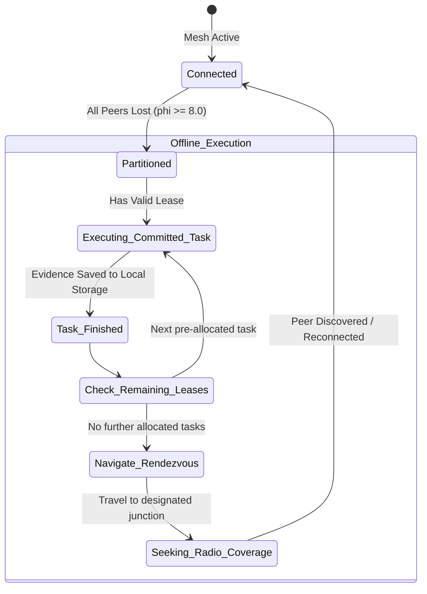

# Submodule 2.7.2: Communication Loss Handling

## 1. Purpose
Governs autonomous robot behavior during partial or total communication blackout, enabling continuous productive execution and communication recovery.

## 2. Responsibility
Enforce offline execution policy: continue executing current committed task lease, record inspection evidence locally, and navigate to communication rendezvous points upon task completion.

## 3. Scope
### In-Scope
Offline execution policy enforcement, local evidence buffering, rendezvous waypoint planning, and reconnection timeout watches.

### Out-of-Scope
Upper-layer cloud dashboard synchronization.

## 4. System Architecture

## 5. Internal Submodules
- **Offline Autonomy Policy Engine**: Authorizes continued autonomous execution of locally committed tasks during total blackout.
- **Rendezvous Waypoint Selector**: Selects the closest designated topological mine junction with known radio propagation.

## 6. Functional Requirements
- **REQ-2.7-003**: Robots shall continue executing committed task leases to completion during total communication blackout without pausing.
- **REQ-2.7-004**: Upon completing tasks while disconnected, the robot shall navigate toward the nearest rendezvous point to re-establish contact.

## 7. Technical Approach
Robots maintain a list of known topological rendezvous points (e.g. mine portal, primary haulage intersection). When disconnected and task queues empty, generate a Nav2 goal to the closest rendezvous point to upload evidence.

## 8. Open-Source Resources
### Delay-Tolerant Networking (DTN) Architecture
- **What it provides**: Store-and-forward communications paradigms.
- **Why it is relevant**: Underpins robotics data collection in disconnected environments.
- **What we can reuse**: DTN custody transfer principles.
- **What we must develop ourselves**: Robotics rendezvous path generator.

## 9. Prerequisites
Submodule 1.4.2 Global Planning, Submodule 2.6.1 Local Mission State.

## 10. Dependencies
- **Upstream Dependencies**: Submodule 2.6.1 Local Mission State.
- **Downstream Dependencies**: Submodule 1.4.2 Global Planning, Submodule 2.6.5 Reconciliation.
- **Interfaces with Other Modules**: Nav2 Action Client.

## 11. Development Phases
### Phase 1: Offline Policy Daemon
- **Objective**: Implement disconnected mission execution loop.
- **Activities**: Code offline state handler, test in simulated communications dead zone.
- **Required resources**: C++, Nav2.
- **Input**: Task lease, peer status.
- **Output**: Rendezvous navigation goal.
- **Dependencies**: None.
- **Validation**: Cut RF link; verify robot finishes inspection and returns to portal.
- **Completion criteria**: Robot completes inspection without stopping.

## 12. Interfaces
### Topics
- `/robot_a/autonomy/mode`: std_msgs/String reporting CONNECTED vs DISCONNECTED_AUTONOMOUS.

## 13. Testing Strategy
Cut communication while Robot B is en-route to thermal inspection; verify Robot B navigates to asset, captures thermal frame, and returns to junction where Robot A is waiting.

## 14. Known Challenges
- **Rendezvous Miss Deadlock**: If both robots choose different rendezvous points, they may search indefinitely; requires deterministic shared rendezvous schedule.

## 15. Implementation Status
`PLANNED`

## 16. References
- **Cerf et al., Delay-Tolerant Networking Architecture**: RFC 4838, IETF, 2007
