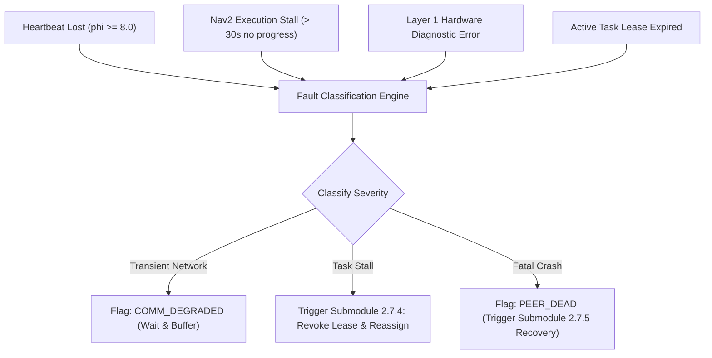

# Submodule 2.7.1: Failure Detection

## 1. Purpose
Monitors multi-tier system health, detects peer communication silence, software crashes, navigation stalls, and hardware sensor failures.

## 2. Responsibility
Aggregate health signals from Submodule 2.1.4 (availability), Layer 1 diagnostics, and task execution progress timers; classify failure severity.

## 3. Scope
### In-Scope
Failure signal aggregation, fault classification (`COMMUNICATION_LOSS`, `NAV_STALL`, `HARDWARE_FAULT`, `CATASTROPHIC_CRASH`), and fault event publishing.

### Out-of-Scope
Physical robot repair.

## 4. System Architecture

## 5. Internal Submodules
- **Fault Aggregation Pipeline**: Centralizes error streams from networking, navigation, and hardware layers.
- **Failure Severity Classifier**: Separates transient warnings (e.g. packet jitter) from fatal unrecoverable crashes.

## 6. Functional Requirements
- **REQ-2.7-001**: Catastrophic robot failure shall be detected by peers within `[PROPOSED TARGET: < 5.0 s]` of heartbeat cessation.
- **REQ-2.7-002**: Task execution stalls shall be flagged if vehicle displacement is < 0.1m over 30 seconds of commanded motion.

## 7. Technical Approach
Deploy a rule-based fault detection daemon subscribing to internal telemetry, heartbeat arrival stats, and task lease timers. Publish structured `FaultEvent` messages.

## 8. Open-Source Resources
### ROS 2 Diagnostic Framework
- **What it provides**: Diagnostic aggregation and status propagation.
- **Why it is relevant**: Standardized hardware status reporting.
- **What we can reuse**: diagnostic_aggregator concepts.
- **What we must develop ourselves**: Distributed multi-robot fault classifier.

## 9. Prerequisites
Submodule 2.1.4 Agent Availability, Submodule 1.6.5 Communication Health.

## 10. Dependencies
- **Upstream Dependencies**: Submodule 2.1.4 Agent Availability.
- **Downstream Dependencies**: Submodule 2.7.4 Task Reassignment, Submodule 2.7.5 Recovery Coordination.
- **Interfaces with Other Modules**: Publishes `/mine/faults/events`.

## 11. Development Phases
### Phase 1: Fault Classifier Implementation
- **Objective**: Implement multi-signal fault classifier node.
- **Activities**: Code classification rules, test with injected simulated failures.
- **Required resources**: C++, ROS 2.
- **Input**: Diagnostics and availability.
- **Output**: FaultEvent topic.
- **Dependencies**: None.
- **Validation**: Inject simulated motor stall; verify NAV_STALL event fires within 30s.
- **Completion criteria**: Zero missed stall classifications.

## 12. Interfaces
### Topics
- `mine/faults/events`: Custom FaultEvent message broadcasting detected failures.

## 13. Testing Strategy
Kill Robot A process cleanly and uncleanly; verify Robot B's failure detector logs `PEER_UNREACHABLE` within 5 seconds in both cases.

## 14. Known Challenges
- **Distinguishing RF Loss from Robot Crash**: Both RF shadow and chassis power loss look like silent heartbeats; requires delaying irreversible task revocation until lease duration fully expires.

## 15. Implementation Status
`PLANNED`

## 16. References
- **Fault-Tolerant Multi-Robot Systems**: Parker, IEEE Transactions on Robotics and Automation, 1998
