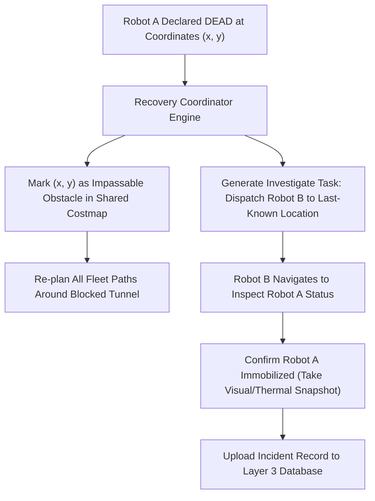

# Submodule 2.7.5: Recovery Coordination

## 1. Purpose
Coordinates multi-robot physical collaborative recovery, including dispatching peer robots to search for lost teammates or rerouting around immobilized vehicles.

## 2. Responsibility
Plan search routes to last-known coordinates of silent robots, mark blocked tunnels containing disabled robots as impassable, and reconfigure fleet mission routes.

## 3. Scope
### In-Scope
Search-and-investigate task generation, costmap keep-out injection at disabled robot locations, and mission topology rerouting.

### Out-of-Scope
Mechanical vehicle towing or winch operation.

## 4. System Architecture

## 5. Internal Submodules
- **Lost Peer Search Generator**: Formulates an autonomous inspection task targeted at the last-known GPS/odometry coordinates of a missing peer.
- **Tunnel Obstacle Marker**: Inserts permanent high-cost obstacle polygons around disabled robot hulls to prevent traffic pileups.

## 6. Functional Requirements
- **REQ-2.7-009**: Disabled robot hulls shall be inserted into the shared costmap as lethal obstacles within `[PROPOSED TARGET: < 2.0 s]` of confirmed failure.
- **REQ-2.7-010**: Search and rescue investigation tasks shall be classified under `CRITICAL_INSPECTION` priority tier.

## 7. Technical Approach
When a robot is confirmed dead, extract its last-known EKF pose from replicated state. Inject an inflated obstacle bounding box into the shared costmap. Generate a high-priority task dispatching the surviving robot to inspect the vehicle.

## 8. Open-Source Resources
### Nav2 Costmap Keep-Out Zones
- **What it provides**: Dynamic costmap polygon insertion.
- **Why it is relevant**: Blocks navigation through tunnels obstructed by disabled vehicles.
- **What we can reuse**: Costmap2D keep-out layer.
- **What we must develop ourselves**: Automated disabled vehicle hazard generator.

## 9. Prerequisites
Submodule 2.7.3 Robot Failure Handling, Submodule 1.4.1 Map Management.

## 10. Dependencies
- **Upstream Dependencies**: Submodule 2.7.3 Robot Failure Handling.
- **Downstream Dependencies**: Submodule 1.4.1 Map Management, Module 2.3 Mission Management.
- **Interfaces with Other Modules**: Updates shared costmaps and generates inspection tasks.

## 11. Development Phases
### Phase 1: Recovery Coordination Engine
- **Objective**: Implement obstacle insertion and investigation dispatch.
- **Activities**: Code keep-out zone injection, write peer investigation test.
- **Required resources**: C++, Nav2.
- **Input**: Disabled robot pose.
- **Output**: Costmap update and investigate task.
- **Dependencies**: None.
- **Validation**: Disable Robot A in narrow tunnel; verify Robot B reroutes around tunnel.
- **Completion criteria**: Zero collisions with disabled robot.

## 12. Interfaces
### Topics
- `/shared/hazards/disabled_robot`: geometry_msgs/PoseStamped pose of immobilized robot.

## 13. Testing Strategy
Disable Robot A in a tunnel segment; verify Robot B updates its costmap, avoids the blocked tunnel, and successfully navigates through an alternate cross-cut.

## 14. Known Challenges
- **Single-Route Trap**: If a disabled robot blocks the only exit of a blind tunnel, trapped robots behind it cannot escape; requires human operator intervention alert.

## 15. Implementation Status
`PLANNED`

## 16. References
- **Multi-Robot Fault Recovery and Search Strategies**: Field Robotics Journal
