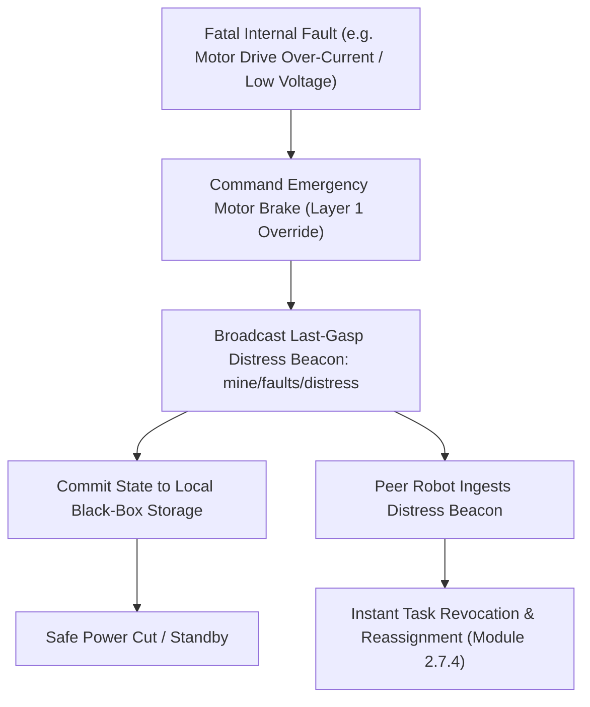

# Submodule 2.7.3: Robot Failure Handling

## 1. Purpose
Manages catastrophic onboard robot failures, ensures safe hardware shutdown, broadcasts last-gasp distress beacons, and triggers peer takeover.

## 2. Responsibility
Detect fatal internal faults (critical battery depletion, motor drive failure, hardware crash), transition to safe stop, and transmit last-gasp diagnostic beacon before power off.

## 3. Scope
### In-Scope
Onboard fatal fault handling, last-gasp distress beacon generation, emergency brake locking, and black-box state persistence.

### Out-of-Scope
Physical hardware component repair.

## 4. System Architecture

## 5. Internal Submodules
- **Last-Gasp Beacon Broadcaster**: Transmits emergency UDP/Zenoh packet containing robot UUID, fault code, and current coordinates before shutdown.
- **Black-Box Logger**: Flushes recent sensor logs, task history, and fault dumps to non-volatile flash storage.

## 6. Functional Requirements
- **REQ-2.7-005**: Last-gasp distress beacon shall be transmitted within `[PROPOSED TARGET: < 50 ms]` of fatal fault detection.
- **REQ-2.7-006**: Upon receiving a distress beacon, peers shall immediately revoke the failing robot's tasks without waiting for lease timeout.

## 7. Technical Approach
Implement a high-priority crash handler in C++. Hook into Linux POSIX signals (`SIGSEGV`, `SIGABRT`) and Layer 1 safety alerts to fire the distress beacon over raw UDP socket before process termination.

## 8. Open-Source Resources
### Linux Signal Handlers & POSIX Crash Dumps
- **What it provides**: Low-level crash recovery hooks.
- **Why it is relevant**: Ensures last-gasp beacons fire even during segmentation faults.
- **What we can reuse**: sigaction handlers.
- **What we must develop ourselves**: UDP distress beacon broadcaster.

## 9. Prerequisites
Submodule 1.5.3 Robot State Manager.

## 10. Dependencies
- **Upstream Dependencies**: Submodule 1.5.3 Robot State Manager.
- **Downstream Dependencies**: Submodule 2.7.4 Task Reassignment.
- **Interfaces with Other Modules**: Broadcasts UDP distress packet.

## 11. Development Phases
### Phase 1: Distress Beacon Implementation
- **Objective**: Implement last-gasp crash handler and peer receiver.
- **Activities**: Code crash hook, test sudden process termination.
- **Required resources**: C++, POSIX.
- **Input**: Fatal error event.
- **Output**: Distress broadcast.
- **Dependencies**: None.
- **Validation**: Kill robot process with SIGSEGV; verify peer receives distress packet.
- **Completion criteria**: Distress packet received by peer within 50 ms.

## 12. Interfaces
### Topics
- `mine/faults/distress`: Custom DistressBeacon message with robot UUID, coordinates, and error code.

## 13. Testing Strategy
Inject motor drive fault in Robot A; verify Robot A stops, broadcasts distress beacon, and Robot B instantly initiates task reassignment.

## 14. Known Challenges
- **Distress Packet Loss**: If the crash occurs in an RF dead zone, the distress beacon will not reach peers; the system must gracefully fall back to lease timeout.

## 15. Implementation Status
`PLANNED`

## 16. References
- **Reliable Distributed Systems: Technologies, Web Services, and Applications**: Birman, Springer, 2005
