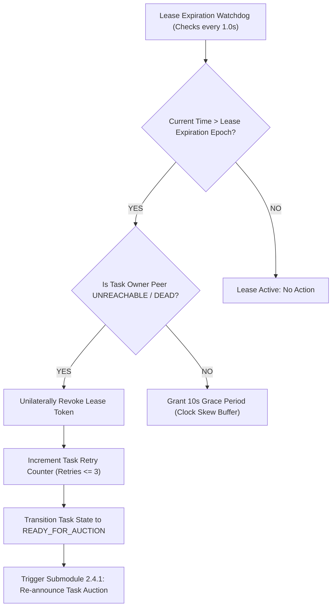

# Submodule 2.7.4: Task Reassignment

## 1. Purpose
Revokes expired or orphaned task leases and automatically re-opens tasks for distributed bidding to surviving capable robots.

## 2. Responsibility
Monitor active task lease expiration timestamps, identify uncompleted tasks assigned to failed or unreachable robots, revoke leases, transition task state to `READY_FOR_AUCTION`, and initiate re-allocation.

## 3. Scope
### In-Scope
Lease timeout watchdog, unilateral lease revocation, task unclaiming, retry count incrementing, and auction re-announcement.

### Out-of-Scope
Contract Net Protocol auction clearing (handled by Module 2.4).

## 4. System Architecture

## 5. Internal Submodules
- **Lease Expiration Watchdog**: Runs continuous 1 Hz check over active task leases stored in the local mission state.
- **Re-Auction Dispatcher**: Re-packages uncompleted task requirements and broadcasts a new auction announcement.

## 6. Functional Requirements
- **REQ-2.7-007**: Expired task leases shall be revoked and re-auctioned within `[PROPOSED TARGET: < 8.0 s]` of lease expiration.
- **REQ-2.7-008**: Tasks whose retry count exceeds 3 shall be transitioned to permanently `FAILED` with an alert logged to Layer 3.

## 7. Technical Approach
Deploy lease monitor loop in C++. When lease $T_{expire} < T_{now}$ and the owner is marked `UNREACHABLE` by Submodule 2.1.4, update local CRDT state: remove old lease, increment retry count, set state `READY_FOR_AUCTION`, and publish auction announcement.

## 8. Open-Source Resources
### Distributed Lease Protocols (Gray & Cheriton)
- **What it provides**: Formal lease revocation invariants.
- **Why it is relevant**: Guarantees safe task recovery without central master locks.
- **What we can reuse**: Lease timeout math.
- **What we must develop ourselves**: Multi-robot task reassignment engine.

## 9. Prerequisites
Submodule 2.4.5 Duplicate Prevention, Submodule 2.7.1 Failure Detection.

## 10. Dependencies
- **Upstream Dependencies**: Submodule 2.4.5 Duplicate Prevention, Submodule 2.7.1 Failure Detection.
- **Downstream Dependencies**: Module 2.4 Distributed Task Allocation.
- **Interfaces with Other Modules**: Triggers Contract Net Protocol auction.

## 11. Development Phases
### Phase 1: Task Reassignment Loop
- **Objective**: Implement lease revocation and re-auction pipeline.
- **Activities**: Code lease watchdog, test with simulated dead robot.
- **Required resources**: C++, GTest.
- **Input**: Expired leases.
- **Output**: New auction announcements.
- **Dependencies**: None.
- **Validation**: Crash task holder; measure time until peer re-claims task.
- **Completion criteria**: Task re-auctioned within 8 seconds.

## 12. Interfaces
### Events
- `TaskLeaseRevoked(task_id, previous_owner_uuid, reason)`: Event fired when a stale lease is revoked.

## 13. Testing Strategy
Assign 3 inspection tasks to Robot A; kill Robot A in Gazebo; verify Robot B revokes leases and claims all 3 tasks within 8 seconds.

## 14. Known Challenges
- **Preventing Rapid Flapping**: A robot struggling with high friction might temporarily exceed lease time while still making progress; requires lease extension requests from active robots.

## 15. Implementation Status
`PLANNED`

## 16. References
- **Gray & Cheriton, Leases: An Efficient Fault-Tolerant Mechanism for Distributed File Cache Consistency**: SOSP 1989
