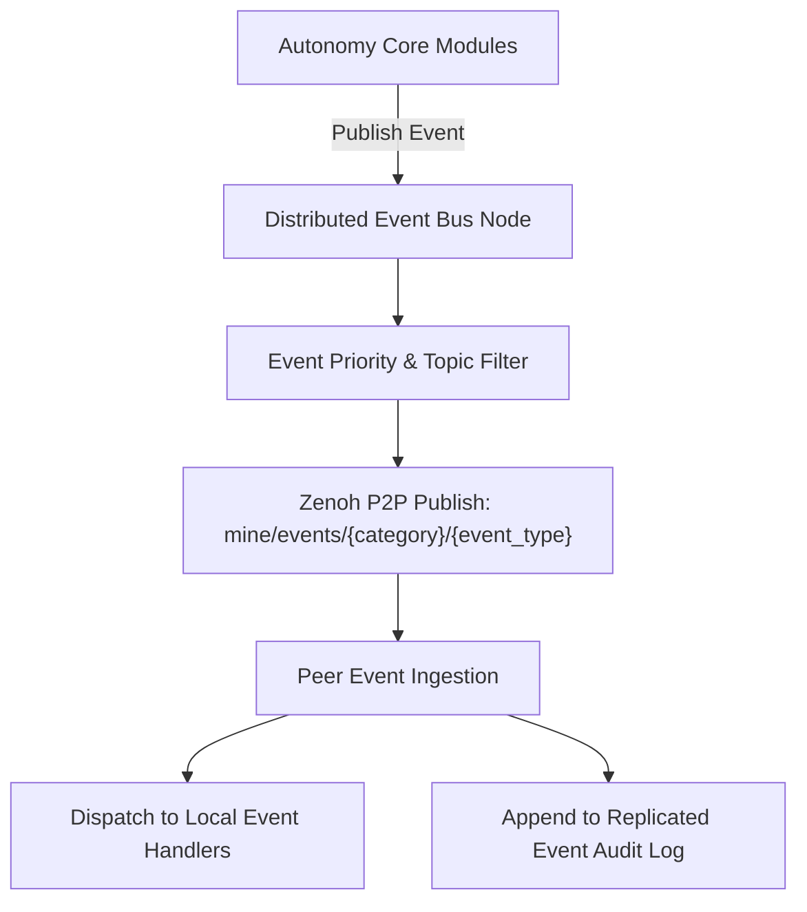

# Submodule 2.8.3: Event Interface

## 1. Purpose
Provides a distributed, decoupled publish/subscribe event bus for broadcasting and receiving asynchronous autonomy and operational events.

## 2. Responsibility
Serialize and dispatch events: `TaskAssigned`, `TaskCompleted`, `HazardDetected`, `PeerDiscovered`, `PeerLost`, and `SafetyIntervention` across the cluster.

## 3. Scope
### In-Scope
Event bus architecture, strongly typed event serialization, event filtering by topic/severity, and subscriber dispatching.

### Out-of-Scope
High-bandwidth sensor video streaming.

## 4. System Architecture

## 5. Internal Submodules
- **Event Serialization Engine**: Encodes events into compact binary or JSON formats with ISO-8601 timestamps and actor UUIDs.
- **Topic Filter & Dispatcher**: Routes incoming events to registered listener callbacks based on category patterns.

## 6. Functional Requirements
- **REQ-2.8-005**: Event bus dispatch latency shall not exceed `[PROPOSED TARGET: < 5 ms]` locally and < 50 ms over local mesh.
- **REQ-2.8-006**: All safety-critical events shall be marked with high QoS priority (Reliable, KeepAll).

## 7. Technical Approach
Deploy Zenoh hierarchical key expressions (`mine/events/autonomy/*`, `mine/events/safety/*`, `mine/events/hazard/*`). Subscribers bind wildcard expressions to receive filtered event feeds.

## 8. Open-Source Resources
### Zenoh Pub/Sub Topic Hierarchy
- **What it provides**: Wildcard pattern matching on key expressions.
- **Why it is relevant**: Fine-grained event filtering with zero broker overhead.
- **What we can reuse**: Native Zenoh pattern matching.
- **What we must develop ourselves**: Autonomy event taxonomy.

## 9. Prerequisites
Eclipse Zenoh SDK.

## 10. Dependencies
- **Upstream Dependencies**: None.
- **Downstream Dependencies**: All Layer 2 and Layer 3 modules.
- **Interfaces with Other Modules**: Zenoh key expression `mine/events/**`.

## 11. Development Phases
### Phase 1: Event Bus Architecture
- **Objective**: Implement event emitter and subscriber classes.
- **Activities**: Define event structs, benchmark event propagation latency.
- **Required resources**: C++, Zenoh.
- **Input**: Event structs.
- **Output**: Filtered event streams.
- **Dependencies**: None.
- **Validation**: Publish HazardDetected; verify all peers execute callback.
- **Completion criteria**: Event received by all peers in < 50 ms.

## 12. Interfaces
### Topics
- `mine/events/{category}/{type}`: Zenoh key expression for all system events.

## 13. Testing Strategy
Fire 1,000 events/sec across simulated link; verify zero dropped high-priority events and CPU load remains < 5%.

## 14. Known Challenges
- **Event Deduplication**: Re-transmissions over mesh radios can deliver duplicate event notifications; requires monotonic event sequence IDs.

## 15. Implementation Status
`PLANNED`

## 16. References
- **Eugster et al., The Many Faces of Publish/Subscribe**: ACM Computing Surveys, 2003
