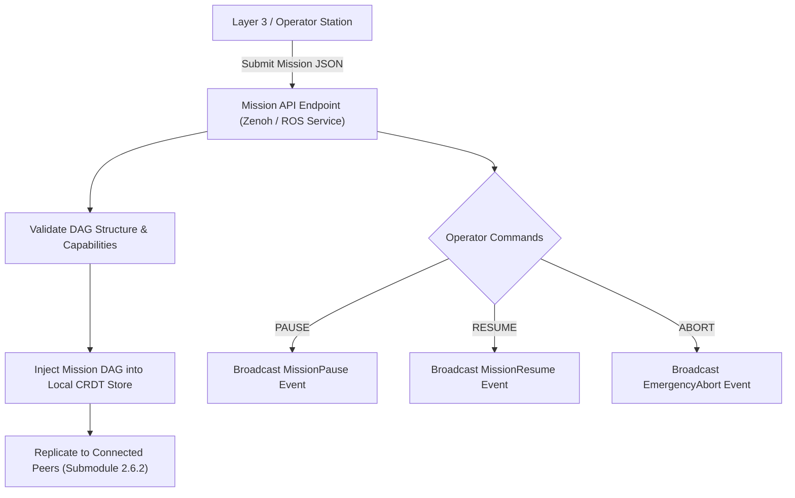

# Submodule 2.8.2: Mission API

## 1. Purpose
Provides an internal asynchronous API for submitting new missions, pausing in-flight missions, resuming execution, or triggering global emergency mission aborts.

## 2. Responsibility
Expose programmatic endpoints (Zenoh / ROS 2 Services) for mission lifecycle control, validate authorization credentials, and inject mission DAGs into the replicated state engine.

## 3. Scope
### In-Scope
Mission ingestion endpoint, pause/resume lifecycle controls, global abort broadcast, and mission status query APIs.

### Out-of-Scope
Graphical Web UI rendering (handled by Layer 3).

## 4. System Architecture

## 5. Internal Submodules
- **Mission Submission Handler**: Validates and ingests declarative JSON mission files.
- **Fleet Lifecycle Controller**: Broadcasts cluster-wide pause, resume, and emergency abort commands.

## 6. Functional Requirements
- **REQ-2.8-003**: Mission submission shall validate and inject mission DAGs within `[PROPOSED TARGET: < 500 ms]`.
- **REQ-2.8-004**: Global emergency abort commands shall propagate to all reachable robots within 100 ms.

## 7. Technical Approach
Expose a Zenoh Queryable and ROS 2 Service `SubmitMission.srv`. Ingested missions are committed directly into the local CRDT state store, which automatically replicates them to all peers over anti-entropy gossip.

## 8. Open-Source Resources
### Zenoh RPC Queryables
- **What it provides**: P2P request/reply semantics.
- **Why it is relevant**: Enables operators to inject missions via any connected robot node.
- **What we can reuse**: zenoh::queryable API.
- **What we must develop ourselves**: Mission ingestion handler.

## 9. Prerequisites
Submodule 2.3.1 Mission Representation, Submodule 2.6.1 Local Mission State.

## 10. Dependencies
- **Upstream Dependencies**: Module 3.2 Mission Management.
- **Downstream Dependencies**: Submodule 2.3.1 Mission Representation, Submodule 2.6.1 Local Mission State.
- **Interfaces with Other Modules**: Zenoh endpoint `mine/mission/submit` and `/control`.

## 11. Development Phases
### Phase 1: Mission API Implementation
- **Objective**: Implement mission submission and lifecycle service.
- **Activities**: Code service handlers, test DAG injection via CLI.
- **Required resources**: C++, Zenoh.
- **Input**: mission.json.
- **Output**: MissionAccepted response.
- **Dependencies**: None.
- **Validation**: Submit mission to Robot A; verify Robot B receives replicated mission.
- **Completion criteria**: Mission accepted and replicated across cluster.

## 12. Interfaces
### Services
- `/mission/submit`: Custom SubmitMission service accepting JSON mission DAG string.
- `/mission/control`: Custom ControlMission service (PAUSE, RESUME, ABORT).

## 13. Testing Strategy
Inject 20-task mission via Robot A while connected to Robot B; verify both robots initialize their task allocation queues.

## 14. Known Challenges
- **Concurrent Ingestion of Conflicting Missions**: Two operators submitting conflicting missions to different robots during a network partition; resolved by mission UUID priority.

## 15. Implementation Status
`PLANNED`

## 16. References
- **REST and RPC Design Patterns for Robotics**: IEEE Robotics & Automation Magazine
