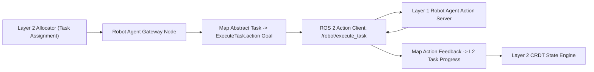

# Submodule 2.8.1: Robot Agent Gateway

## 1. Purpose
Translates high-level abstract tasks from Layer 2 into concrete ROS 2 Action Goals for the local Layer 1 Robot Agent, maintaining complete architectural decoupling.

## 2. Responsibility
Act as the exclusive inter-layer translation bridge between Layer 2 autonomy and Layer 1 execution: dispatch goals, monitor action progress, map feedback, and forward results.

## 3. Scope
### In-Scope
Action client dispatching (`ExecuteTask.action`), parameter mapping, coordinate frame translation, and action result parsing.

### Out-of-Scope
Direct hardware motor control (strictly encapsulated within Layer 1).

## 4. System Architecture

## 5. Internal Submodules
- **Task-to-Action Protocol Mapper**: Translates generic task structs into ROS 2 IDL action goal structures.
- **Execution Feedback Relayer**: Bridges 2 Hz Nav2 feedback into Layer 2 task progress updates.

## 6. Functional Requirements
- **REQ-2.8-001**: Gateway translation overhead between Layer 2 and Layer 1 shall not exceed `[PROPOSED TARGET: < 5 ms]`.
- **REQ-2.8-002**: Gateway shall support asynchronous cancellation of active Layer 1 action goals upon Layer 2 preemption.

## 7. Technical Approach
Implement a C++ node containing an `rclcpp_action::Client<ExecuteTask>`. The node listens to local Layer 2 dispatch triggers, serializes parameters, invokes the action server, and maps results.

## 8. Open-Source Resources
### rclcpp_action::Client
- **What it provides**: Standard ROS 2 Action Client API.
- **Why it is relevant**: Provides robust goal dispatching, cancellation, and feedback callbacks.
- **What we can reuse**: Action client template classes.
- **What we must develop ourselves**: Layer 2 autonomy task bridge.

## 9. Prerequisites
Submodule 1.5.4 Task Execution Interface, Submodule 2.4.4 Assignment Confirmation.

## 10. Dependencies
- **Upstream Dependencies**: Submodule 2.4.4 Assignment Confirmation.
- **Downstream Dependencies**: Submodule 1.5.4 Task Execution Interface.
- **Interfaces with Other Modules**: ROS 2 Action `ExecuteTask.action`.

## 11. Development Phases
### Phase 1: Gateway Implementation
- **Objective**: Implement ROS 2 action client bridge.
- **Activities**: Code gateway class, test dispatching to mock action server.
- **Required resources**: C++, ROS 2.
- **Input**: Task assignment.
- **Output**: Dispatched action goal.
- **Dependencies**: None.
- **Validation**: Send task from Layer 2; verify action server receives goal.
- **Completion criteria**: Action goal executed cleanly with progress feedback.

## 12. Interfaces
### Actions
- `/robot_a/execute_task`: Action client endpoint invoking Layer 1 execution.

## 13. Testing Strategy
Dispatch waypoint task from Layer 2; cancel halfway; verify Layer 1 halts and gateway returns CANCELED result to Layer 2.

## 14. Known Challenges
- **Action Server Crash during Transit**: If the Layer 1 action server crashes mid-task, gateway must catch the broken action pipe and report FAILURE to Layer 2 without hanging.

## 15. Implementation Status
`PLANNED`

## 16. References
- [ROS 2 Action Client Tutorials](https://docs.ros.org)
