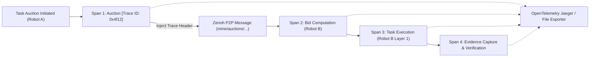

# Submodule 2.8.4: Runtime Observability and Tracing

## 1. Purpose
Provides distributed tracing, OpenTelemetry span propagation, performance profiling, and post-mission audit logging across the decentralized multi-robot system.

## 2. Responsibility
Inject distributed trace contexts into inter-robot RPCs, track task lifecycle spans across machines, measure bidding and execution latencies, and export metrics.

## 3. Scope
### In-Scope
OpenTelemetry C++ integration, trace context propagation across Zenoh messages, latency profiling, and flight-recorder telemetry buffering.

### Out-of-Scope
Real-time operator video rendering (handled by Layer 3).

## 4. System Architecture

## 5. Internal Submodules
- **Trace Context Injector / Extractor**: Embeds and extracts W3C Trace Context headers (`traceparent`) in Zenoh binary payloads.
- **Flight-Recorder Ring Buffer**: Buffers high-resolution trace spans in circular memory for post-mortem crash analysis.

## 6. Functional Requirements
- **REQ-2.8-007**: Tracing instrumentation shall add < 1% CPU overhead and < 32 bytes wire overhead per message.
- **REQ-2.8-008**: Every task auction and execution flow shall be traceable from inception to completion under a unified `trace_id`.

## 7. Technical Approach
Integrate OpenTelemetry C++ SDK (`opentelemetry-cpp`). Propagate W3C TraceContext headers over Zenoh user attachments. Dump traces locally to compressed files or stream to Jaeger when base station link is online.

## 8. Open-Source Resources
### OpenTelemetry C++ SDK
- **What it provides**: Standard distributed tracing and metrics instrumentation.
- **Why it is relevant**: Industry standard for distributed systems observability.
- **What we can reuse**: Core tracer and span exporters.
- **What we must develop ourselves**: Zenoh message carrier injector.

## 9. Prerequisites
OpenTelemetry C++ SDK.

## 10. Dependencies
- **Upstream Dependencies**: None.
- **Downstream Dependencies**: All Layer 2 modules, Module 3.4 Monitoring.
- **Interfaces with Other Modules**: W3C TraceContext headers.

## 11. Development Phases
### Phase 1: OpenTelemetry Instrumentation
- **Objective**: Implement trace injection and flight recorder.
- **Activities**: Instrument task allocator and gateway, benchmark overhead.
- **Required resources**: C++, OpenTelemetry.
- **Input**: RPC messages.
- **Output**: Distributed spans.
- **Dependencies**: None.
- **Validation**: Execute auction; inspect trace in Jaeger viewer.
- **Completion criteria**: Continuous trace span connecting Robot A and B visible in Jaeger.

## 12. Interfaces
### Data Types
- `traceparent`: W3C standard header: version-trace_id-parent_id-trace_flags.

## 13. Testing Strategy
Trace end-to-end mission flow: Mission Submitted -> Task Auctioned -> Robot B Executed -> Evidence Saved; verify complete unbroken trace graph.

## 14. Known Challenges
- **Asynchronous Trace Exfiltration**: Robots out of radio range cannot stream spans to a central collector; requires local spooling and batch exfiltration upon reconnection.

## 15. Implementation Status
`PLANNED`

## 16. References
- [W3C Trace Context Specification](https://www.w3.org/TR/trace-context/)
- [OpenTelemetry C++ Documentation](https://opentelemetry.io/docs/languages/cpp/)
