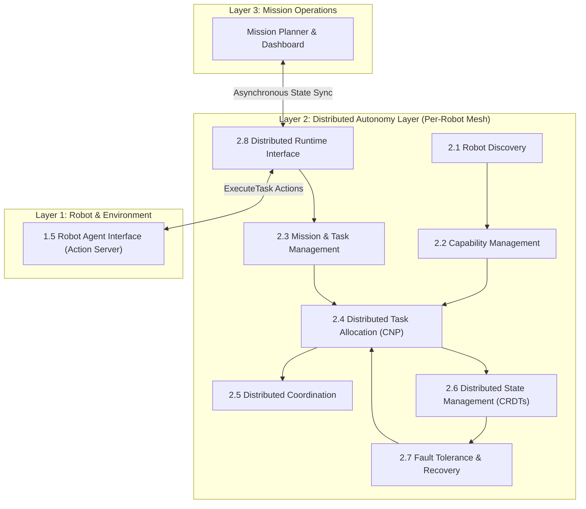

# Layer 2: Distributed Autonomy Layer

## 1. Overview
The **Distributed Autonomy Layer** provides decentralized intelligence, dynamic task allocation, peer coordination, distributed state replication, and autonomous fault recovery for the multi-robot fleet in communications-degraded underground mines.

---

## 2. Architectural Role
Layer 2 eliminates the single point of failure inherent in centralized multi-robot systems. Operating directly on each robot's onboard compute, it coordinates peer-to-peer over an ad-hoc gossip mesh (Eclipse Zenoh / ROS 2 DDS). It interfaces downwards with **Layer 1** via the standardized Robot Agent Gateway and upwards with **Layer 3** via asynchronous mission synchronization.

---

## 3. Module Index

| Module | Description | Directory Link |
|---|---|---|
| **2.1 Robot Discovery** | Zero-conf peer discovery, liveliness tracking, gossip heartbeats | [2.1 Robot Discovery](2.1_robot_discovery/README.md) |
| **2.2 Capability Management** | Semantic capability schemas, peer capability exchange, matching | [2.2 Capability Management](2.2_capability_management/README.md) |
| **2.3 Mission & Task Management** | DAG mission representations, task decomposition, lifecycle | [2.3 Mission & Task Management](2.3_mission_task_management/README.md) |
| **2.4 Distributed Task Allocation** | Contract Net Protocol (CNP) auctioning, cost evaluation, leases | [2.4 Distributed Task Allocation](2.4_distributed_task_allocation/README.md) |
| **2.5 Distributed Coordination** | P2P spatial deconfliction, right-of-way in single-lane drifts | [2.5 Distributed Coordination](2.5_distributed_coordination/README.md) |
| **2.6 Distributed State Management** | Replicated state engine, CRDTs (OR-Set, LWW), vector clocks | [2.6 Distributed State Management](2.6_distributed_state_management/README.md) |
| **2.7 Fault Tolerance & Recovery** | Failure detection, partition handling, lease revocation, reassignment | [2.7 Fault Tolerance & Recovery](2.7_fault_tolerance_recovery/README.md) |
| **2.8 Distributed Runtime Interface** | Inter-layer gateway, event bus, distributed tracing, observability | [2.8 Distributed Runtime Interface](2.8_distributed_runtime_interface/README.md) |
