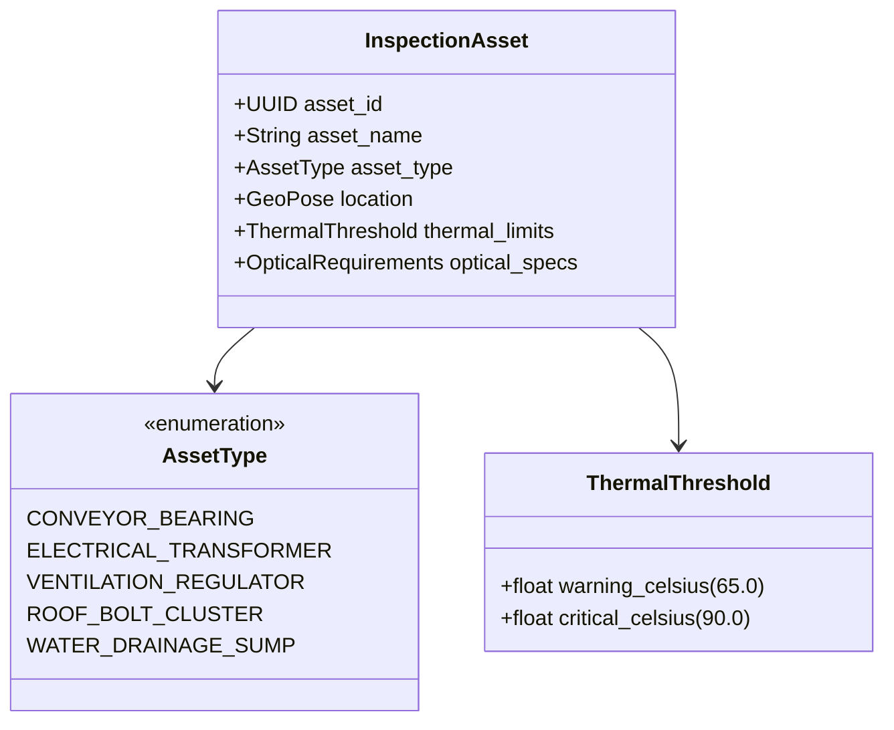

# Submodule 3.1.2: Inspection Objectives

## 1. Purpose
Defines subterranean asset inspection specifications, baseline operating standards, and anomaly evaluation criteria for mining infrastructure.

## 2. Responsibility
Catalogue mine assets (conveyor belt drive rollers, high-voltage transformers, ventilation bulkheads, roof-bolt clusters), establish baseline thermal signatures, and set alarm thresholds.

## 3. Scope
### In-Scope
Asset taxonomy definition, target coordinate georeferencing, allowable temperature thresholds ($T_{max}$), optical resolution requirements, and inspection frequencies.

### Out-of-Scope
Real-time thermal anomaly extraction algorithms (handled by Layer 1).

## 4. System Architecture

## 5. Internal Submodules
- **Asset Registry Database**: Stores known physical mine assets with surveyed Cartesian coordinates relative to portal datum.
- **Inspection Criteria Manager**: Defines PASS/WARN/FAIL criteria (e.g. bearing temperature $> 75^\circ$C triggers WARN).

## 6. Functional Requirements
- **REQ-3.1-003**: Every inspection objective shall define explicit warning and critical temperature thresholds.
- **REQ-3.1-004**: Assets shall be referenceable by unique asset ID and spatial pose.

## 7. Technical Approach
Model assets in relational database (PostgreSQL) and export them as target schemas in mission planning. Define temperature thresholds based on manufacturer and MSHA safety guidelines.

## 8. Open-Source Resources
### PostgreSQL 14 / PostGIS
- **What it provides**: Spatial relational database.
- **Why it is relevant**: Stores mine asset spatial coordinates and attribute records.
- **What we can reuse**: PostGIS geometry tables.
- **What we must develop ourselves**: Mining asset inspection schema.

## 9. Prerequisites
PostgreSQL 14.

## 10. Dependencies
- **Upstream Dependencies**: None.
- **Downstream Dependencies**: Submodule 3.1.3 Task Definition, Module 3.3 Inspection Management.
- **Interfaces with Other Modules**: Database table `inspection_assets`.

## 11. Development Phases
### Phase 1: Asset Schema Definition
- **Objective**: Define database table and seed mine asset data.
- **Activities**: Write SQL schema, insert 20 test mine inspection targets.
- **Required resources**: PostgreSQL, SQL.
- **Input**: Mine survey points.
- **Output**: Populated asset database.
- **Dependencies**: None.
- **Validation**: Query assets by geographic radius; verify spatial indexing.
- **Completion criteria**: Spatial query returns target assets within 10 ms.

## 12. Interfaces
### SQL
- `schema/01_assets.sql`: Database schema defining physical inspection targets.

## 13. Testing Strategy
Insert transformer asset with 80°C threshold; simulate 85°C reading; verify inspection manager flags status as CRITICAL.

## 14. Known Challenges
- **Survey Coordinate Accuracy**: Underground surveying uses local mine coordinate grids that must be aligned with robot SLAM map reference frames.

## 15. Implementation Status
`PLANNED`

## 16. References
- [MSHA Electrical Equipment Safety Guidelines](https://www.msha.gov)
