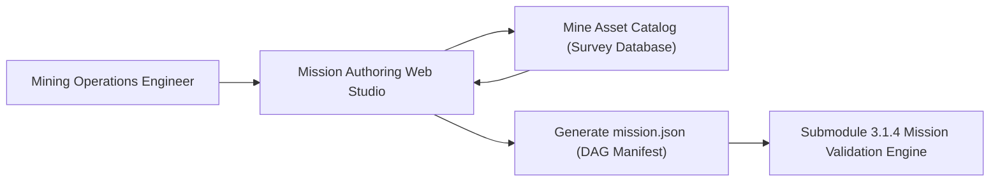

# Submodule 3.1.1: Mission Creation

## 1. Purpose
Enables mining engineers and operators to construct declarative multi-robot inspection missions using structured JSON/YAML manifests or an intuitive visual workflow editor.

## 2. Responsibility
Author mission metadata, specify operational zones, define mission objectives, assemble task nodes and dependency edges, and export standardized mission DAG files.

## 3. Scope
### In-Scope
Mission creation UI wizard, JSON/YAML template generation, visual DAG node linking, and manifest file saving.

### Out-of-Scope
Runtime task auctioning (handled by Layer 2).

## 4. System Architecture

## 5. Internal Submodules
- **Visual DAG Workflow Canvas**: Web-based node-and-edge graphical canvas for assembling interdependent tasks.
- **Mission Template Library**: Pre-configured templates for standard mine operations: 'Routine Drift Inspection', 'Post-Blast Gas & Structural Check', 'Conveyor Belt Thermal Survey'.

## 6. Functional Requirements
- **REQ-3.1-001**: The authoring tool shall generate valid mission manifests adhering strictly to `MISSION_SCHEMA.md`.
- **REQ-3.1-002**: Operators shall be able to assign geographic boundary fences and maximum mission duration bounds.

## 7. Technical Approach
Develop a React/TypeScript web interface using ReactFlow or Rete.js for visual DAG graph authoring. Provide automated export to JSON conforming to `schemas/mission_schema.json`.

## 8. Open-Source Resources
### ReactFlow
- **What it provides**: Customizable React library for node-based UIs and workflow editors.
- **Why it is relevant**: Intuitive drag-and-drop mission DAG construction.
- **What we can reuse**: Core canvas and node connection components.
- **What we must develop ourselves**: Robotics task node components with parameter forms.

## 9. Prerequisites
`MISSION_SCHEMA.md`.

## 10. Dependencies
- **Upstream Dependencies**: None.
- **Downstream Dependencies**: Submodule 3.1.4 Mission Validation, Module 3.2 Mission Management.
- **Interfaces with Other Modules**: Outputs `mission.json`.

## 11. Development Phases
### Phase 1: Mission Studio Frontend
- **Objective**: Build React DAG authoring component.
- **Activities**: Code node canvas, implement JSON import/export.
- **Required resources**: React, TypeScript, ReactFlow.
- **Input**: User inputs.
- **Output**: Validated mission.json.
- **Dependencies**: None.
- **Validation**: Create 5-task DAG in UI; export to JSON; check schema.
- **Completion criteria**: 100% schema validation match.

## 12. Interfaces
### Files
- `config/mission_templates/routine_inspection.json`: Standard inspection mission template.

## 13. Testing Strategy
Create a 10-task mission using the UI canvas; export JSON; verify all tasks, parameters, and edges are preserved accurately.

## 14. Known Challenges
- **Complex Edge Routing**: Visualizing complex multi-robot DAGs with 50+ nodes in narrow UI canvases requires automated hierarchical layout algorithms (Dagre / ELK).

## 15. Implementation Status
`PLANNED`

## 16. References
- [ReactFlow Documentation](https://reactflow.dev)
