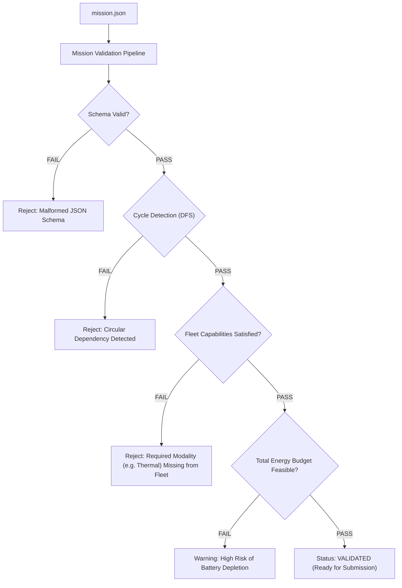

# Submodule 3.1.4: Mission Validation

## 1. Purpose
Performs comprehensive static analysis and pre-flight validation on mission manifests prior to submission to the multi-robot fleet.

## 2. Responsibility
Verify DAG acyclicity, ensure at least one available robot satisfies all task capability requirements, check spatial reachability, and validate energy feasibility.

## 3. Scope
### In-Scope
Graph cycle detection (Kahn's algorithm), capability satisfiability checking, energy budget feasibility estimation, and pre-flight warning generation.

### Out-of-Scope
Runtime dynamic replanning.

## 4. System Architecture

## 5. Internal Submodules
- **Static Graph Analyzer**: Validates that all referenced prerequisite task IDs exist and that graph has a valid topological ordering.
- **Fleet Capability Satisfiability Verifier**: Cross-checks required task capabilities against the active robot capability roster.

## 6. Functional Requirements
- **REQ-3.1-007**: Pre-flight validation shall reject any mission requiring capabilities not possessed by any robot in the fleet.
- **REQ-3.1-008**: Validation pipeline shall complete execution in `[PROPOSED TARGET: < 100 ms]` for a 100-task mission.

## 7. Technical Approach
Implement a validation library in Python/C++. Parse the mission JSON, run Kahn's algorithm for topological sorting, query the active fleet capability cache, and verify that $\forall task \in Mission, \exists robot \in Fleet$ capable of executing it.

## 8. Open-Source Resources
### NetworkX (Python)
- **What it provides**: Comprehensive network analysis algorithms.
- **Why it is relevant**: Rapid graph cycle detection and DAG analysis.
- **What we can reuse**: is_directed_acyclic_graph, topological_sort.
- **What we must develop ourselves**: Fleet capability satisfiability checker.

## 9. Prerequisites
Submodule 3.1.1 Mission Creation, Module 2.2 Capability Management.

## 10. Dependencies
- **Upstream Dependencies**: Submodule 3.1.1 Mission Creation.
- **Downstream Dependencies**: Module 3.2 Mission Management.
- **Interfaces with Other Modules**: CLI `validate_mission mission.json`.

## 11. Development Phases
### Phase 1: Validator Library
- **Objective**: Implement validation CLI and library.
- **Activities**: Code validation rules, integrate NetworkX cycle detection, write test suite.
- **Required resources**: Python, NetworkX.
- **Input**: mission.json, fleet_roster.json.
- **Output**: Validation report.
- **Dependencies**: None.
- **Validation**: Test mission requiring thermal camera when only Robot A is present; verify rejection.
- **Completion criteria**: Rejection message explains missing thermal capability.

## 12. Interfaces
### CLI
- `tools/validate_mission.py`: Command-line pre-flight validation utility.

## 13. Testing Strategy
Run validation suite on 20 test missions with varied topological defects; verify 100% of defective missions are rejected with informative errors.

## 14. Known Challenges
- **Estimating Traversal Energy Pre-Flight**: Accurate energy feasibility requires predicting path distances before SLAM has mapped the drifts; requires conservative upper-bound distance heuristics.

## 15. Implementation Status
`PLANNED`

## 16. References
- **Kahn, Topological Sorting of Large Networks**: Communications of the ACM, 1962
