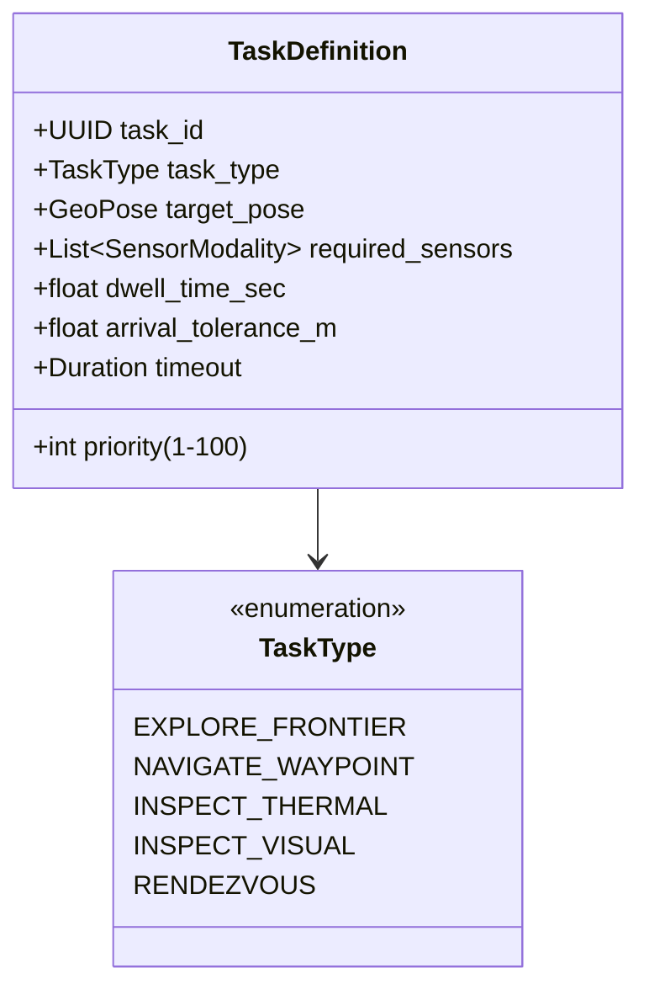

# Submodule 3.1.3: Task Definition

## 1. Purpose
Defines the parameterization and configuration schema for individual atomic tasks generated during mission authoring.

## 2. Responsibility
Specify task parameters: target waypoint coordinates $(x, y, z, \theta)$, inspection sensor modalities (`THERMAL`, `RGB`, `LIDAR`), inspection dwell time, and verification tolerance.

## 3. Scope
### In-Scope
Task parameterization schema, validation of coordinate ranges, tolerance specification, and timeout deadlines.

### Out-of-Scope
Task execution inside Nav2.

## 4. System Architecture

## 5. Internal Submodules
- **Parameter Validation Helper**: Validates that target poses lie within traversable tunnel coordinate bounds.
- **Sensor Requirement Assigner**: Binds required sensor modalities based on chosen task type (e.g. binds `RADIOMETRIC_THERMAL` to `INSPECT_THERMAL`).

## 6. Functional Requirements
- **REQ-3.1-005**: All inspection tasks shall specify target sensor modality and minimum dwell time >= 2.0 seconds.
- **REQ-3.1-006**: Target waypoints outside the defined mine world bounding box shall be rejected during definition.

## 7. Technical Approach
Enforce strict schema validation using `schemas/task_schema.json`. Provide TypeScript and Python factory functions to generate pre-validated task objects.

## 8. Open-Source Resources
### Pydantic (Python 3)
- **What it provides**: Data validation and settings management using Python type annotations.
- **Why it is relevant**: Provides robust parameter validation for task definition scripts.
- **What we can reuse**: BaseModel validation classes.
- **What we must develop ourselves**: Robotics task models.

## 9. Prerequisites
`TASK_SCHEMA.md`.

## 10. Dependencies
- **Upstream Dependencies**: Submodule 3.1.2 Inspection Objectives.
- **Downstream Dependencies**: Submodule 3.1.4 Mission Validation.
- **Interfaces with Other Modules**: JSON Schema `task_schema.json`.

## 11. Development Phases
### Phase 1: Task Model Classes
- **Objective**: Implement Pydantic and C++ task definition classes.
- **Activities**: Code data models, write automated validation tests.
- **Required resources**: Python, Pydantic.
- **Input**: Task dictionary.
- **Output**: Validated TaskDefinition instance.
- **Dependencies**: None.
- **Validation**: Instantiate invalid task (e.g. negative dwell time); verify exception.
- **Completion criteria**: Pydantic ValidationError raised for invalid params.

## 12. Interfaces
### Schemas
- `interfaces/schemas/task_schema.json`: Schema defining valid task definitions.

## 13. Testing Strategy
Generate 50 randomized task definitions; verify all pass schema validation and serialize cleanly to JSON.

## 14. Known Challenges
- **Orientation Specification**: Operators often specify $(x, y)$ position but forget sensor yaw angle $\theta$; requires automated look-at vector computation toward the asset target.

## 15. Implementation Status
`PLANNED`

## 16. References
- [Pydantic Documentation](https://docs.pydantic.dev)
