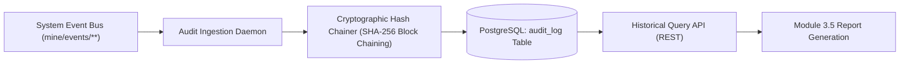

# Submodule 3.2.4: Mission History

## 1. Purpose
Maintains an immutable, chronologically ordered audit trail of all mission runs, task allocations, human operator interventions, and safety events.

## 2. Responsibility
Record every state mutation, auction bid, allocation decision, operator command, and safety stop event into an append-only audit database for compliance reporting.

## 3. Scope
### In-Scope
Audit trail schema design, event serialization, cryptographic hash chaining for tamper-evidence, and historical query APIs.

### Out-of-Scope
Ephemeral debug log messages.

## 4. System Architecture

## 5. Internal Submodules
- **Audit Log Ingestion Pipeline**: Subscribes to all system events and writes structured records to storage.
- **Cryptographic Hash Chainer**: Links audit entries with parent hashes to detect any post-mission tampering with safety records.

## 6. Functional Requirements
- **REQ-3.2-007**: Audit logs shall be immutable and cryptographically verifiable using SHA-256 hash chaining.
- **REQ-3.2-008**: Historical queries by mission ID, robot UUID, or timestamp range shall execute in `[PROPOSED TARGET: < 50 ms]`.

## 7. Technical Approach
Store audit logs in PostgreSQL with write-only append permissions. Each row contains $Hash_n = SHA256(Hash_{n-1} + Timestamp + EventData)$. Expose indexed REST endpoints for historical review.

## 8. Open-Source Resources
### PostgreSQL Write-Ahead Logging & Append Tables
- **What it provides**: Enterprise relational persistence.
- **Why it is relevant**: Industry standard for audit trails and compliance.
- **What we can reuse**: PostgreSQL indexing and triggers.
- **What we must develop ourselves**: Tamper-evident hash chaining trigger.

## 9. Prerequisites
PostgreSQL 14, Submodule 2.8.3 Event Interface.

## 10. Dependencies
- **Upstream Dependencies**: Submodule 2.8.3 Event Interface.
- **Downstream Dependencies**: Module 3.5 Data & Reporting.
- **Interfaces with Other Modules**: Database table `mission_audit_log`.

## 11. Development Phases
### Phase 1: Audit Logging Service
- **Objective**: Implement event logger and hash chaining.
- **Activities**: Write PostgreSQL trigger for hash chaining, code event consumer service.
- **Required resources**: PostgreSQL, Python.
- **Input**: Event stream.
- **Output**: Immutable audit database.
- **Dependencies**: None.
- **Validation**: Insert 1,000 events; verify cryptographic chain integrity.
- **Completion criteria**: Zero broken hash links in audit table.

## 12. Interfaces
### SQL
- `schema/02_audit_log.sql`: Schema and trigger for tamper-evident mission audit trail.

## 13. Testing Strategy
Attempt to modify an existing historical audit record in database; verify trigger blocks update or hash verification script flags tampering.

## 14. Known Challenges
- **High Volume Event Ingestion**: Telemetry streams at 50 Hz can bloat audit tables; requires filtering high-frequency noise from true discrete lifecycle events.

## 15. Implementation Status
`PLANNED`

## 16. References
- **NIST SP 800-92: Guide to Computer Security Log Management**: NIST
