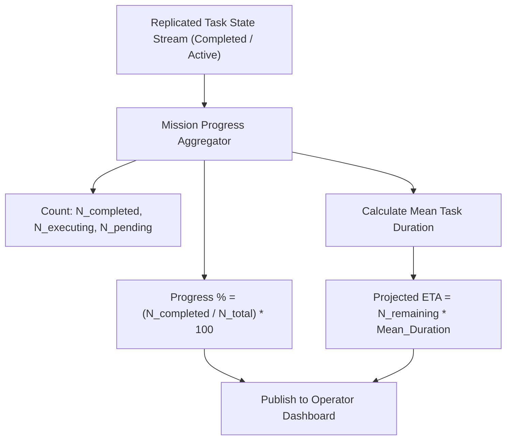

# Submodule 3.2.2: Mission Progress

## 1. Purpose
Aggregates distributed task lifecycle events and telemetry into unified high-level mission progress metrics, percent-complete indicators, and estimated time of arrival (ETA).

## 2. Responsibility
Calculate overall mission completion percentage ($% = \frac{N_{completed}}{N_{total}} \times 100$), track execution velocity, detect schedule delays, and compute projected completion time.

## 3. Scope
### In-Scope
Progress aggregation math, ETA projection, task execution timing analysis, and bottleneck detection.

### Out-of-Scope
Low-level trajectory tracking.

## 4. System Architecture

## 5. Internal Submodules
- **Task Counter & Metric Engine**: Maintains real-time counts of tasks by state.
- **ETA Estimator**: Computes remaining mission duration based on historical task execution rates and remaining graph depth.

## 6. Functional Requirements
- **REQ-3.2-003**: Progress metrics shall update within 1.0 second of any task state transition event.
- **REQ-3.2-004**: ETA projection shall account for parallel multi-robot execution paths in the DAG.

## 7. Technical Approach
Deploy a lightweight Python service subscribing to replicated task state events. Compute critical path duration through remaining DAG tasks using topological longest-path analysis.

## 8. Open-Source Resources
### Critical Path Method (CPM) Algorithms
- **What it provides**: Project scheduling and duration estimation.
- **Why it is relevant**: Accurate multi-robot parallel ETA calculation.
- **What we can reuse**: CPM graph algorithms.
- **What we must develop ourselves**: Robotics task duration estimator.

## 9. Prerequisites
Submodule 2.3.1 Mission Representation, Module 2.6 State Management.

## 10. Dependencies
- **Upstream Dependencies**: Module 2.6 Distributed State Management.
- **Downstream Dependencies**: Submodule 3.4.3 Task Allocation View, Module 3.5 Data & Reporting.
- **Interfaces with Other Modules**: Publishes `/mission/progress`.

## 11. Development Phases
### Phase 1: Progress Aggregator Service
- **Objective**: Implement progress and ETA calculation node.
- **Activities**: Code CPM estimator, test with simulated multi-robot execution traces.
- **Required resources**: Python 3.
- **Input**: Task state updates.
- **Output**: Progress metrics.
- **Dependencies**: None.
- **Validation**: Execute 10-task mission; verify progress increases from 0% to 100% monotonically.
- **Completion criteria**: Progress metric hits 100% upon final task completion.

## 12. Interfaces
### Topics
- `/mission/progress`: Custom MissionProgress message reporting % complete, active tasks, and ETA.

## 13. Testing Strategy
Run simulated 2-robot mission; verify ETA adjusts dynamically when Robot B takes over tasks from stalled Robot A.

## 14. Known Challenges
- **Stale Progress during Partitions**: When robots are disconnected underground, progress appears frozen to the surface operator; UI must display 'Estimated' with timestamp of last known sync.

## 15. Implementation Status
`PLANNED`

## 16. References
- **Kelley & Walker, Critical-Path Planning and Scheduling**: Proc. IRE, 1959
