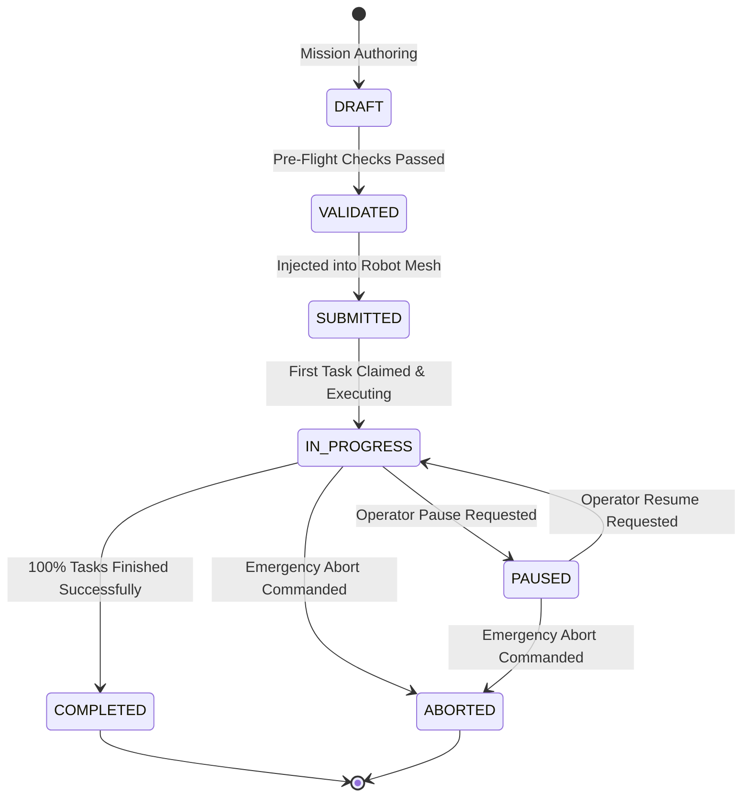

# Submodule 3.2.3: Mission Status

## 1. Purpose
Manages the high-level mission lifecycle state machine from authoring through active execution to terminal completion or abort.

## 2. Responsibility
Govern transitions between top-level states: `DRAFT`, `VALIDATED`, `SUBMITTED`, `IN_PROGRESS`, `PAUSED`, `ABORTED`, and `COMPLETED`.

## 3. Scope
### In-Scope
Mission lifecycle FSM, state change auditing, operator override handling, and terminal state notifications.

### Out-of-Scope
Individual atomic task state machines (handled by Layer 2).

## 4. System Architecture

## 5. Internal Submodules
- **Top-Level Mission FSM**: Enforces valid mission-level lifecycle transitions.
- **Lifecycle Event Broadcaster**: Publishes state change announcements to web dashboards and SMS/email alert gateways.

## 6. Functional Requirements
- **REQ-3.2-005**: Mission state shall transition to `COMPLETED` only when all constituent tasks are `COMPLETED`.
- **REQ-3.2-006**: An emergency `ABORTED` command shall bring all robots to a safe stop within 500 ms.

## 7. Technical Approach
Implement mission state manager in Python/C++. Persist state changes to relational database (PostgreSQL) and emit WebSocket events to connected web dashboards.

## 8. Open-Source Resources
### transitions (Python State Machine)
- **What it provides**: Lightweight, robust Python finite state machines.
- **Why it is relevant**: Manages mission lifecycle cleanly.
- **What we can reuse**: Machine class.
- **What we must develop ourselves**: Mission lifecycle transition guards.

## 9. Prerequisites
Submodule 3.1.4 Mission Validation.

## 10. Dependencies
- **Upstream Dependencies**: Submodule 3.1.4 Mission Validation.
- **Downstream Dependencies**: Module 3.5 Data & Reporting.
- **Interfaces with Other Modules**: Database table `mission_runs`.

## 11. Development Phases
### Phase 1: Mission FSM Service
- **Objective**: Implement mission lifecycle state manager.
- **Activities**: Code state transitions, integrate database logging and WebSocket events.
- **Required resources**: Python, transitions.
- **Input**: Mission events.
- **Output**: MissionState changes.
- **Dependencies**: None.
- **Validation**: Transition through full lifecycle; check database audit records.
- **Completion criteria**: All transitions logged with user ID and timestamp.

## 12. Interfaces
### WebSockets
- `/ws/mission_status`: WebSocket feed broadcasting live mission lifecycle events.

## 13. Testing Strategy
Trigger emergency abort via web UI; verify mission state immediately transitions to `ABORTED` and broadcast event fires.

## 14. Known Challenges
- **Partial Completion Aborts**: Aborting an in-progress mission leaves some inspection evidence collected and other unstarted; must preserve all collected evidence.

## 15. Implementation Status
`PLANNED`

## 16. References
- [Python Transitions Library](https://github.com/py-transitions/transitions)
