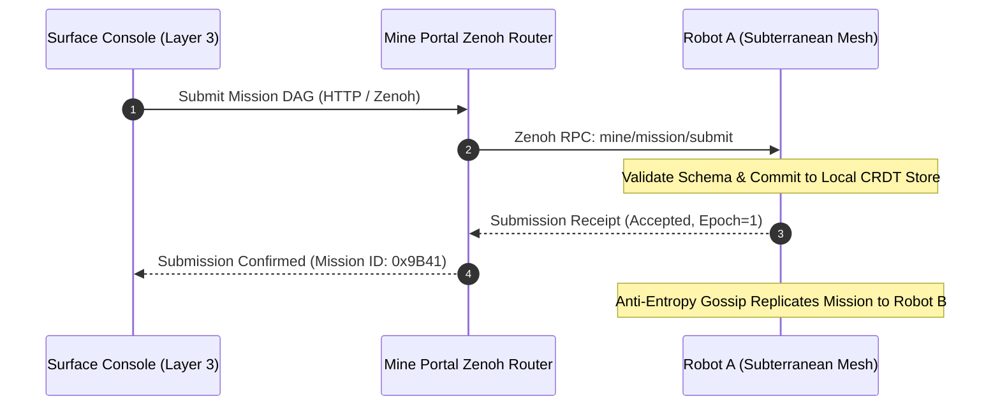

# Submodule 3.2.1: Mission Submission

## 1. Purpose
Transmits approved mission specifications from the surface operations console into the subterranean multi-robot autonomy mesh.

## 2. Responsibility
Connect to available surface portal access points, inject the validated mission DAG into reachable robot agents, verify acknowledgment, and initiate execution.

## 3. Scope
### In-Scope
Mission upload protocol, gateway selection, submission retry logic, and confirmation receipts.

### Out-of-Scope
Subterranean P2P task auctioning (handled by Layer 2).

## 4. System Architecture

## 5. Internal Submodules
- **Submission Transport Client**: Transmits mission manifest over Zenoh or HTTPS REST gateway to available robot endpoints.
- **Submission Acknowledgment Tracker**: Tracks receipts from connected gateway nodes; retries on transport timeout.

## 6. Functional Requirements
- **REQ-3.2-001**: Mission submission shall succeed if at least one robot or gateway node is reachable.
- **REQ-3.2-002**: Submission receipts shall include mission UUID, server timestamp, and committed epoch number.

## 7. Technical Approach
Deploy Zenoh queryable client in Python/C++. Connect to `mine/mission/submit`. On successful response, record mission in database as `SUBMITTED`.

## 8. Open-Source Resources
### Eclipse Zenoh Query API
- **What it provides**: Reliable point-to-point and point-to-multipoint querying.
- **Why it is relevant**: Transmits mission payloads over lossy subterranean portals.
- **What we can reuse**: zenoh::get API.
- **What we must develop ourselves**: Mission submission client.

## 9. Prerequisites
Submodule 3.1.4 Mission Validation, Module 2.8 Distributed Runtime Interface.

## 10. Dependencies
- **Upstream Dependencies**: Submodule 3.1.4 Mission Validation.
- **Downstream Dependencies**: Module 2.8 Distributed Runtime Interface.
- **Interfaces with Other Modules**: Zenoh endpoint `mine/mission/submit`.

## 11. Development Phases
### Phase 1: Submission Client Integration
- **Objective**: Implement submission CLI and REST gateway.
- **Activities**: Code submission script, test upload to simulated robot gateway.
- **Required resources**: Python, Zenoh.
- **Input**: mission.json.
- **Output**: Submission receipt.
- **Dependencies**: None.
- **Validation**: Submit mission; verify Robot A receives and parses manifest.
- **Completion criteria**: Receipt returned within 500 ms.

## 12. Interfaces
### CLI
- `scripts/submit_mission.py`: Utility script for injecting mission files into the fleet.

## 13. Testing Strategy
Submit mission to Robot A while Robot B is unreachable; reconnect Robot B; verify mission replicates to Robot B automatically.

## 14. Known Challenges
- **Submission during Transient Outages**: Operator clicks submit while gateway is experiencing radio fade; client must buffer submission locally and retry upon link restoration.

## 15. Implementation Status
`PLANNED`

## 16. References
- [Zenoh Query API Documentation](https://zenoh.io/docs)
