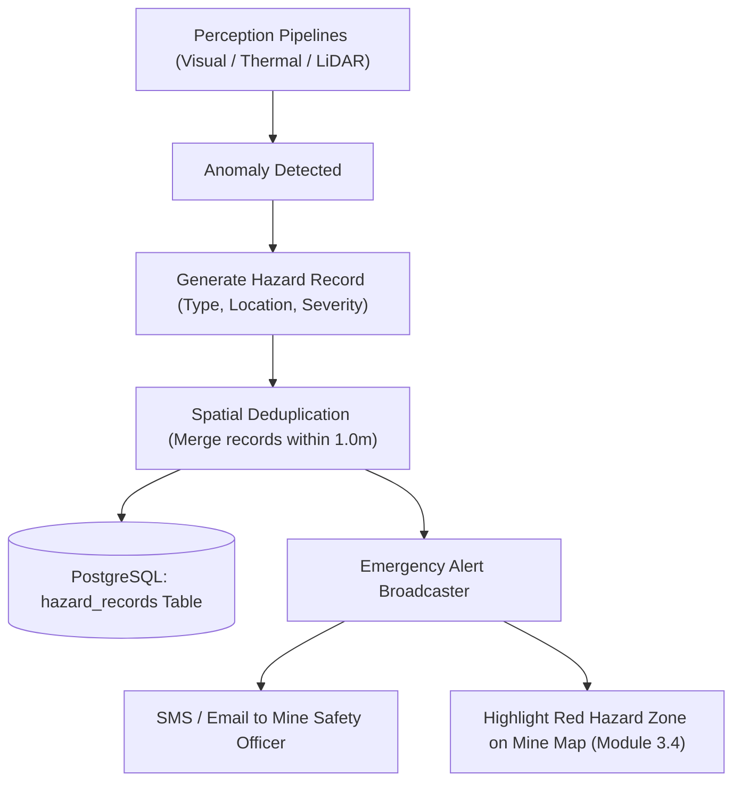

# Submodule 3.3.4: Hazard Records

## 1. Purpose
Catalogs and tracks environmental, structural, and mechanical hazards discovered autonomously by robots during mine inspection missions.

## 2. Responsibility
Log structural rock fractures, rockfall rubble, thermal hotspots, water pooling, and simulated toxic gas leaks with severity ratings and spatial coordinates.

## 3. Scope
### In-Scope
Hazard record schema, severity classification (`CRITICAL`, `WARNING`, `ADVISORY`), spatial clustering, and automated alert notifications.

### Out-of-Scope
Physical hazard remediation.

## 4. System Architecture

## 5. Internal Submodules
- **Spatial Deduplication Filter**: Clusters multiple detections of the same physical hazard into a single consolidated hazard record.
- **Severity Classifier**: Assigns MSHA-aligned severity tiers based on measured temperature, crack width, or obstacle height.

## 6. Functional Requirements
- **REQ-3.3-007**: Hazard records shall capture 3D spatial coordinates, timestamp, hazard classification, and reference evidence URIs.
- **REQ-3.3-008**: Critical hazards shall trigger immediate high-priority alerts across operator dashboards within 1.0 second of ingestion.

## 7. Technical Approach
Model hazards in PostgreSQL with PostGIS geometries. Implement spatial clustering using `ST_ClusterDBSCAN` to prevent multiple robots reporting the same rockfall from creating redundant records.

## 8. Open-Source Resources
### PostGIS Spatial Clustering (ST_ClusterDBSCAN)
- **What it provides**: Density-based spatial clustering.
- **Why it is relevant**: Deduplicates multi-robot hazard detections.
- **What we can reuse**: PostGIS spatial SQL functions.
- **What we must develop ourselves**: Robotics hazard clustering queries.

## 9. Prerequisites
Submodule 3.3.2 Visual Evidence, Submodule 3.3.3 Thermal Evidence.

## 10. Dependencies
- **Upstream Dependencies**: Submodule 3.3.2 Visual Evidence, Submodule 3.3.3 Thermal Evidence.
- **Downstream Dependencies**: Submodule 3.4.1 Mine Map Visualization, Module 3.5 Data & Reporting.
- **Interfaces with Other Modules**: Database table `hazard_records`.

## 11. Development Phases
### Phase 1: Hazard Database & Alerting
- **Objective**: Implement hazard ingestion and alert dispatching.
- **Activities**: Code hazard logging service, integrate WebSocket broadcast.
- **Required resources**: Python, PostgreSQL.
- **Input**: Hazard event.
- **Output**: Database record and alert notification.
- **Dependencies**: None.
- **Validation**: Inject simulated transformer fire; verify dashboard receives red alert.
- **Completion criteria**: Alert delivered to dashboard in < 500 ms.

## 12. Interfaces
### Topics
- `mine/hazards/new`: Custom HazardRecord notification message.

## 13. Testing Strategy
Feed 10 simulated crack detections located within 0.5m of each other; verify deduplication clusters them into a single primary hazard entry.

## 14. Known Challenges
- **Hazard Growth Tracking**: Tracking whether a rock fracture is growing over time across successive missions requires precise historical alignment.

## 15. Implementation Status
`PLANNED`

## 16. References
- [MSHA Ground Control Safety Standards](https://www.msha.gov)
