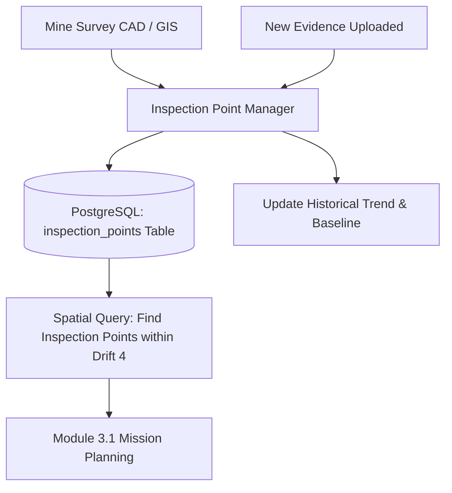

# Submodule 3.3.1: Inspection Point Management

## 1. Purpose
Maintains the spatial registry and historical condition baseline of every designated inspection waypoint across the mine drift network.

## 2. Responsibility
Catalog inspection target coordinates, associate targets with equipment IDs, track historical baseline temperatures, and manage inspection intervals.

## 3. Scope
### In-Scope
Inspection point database, spatial indexing, historical baseline tracking, and point-of-interest query APIs.

### Out-of-Scope
Actual camera capture triggering (handled by Layer 1).

## 4. System Architecture

## 5. Internal Submodules
- **Spatial Point Indexer**: Uses PostGIS R-tree spatial indexing to query inspection targets along specific drift routes.
- **Historical Trend Analyzer**: Tracks temperature and crack growth across successive inspection missions over months.

## 6. Functional Requirements
- **REQ-3.3-001**: Inspection points shall store 3D coordinates $(x, y, z)$ relative to mine portal datum with precision < 0.01 m.
- **REQ-3.3-002**: System shall maintain complete historical record of all inspections conducted at each point.

## 7. Technical Approach
Implement relational schema in PostgreSQL with PostGIS extensions. Expose REST API for querying inspection points by location, equipment class, or days since last inspection.

## 8. Open-Source Resources
### PostGIS
- **What it provides**: Spatial database extender for PostgreSQL.
- **Why it is relevant**: Enables geographic queries over subterranean mine coordinates.
- **What we can reuse**: ST_DWithin, ST_MakePoint.
- **What we must develop ourselves**: Mine drift asset coordinate projections.

## 9. Prerequisites
PostgreSQL 14, PostGIS 3.

## 10. Dependencies
- **Upstream Dependencies**: None.
- **Downstream Dependencies**: Submodule 3.1.2 Inspection Objectives, Submodule 3.3.5 Inspection Results.
- **Interfaces with Other Modules**: REST endpoint `/api/v1/inspection_points`.

## 11. Development Phases
### Phase 1: Inspection Registry Service
- **Objective**: Implement inspection point CRUD API.
- **Activities**: Code FastAPI endpoints, test spatial radius search.
- **Required resources**: Python, FastAPI, PostGIS.
- **Input**: Asset coordinates.
- **Output**: JSON asset list.
- **Dependencies**: None.
- **Validation**: Query points within 10m of tunnel junction; verify matching points.
- **Completion criteria**: Query executes in < 20 ms.

## 12. Interfaces
### Endpoints
- `GET /api/v1/inspection_points?drift=4`: Returns all inspection points along Drift 4.

## 13. Testing Strategy
Insert 100 inspection points across 5 drifts; execute spatial bounding box queries; verify exact point retrieval.

## 14. Known Challenges
- **Mine Drift Deformation**: Active mining drifts deform over time due to rock stress; inspection point coordinates may drift slightly from original survey datum.

## 15. Implementation Status
`PLANNED`

## 16. References
- [PostGIS Spatial Database Manual](https://postgis.net/documentation/)
