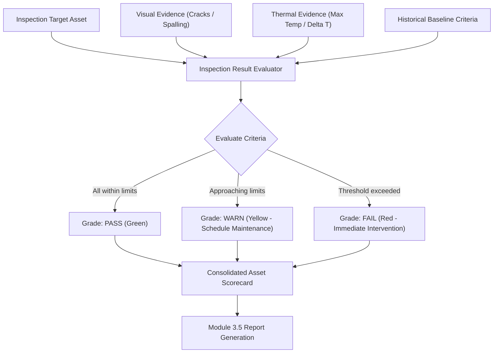

# Submodule 3.3.5: Inspection Results

## 1. Purpose
Consolidates multi-modal evidence into formal PASS/WARN/FAIL inspection scorecards for every target asset in the mission.

## 2. Responsibility
Evaluate collected optical, thermal, and geometric evidence against established baseline thresholds, calculate asset health scores, and generate sign-off scorecards.

## 3. Scope
### In-Scope
Automated scorecard computation, rule-based grading, threshold comparison, operator sign-off workflows, and export formats.

### Out-of-Scope
Legal certification of mining compliance (requires licensed professional engineer).

## 4. System Architecture

## 5. Internal Submodules
- **Automated Grading Engine**: Applies Boolean and threshold evaluation rules to determine asset rating.
- **Sign-off Workflow Manager**: Tracks human supervisor approval, comments, and maintenance work order generation.

## 6. Functional Requirements
- **REQ-3.3-009**: Scorecard evaluator shall generate an unambiguous PASS, WARN, or FAIL status for every scheduled inspection point.
- **REQ-3.3-010**: Scorecards shall link directly to corresponding raw visual and thermal evidence records.

## 7. Technical Approach
Implement evaluation pipeline in Python. Compare observed $T_{max}$ against warning and critical thresholds; compute composite health index ($0-100$). Store results in relational schema.

## 8. Open-Source Resources
### Rule-Based Expert System Patterns
- **What it provides**: Deterministic grading logic.
- **Why it is relevant**: Auditable, transparent safety grading without black-box ML opacity.
- **What we can reuse**: Rule evaluation algorithms.
- **What we must develop ourselves**: Mining asset grading rules.

## 9. Prerequisites
Submodule 3.3.2 Visual Evidence, Submodule 3.3.3 Thermal Evidence.

## 10. Dependencies
- **Upstream Dependencies**: Submodule 3.3.2 Visual Evidence, Submodule 3.3.3 Thermal Evidence.
- **Downstream Dependencies**: Module 3.5 Data & Reporting, Module 3.6 External Integration.
- **Interfaces with Other Modules**: Database table `inspection_results`.

## 11. Development Phases
### Phase 1: Scorecard Evaluator
- **Objective**: Implement automated grading engine.
- **Activities**: Code rule evaluation, test with synthetic inspection datasets.
- **Required resources**: Python, PostgreSQL.
- **Input**: Evidence records.
- **Output**: InspectionScorecard record.
- **Dependencies**: None.
- **Validation**: Grade 10 nominal and 5 hot targets; verify 100% correct classification.
- **Completion criteria**: Zero false negative FAIL ratings.

## 12. Interfaces
### SQL
- `schema/03_inspection_results.sql`: Database table storing asset inspection scorecards.

## 13. Testing Strategy
Evaluate asset with 92°C hotspot (critical threshold 80°C); verify score is evaluated as FAIL and alert flag is asserted.

## 14. Known Challenges
- **Incomplete Evidence Collection**: If a robot was forced to abort before capturing thermal data, the scorecard must be graded as INCOMPLETE rather than defaulting to PASS.

## 15. Implementation Status
`PLANNED`

## 16. References
- **ISO 18434-1: Condition Monitoring and Diagnostics of Machines &mdash; Thermography**: ISO
