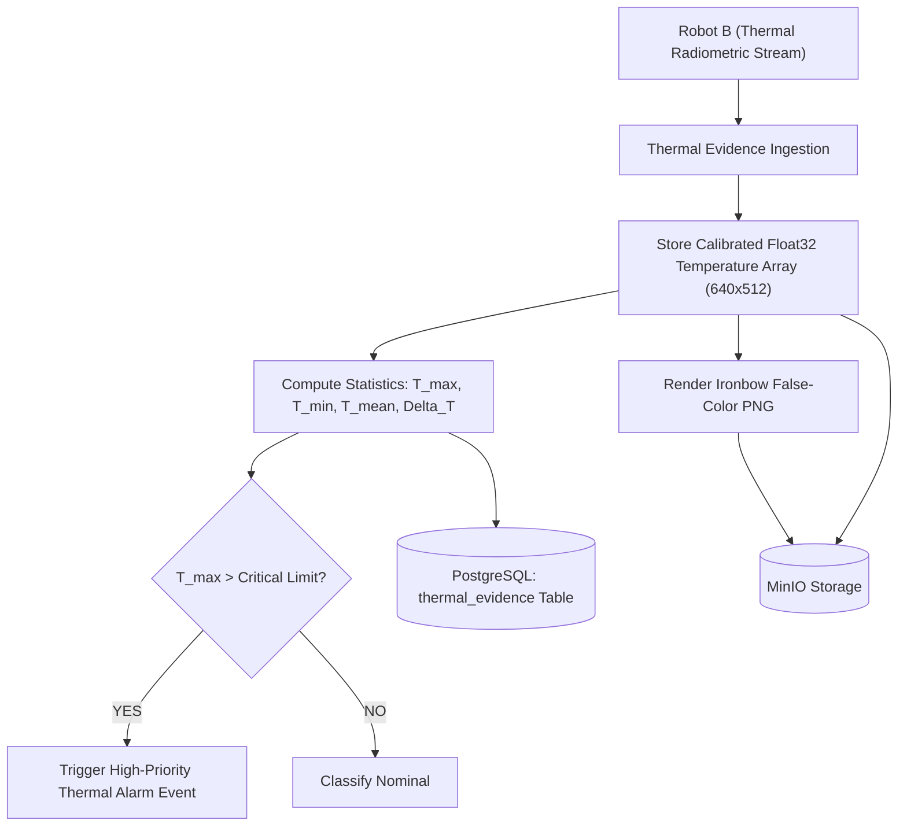

# Submodule 3.3.3: Thermal Evidence Management

## 1. Purpose
Manages radiometric thermal evidence, calibrated temperature matrices, hotspot segmentation records, and cooling curve profiles collected by Robot B.

## 2. Responsibility
Store 16-bit radiometric thermal datasets, compute regional temperature statistics ($T_{max}, T_{min}, T_{mean}$), render false-color thermal visualizations, and detect abnormal heating.

## 3. Scope
### In-Scope
Radiometric matrix storage (raw float arrays), false-color colormap generation (Ironbow, Rainbow), temperature anomaly extraction, and delta comparison against baseline.

### Out-of-Scope
Camera sensor microbolometer physics.

## 4. System Architecture

## 5. Internal Submodules
- **Radiometric Data Store**: Stores full-resolution 2D floating-point matrices of absolute temperatures in degrees Celsius.
- **False-Color Palette Generator**: Renders human-readable inspection PNGs applying standard Ironbow / White-Hot color ramps.

## 6. Functional Requirements
- **REQ-3.3-005**: Thermal evidence shall retain floating-point radiometric temperature data with resolution >= 0.1°C.
- **REQ-3.3-006**: Thermal records with $T_{max} > 80^\circ$C shall automatically generate a `THERMAL_ANOMALY` hazard record.

## 7. Technical Approach
Store calibrated temperature grids as compressed NumPy (`.npz`) or HDF5 arrays in MinIO. Use OpenCV `applyColorMap` to generate lightweight PNG previews for web dashboard viewing.

## 8. Open-Source Resources
### HDF5 / h5py
- **What it provides**: Hierarchical Data Format for scientific numerical arrays.
- **Why it is relevant**: Standard high-performance format for radiometric thermal grids.
- **What we can reuse**: h5py library.
- **What we must develop ourselves**: Radiometric metadata header encapsulation.

## 9. Prerequisites
Submodule 1.3.3 Camera Processing, MinIO.

## 10. Dependencies
- **Upstream Dependencies**: Submodule 1.3.3 Camera Processing.
- **Downstream Dependencies**: Submodule 3.3.4 Hazard Records, Submodule 3.3.5 Inspection Results.
- **Interfaces with Other Modules**: REST endpoint `/api/v1/evidence/thermal`.

## 11. Development Phases
### Phase 1: Thermal Evidence Engine
- **Objective**: Implement radiometric ingestion and colormap rendering.
- **Activities**: Code h5py storage and OpenCV color mapping.
- **Required resources**: Python, OpenCV, h5py.
- **Input**: Float32 temperature array.
- **Output**: HDF5 file and PNG preview.
- **Dependencies**: None.
- **Validation**: Ingest simulated 95°C hotspot; check rendered Ironbow image.
- **Completion criteria**: Hotspot clearly delineated in red/white with accurate temperature metadata.

## 12. Interfaces
### Endpoints
- `POST /api/v1/evidence/thermal`: Uploads radiometric thermal matrix and metadata.

## 13. Testing Strategy
Query thermal matrix for specific pixel coordinates; verify retrieved temperature matches ground truth within 0.1°C.

## 14. Known Challenges
- **Emissivity Variations**: Different mine surfaces (rusty iron vs wet rock) have different thermal emissivity; requires storing material emissivity correction factors.

## 15. Implementation Status
`PLANNED`

## 16. References
- [FLIR Radiometric Data File Formats](https://www.flir.com)
