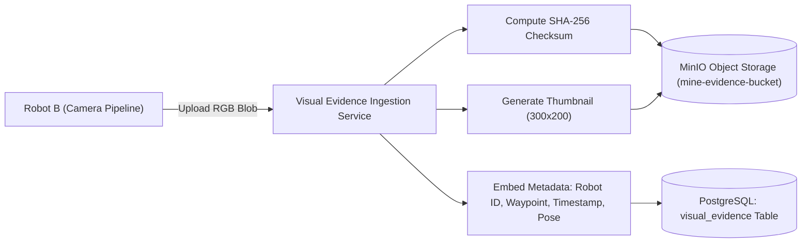

# Submodule 3.3.2: Visual Evidence Management

## 1. Purpose
Stores, categorizes, geotags, and processes high-resolution optical RGB imagery collected during autonomous inspection missions.

## 2. Responsibility
Ingest visual inspection images, extract EXIF metadata, bind images to capturing robot UUID and inspection point ID, compute hash checksums, and store blobs in object storage.

## 3. Scope
### In-Scope
RGB image ingestion, EXIF/XMP metadata embedding, image compression (JPEG/WebP), thumbnail generation, and MinIO storage.

### Out-of-Scope
Real-time camera exposure control (handled by Layer 1).

## 4. System Architecture

## 5. Internal Submodules
- **Metadata Embedder**: Embeds spatial coordinates, robot UUID, and mission ID directly into JPEG EXIF tags.
- **Evidence Storage Pipeline**: Streams compressed images to MinIO S3-compatible object storage.

## 6. Functional Requirements
- **REQ-3.3-003**: Every visual evidence image shall be associated with capturing robot pose and timestamp with precision < 10 ms.
- **REQ-3.3-004**: Image integrity shall be protected via SHA-256 checksums stored in relational database.

## 7. Technical Approach
Deploy FastAPI service with MinIO Python SDK. Store image binaries in MinIO bucket structured as `/{mission_id}/{robot_id}/{task_id}.jpg`. Store metadata in PostgreSQL.

## 8. Open-Source Resources
### MinIO
- **What it provides**: High-performance S3-compatible object storage.
- **Why it is relevant**: Standard scalable blob storage for inspection images and point clouds.
- **What we can reuse**: MinIO server and Python SDK.
- **What we must develop ourselves**: Mine evidence storage policy.

## 9. Prerequisites
MinIO, PostgreSQL 14.

## 10. Dependencies
- **Upstream Dependencies**: Submodule 1.3.3 Camera Processing.
- **Downstream Dependencies**: Submodule 3.3.5 Inspection Results, Submodule 3.5.3 Evidence Storage.
- **Interfaces with Other Modules**: REST endpoint `/api/v1/evidence/visual`.

## 11. Development Phases
### Phase 1: Visual Evidence Service
- **Objective**: Implement image upload and metadata extraction.
- **Activities**: Code FastAPI upload handler, test MinIO storage.
- **Required resources**: Python, FastAPI, MinIO.
- **Input**: Image payload with headers.
- **Output**: Stored URI and DB record.
- **Dependencies**: None.
- **Validation**: Upload 1080p image; verify EXIF tags and MinIO URL.
- **Completion criteria**: Image uploaded and indexed in < 100 ms.

## 12. Interfaces
### Endpoints
- `POST /api/v1/evidence/visual`: Uploads high-res RGB inspection image with metadata.

## 13. Testing Strategy
Upload corrupted image; verify ingestion rejects payload and flags CRC mismatch error.

## 14. Known Challenges
- **Bandwidth Constraints for Large Images**: Uploading uncompressed 1080p frames across mesh radios causes packet backlog; requires local WebP compression on robot before transmission.

## 15. Implementation Status
`PLANNED`

## 16. References
- [MinIO Documentation](https://min.io/docs/minio/linux/index.html)
