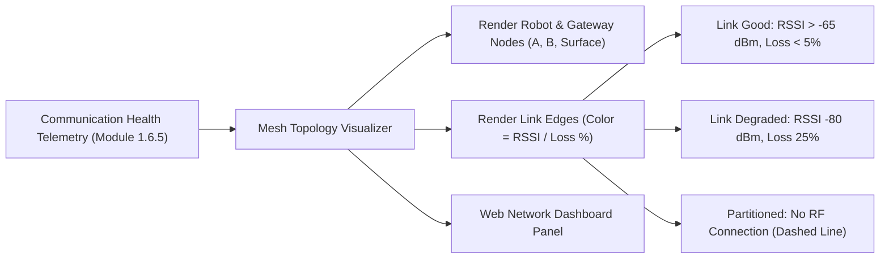

# Submodule 3.4.5: Communication Status

## 1. Purpose
Visualizes the subterranean ad-hoc wireless mesh topology, inter-robot link quality, round-trip times (RTT), packet drop percentages, and routing hops.

## 2. Responsibility
Render interactive network topology graph, display real-time signal strength (RSSI) on drift links, highlight network partitions, and warn of imminent radio loss.

## 3. Scope
### In-Scope
Network graph visualization (nodes and link edges), RSSI color-coding, packet loss indicators, partition boundary markers, and mesh throughput meters.

### Out-of-Scope
Physical radio frequency firmware configuration.

## 4. System Architecture

## 5. Internal Submodules
- **Network Topology Graph Renderer**: Force-directed or geographic node-link graph showing active P2P Zenoh connections.
- **RF Link Quality Monitor**: Displays real-time time-series plots of RSSI, packet loss, and RTT per peer link.

## 6. Functional Requirements
- **REQ-3.4-009**: Topology graph shall update link edge status within 1.0 second of communication loss or reconnection.
- **REQ-3.4-010**: Network edges shall visually indicate packet loss rates exceeding 30% via warning styling.

## 7. Technical Approach
Deploy Cytoscape.js or Vis.js Network within React. Bind link data directly to Submodule 1.6.5 telemetry streams. Color-code link edges from Green (optimal) to Red (marginal) to Grey/Dashed (disconnected).

## 8. Open-Source Resources
### Cytoscape.js
- **What it provides**: Graph theory library for network visualization.
- **Why it is relevant**: Standard library for rendering dynamic wireless mesh topologies.
- **What we can reuse**: Core graph layout and styling engines.
- **What we must develop ourselves**: Robotics RF mesh node styles.

## 9. Prerequisites
Submodule 1.6.5 Communication Health.

## 10. Dependencies
- **Upstream Dependencies**: Submodule 1.6.5 Communication Health.
- **Downstream Dependencies**: None.
- **Interfaces with Other Modules**: WebSockets `/ws/network_status`.

## 11. Development Phases
### Phase 1: Network Graph Component
- **Objective**: Implement Cytoscape mesh graph visualizer.
- **Activities**: Code graph component, bind link telemetry, test partition visualizer.
- **Required resources**: React, Cytoscape.js.
- **Input**: Link quality telemetry.
- **Output**: Interactive network graph.
- **Dependencies**: None.
- **Validation**: Disconnect link in simulation; verify edge turns dashed grey.
- **Completion criteria**: Visual link state updates within 1.0 s.

## 12. Interfaces
### WebSockets
- `/ws/network_status`: WebSocket stream of mesh adjacency matrix and link metrics.

## 13. Testing Strategy
Drive robots around a tunnel corner in simulation; verify link edge changes from green to yellow to disconnected as RF attenuation increases.

## 14. Known Challenges
- **Visualizing Partitioned Sub-Networks**: When two robots communicate with each other underground while disconnected from the surface, the surface dashboard cannot see their link; requires displaying 'Last Known Mesh State'.

## 15. Implementation Status
`PLANNED`

## 16. References
- [Cytoscape.js Documentation](https://js.cytoscape.org)
