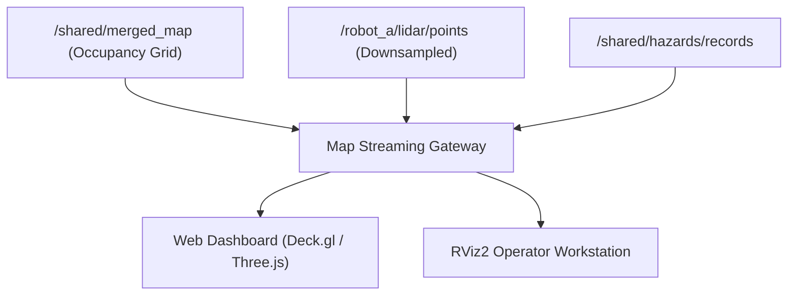

# Submodule 3.4.1: Mine Map Visualization

## 1. Purpose
Renders real-time 2D occupancy grid maps, 3D point clouds, and topological mine drift geometry for human operators.

## 2. Responsibility
Stream map updates from the subterranean robots, merge multi-robot sub-maps into a unified display, render hazard overlays, and provide pan/zoom controls.

## 3. Scope
### In-Scope
Web-based 2D map canvas (Deck.gl / Leaflet), 3D point cloud streaming (Three.js / Potree), RViz2 configuration profiles, and hazard pin overlays.

### Out-of-Scope
Algorithmic SLAM map generation (handled by Layer 1).

## 4. System Architecture

## 5. Internal Submodules
- **2D Map Canvas Renderer**: Renders high-resolution raster tiles from dynamic ROS 2 occupancy grids.
- **Point Cloud Stream Throttler**: Downsamples dense 3D point clouds to 50,000 points/sec for smooth browser rendering.

## 6. Functional Requirements
- **REQ-3.4-001**: Map visualizer shall render 200m x 200m occupancy grid maps at >= 10 fps in standard web browsers.
- **REQ-3.4-002**: Hazard locations and inspection points shall be displayed as clickable interactive map overlays.

## 7. Technical Approach
Develop a React web component using Deck.gl for high-performance WebGL raster map rendering. Stream map diffs from the ROS 2 / Zenoh bridge via WebSockets.

## 8. Open-Source Resources
### Deck.gl (vis.gl)
- **What it provides**: WebGL-powered framework for large-scale dataset visualization.
- **Why it is relevant**: Smooth GPU rendering of large mine occupancy grids.
- **What we can reuse**: BitmapLayer, PointCloudLayer, IconLayer.
- **What we must develop ourselves**: ROS 2 occupancy grid tile adapter.

## 9. Prerequisites
Submodule 1.3.6 Map Alignment, React 18+.

## 10. Dependencies
- **Upstream Dependencies**: Submodule 1.3.6 Map Alignment.
- **Downstream Dependencies**: None (Terminal visualization module).
- **Interfaces with Other Modules**: WebSockets `/ws/map_stream`.

## 11. Development Phases
### Phase 1: Map Canvas Development
- **Objective**: Build React Deck.gl map viewer component.
- **Activities**: Code raster layer, integrate WebSocket map stream, add hazard pins.
- **Required resources**: React, TypeScript, Deck.gl.
- **Input**: Occupancy grid bytes.
- **Output**: Rendered browser canvas.
- **Dependencies**: None.
- **Validation**: Stream simulated 1000x1000 grid; measure browser frame rate.
- **Completion criteria**: Maintains >= 30 fps on standard laptop GPU.

## 12. Interfaces
### WebSockets
- `/ws/map_stream`: Binary WebSocket stream broadcasting compressed occupancy grid diffs.

## 13. Testing Strategy
Load 500m simulated mine drift map; verify map pan/zoom operates smoothly without memory leaks or stutter.

## 14. Known Challenges
- **High Memory in Browser WebGL**: Unbounded texture allocations for growing SLAM maps can crash mobile browser tabs; requires dynamic tile culling.

## 15. Implementation Status
`PLANNED`

## 16. References
- [Deck.gl Documentation](https://deck.gl)
