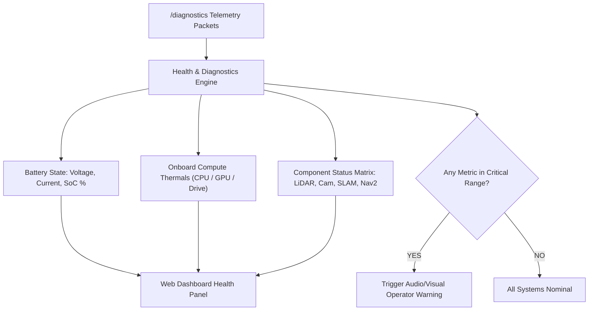

# Submodule 3.4.4: Robot Health and Diagnostics

## 1. Purpose
Monitors physical and computational hardware health metrics across the fleet: battery SoC, motor currents, CPU/GPU temperatures, memory, and sensor diagnostics.

## 2. Responsibility
Parse diagnostic telemetry, render gauge dashboards, monitor threshold alarms, display active warning banners, and track sub-system health statuses.

## 3. Scope
### In-Scope
Telemetry gauge components (battery SoC, voltage, current, temps), component status lights (LiDAR, Camera, Thermal, Motors, Nav2), and alert logs.

### Out-of-Scope
Low-level hardware driver registers.

## 4. System Architecture

## 5. Internal Submodules
- **Telemetry Gauge Renderer**: Renders circular radial gauges and line graphs for continuous physical variables.
- **Subsystem Status Matrix**: Renders green/yellow/red status indicators for every individual sensor and software node.

## 6. Functional Requirements
- **REQ-3.4-007**: Health dashboard shall update battery SoC, motor currents, and temperatures at >= 1 Hz.
- **REQ-3.4-008**: Critical alarms (battery < 15%, motor over-temp > 85°C) shall trigger immediate persistent modal alerts.

## 7. Technical Approach
Deploy standard ROS 2 web diagnostics bridge. Ingest `diagnostic_msgs/DiagnosticArray` via WebSocket and render in React using Tailwind CSS and Lucide icons.

## 8. Open-Source Resources
### Lucide React / Tailwind CSS
- **What it provides**: Clean UI component primitives and iconography.
- **Why it is relevant**: Building clear industrial operator dashboards.
- **What we can reuse**: Gauge and badge components.
- **What we must develop ourselves**: Robotics diagnostic card layout.

## 9. Prerequisites
Submodule 1.6.2 State Publisher.

## 10. Dependencies
- **Upstream Dependencies**: Submodule 1.6.2 State Publisher.
- **Downstream Dependencies**: None.
- **Interfaces with Other Modules**: WebSockets `/ws/diagnostics`.

## 11. Development Phases
### Phase 1: Health Dashboard Component
- **Objective**: Implement diagnostic card and telemetry gauges.
- **Activities**: Code gauge cards, test with simulated diagnostic streams.
- **Required resources**: React, Tailwind.
- **Input**: DiagnosticArray messages.
- **Output**: Health UI panel.
- **Dependencies**: None.
- **Validation**: Inject high motor temperature warning; verify badge turns red.
- **Completion criteria**: Status updates reflected in < 100 ms.

## 12. Interfaces
### WebSockets
- `/ws/diagnostics`: WebSocket stream of diagnostic array messages.

## 13. Testing Strategy
Inject simulated 90°C motor driver temperature in Robot B; verify health panel highlights motor drive card in red and asserts audible warning.

## 14. Known Challenges
- **Information Overload**: Displaying hundreds of raw ROS 2 diagnostic topics overwhelms operators; requires hierarchical roll-up to high-level subsystem health scores.

## 15. Implementation Status
`PLANNED`

## 16. References
- [ROS 2 Diagnostic Tooling](https://github.com/ros/diagnostics)
