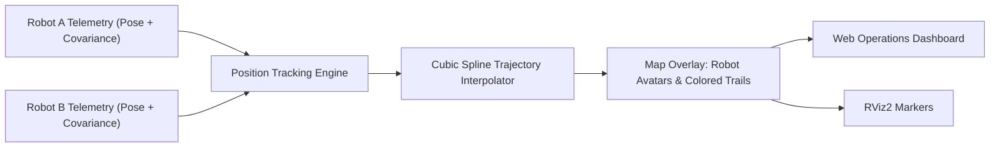

# Submodule 3.4.2: Robot Position and Trajectory Visualization

## 1. Purpose
Visualizes real-time robot locations, heading orientations, historical trajectory breadcrumbs, and positional uncertainty ellipses on the operations map.

## 2. Responsibility
Ingest telemetry poses from Robot A and B, render differentiated vehicle icons, draw color-coded historical path trails, and indicate localization covariance.

## 3. Scope
### In-Scope
Robot avatar rendering, trajectory trail smoothing, covariance ellipse rendering ($3\sigma$), heading vectors, and interpolation.

### Out-of-Scope
EKF sensor fusion algorithms (handled by Layer 1).

## 4. System Architecture

## 5. Internal Submodules
- **Trajectory Interpolator**: Interpolates discrete 5 Hz telemetry packets to achieve silky smooth 60 fps icon movement on screen.
- **Covariance Ellipse Calculator**: Transforms $2 \times 2$ position covariance matrix into visual $3\sigma$ confidence ellipses.

## 6. Functional Requirements
- **REQ-3.4-003**: Robot positions shall update on the map display with end-to-end latency `[PROPOSED TARGET: < 150 ms]` when link is online.
- **REQ-3.4-004**: Visual markers shall clearly distinguish Robot A (Explorer - Blue) from Robot B (Inspector - Orange).

## 7. Technical Approach
Implement Deck.gl `IconLayer` and `PathLayer`. Position packets received over WebSocket update an in-memory trajectory buffer. Smooth motion using client-side requestAnimationFrame interpolation.

## 8. Open-Source Resources
### Deck.gl PathLayer & IconLayer
- **What it provides**: Fast GPU path and marker rendering.
- **Why it is relevant**: Visualizing multi-robot breadcrumbs and vehicle headings.
- **What we can reuse**: PathLayer primitives.
- **What we must develop ourselves**: Covariance ellipse polygon generator.

## 9. Prerequisites
Submodule 1.6.2 State Publisher, Submodule 3.4.1 Mine Map Visualization.

## 10. Dependencies
- **Upstream Dependencies**: Submodule 1.6.2 State Publisher.
- **Downstream Dependencies**: None.
- **Interfaces with Other Modules**: WebSockets `/ws/telemetry`.

## 11. Development Phases
### Phase 1: Position Tracker Component
- **Objective**: Build React position tracking overlay.
- **Activities**: Code icon rendering, test trajectory smoothing with simulated telemetry.
- **Required resources**: React, Deck.gl.
- **Input**: Telemetry stream.
- **Output**: Animated map icons.
- **Dependencies**: Submodule 3.4.1.
- **Validation**: Stream simulated 100m drive; verify smooth path tracking without jumps.
- **Completion criteria**: Zero visual jitter in icon motion.

## 12. Interfaces
### WebSockets
- `/ws/telemetry`: JSON stream of live robot poses, velocities, and status.

## 13. Testing Strategy
Simulate high covariance spike (loss of SLAM features); verify covariance ellipse on map visually expands to alert operator of localization uncertainty.

## 14. Known Challenges
- **Visualizing Partitioned Robots**: When a robot loses radio contact, its position marker freezes; UI must display 'Last Known Pose' with fading transparency.

## 15. Implementation Status
`PLANNED`

## 16. References
- [Deck.gl PathLayer Reference](https://deck.gl/docs/api-reference/layers/path-layer)
