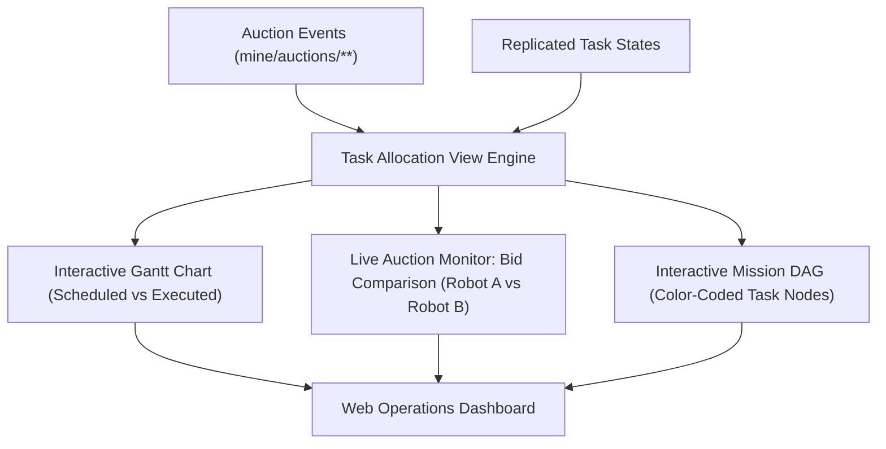

# Submodule 3.4.3: Task Allocation View

## 1. Purpose
Visualizes the live distributed task allocation process, Contract Net Protocol auctions, submitted bids, lease assignments, and mission DAG progress.

## 2. Responsibility
Render interactive Gantt charts of scheduled tasks, display live auction bidding windows, visualize cost breakdown graphs, and highlight task dependency chains.

## 3. Scope
### In-Scope
Gantt chart visualization, auction bid comparison bar charts, interactive DAG graph inspector, and task detail drawer.

### Out-of-Scope
Algorithmic task allocation negotiation (handled by Layer 2).

## 4. System Architecture

## 5. Internal Submodules
- **Live Auction Visualizer**: Displays real-time bid arrival timelines and cost component breakdowns ($D_{travel}, E_{battery}, C_{fit}$).
- **Mission DAG Graph Inspector**: Interactive graph rendering task nodes color-coded by state (`BLOCKED`, `READY`, `ASSIGNED`, `COMPLETED`).

## 6. Functional Requirements
- **REQ-3.4-005**: The UI shall display auction bid submissions in real time as they arrive during active bidding windows.
- **REQ-3.4-006**: Clicking any task node shall display full parameter details, assigned robot, lease token, and inspection evidence.

## 7. Technical Approach
Utilize React with Visx or Chart.js for Gantt and bar charts, and ReactFlow for interactive DAG state rendering. Bind directly to the system event bus WebSocket feed.

## 8. Open-Source Resources
### Visx (Airbnb)
- **What it provides**: Low-level visualization components for React.
- **Why it is relevant**: Building customized, responsive robotics Gantt charts.
- **What we can reuse**: Visx shape and scale primitives.
- **What we must develop ourselves**: Multi-robot task timeline view.

## 9. Prerequisites
Module 2.4 Distributed Task Allocation, React 18+.

## 10. Dependencies
- **Upstream Dependencies**: Module 2.4 Distributed Task Allocation.
- **Downstream Dependencies**: None.
- **Interfaces with Other Modules**: WebSockets `/ws/auctions`.

## 11. Development Phases
### Phase 1: Auction Visualizer Component
- **Objective**: Build React Gantt chart and auction inspector.
- **Activities**: Code Gantt component, test with recorded auction events.
- **Required resources**: React, Visx.
- **Input**: Auction and task events.
- **Output**: Interactive task timeline.
- **Dependencies**: None.
- **Validation**: Simulate 10-task auction sequence; verify Gantt updates live.
- **Completion criteria**: Tasks dynamically populate into robot timeline.

## 12. Interfaces
### WebSockets
- `/ws/auctions`: WebSocket feed broadcasting live auction announcements, bids, and awards.

## 13. Testing Strategy
Open auction view; trigger auction in simulation; verify operator can inspect bids submitted by Robot A and Robot B side-by-side.

## 14. Known Challenges
- **Gantt Re-alignment on Delays**: When a robot encounters terrain obstacles, task duration stretches; Gantt chart must dynamically shift dependent downstream tasks forward in time.

## 15. Implementation Status
`PLANNED`

## 16. References
- [Visx Documentation](https://airbnb.io/visx/)
