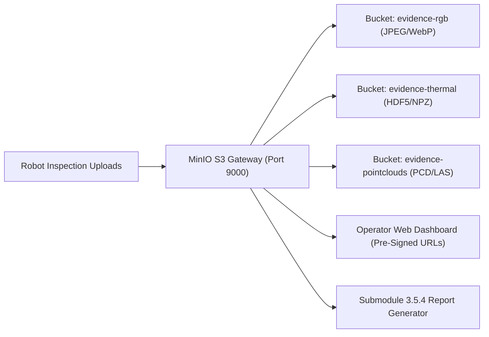

# Submodule 3.5.3: Evidence Storage

## 1. Purpose
Provides high-performance, S3-compatible, horizontally scalable object storage for massive binary inspection datasets: high-res RGB imagery, radiometric thermal grids, and 3D point cloud scans.

## 2. Responsibility
Store binary evidence blobs, manage bucket access policies, enforce retention periods, generate pre-signed retrieval URLs, and guarantee data durability.

## 3. Scope
### In-Scope
MinIO object storage deployment, bucket organization policies (`/missions`, `/evidence/rgb`, `/evidence/thermal`, `/pointclouds`), pre-signed URL generation, and lifecycle management.

### Out-of-Scope
Relational metadata querying (handled by Submodule 3.5.1).

## 4. System Architecture

## 5. Internal Submodules
- **S3 Bucket Lifecycle Manager**: Enforces data retention policies (e.g. retain raw evidence for 3 years, archive to cold storage after 1 year).
- **Pre-signed URL Generator**: Issues time-bounded (15-minute) authenticated access tokens for browser image loading.

## 6. Functional Requirements
- **REQ-3.5-005**: Evidence storage shall provide standard AWS S3 API compatibility for seamless integration with cloud tools.
- **REQ-3.5-006**: Blob retrieval operations shall support read throughput >= 100 MB/s over local Gigabit LAN.

## 7. Technical Approach
Deploy MinIO in Docker/containerized environment. Configure TLS encryption, automated volume snapshots, and IAM service credentials for robot uploads.

## 8. Open-Source Resources
### MinIO Object Storage
- **What it provides**: High-performance S3-compatible object storage.
- **Why it is relevant**: Standard open-source cloud storage for edge and on-premise robotics.
- **What we can reuse**: MinIO server binary and Docker container.
- **What we must develop ourselves**: Bucket layout and access policies.

## 9. Prerequisites
Docker or standalone Linux host, NVMe storage.

## 10. Dependencies
- **Upstream Dependencies**: None.
- **Downstream Dependencies**: Submodule 3.3.2 Visual Evidence, Submodule 3.3.3 Thermal Evidence, Submodule 3.5.4 Report Generation.
- **Interfaces with Other Modules**: S3 API endpoint `http://localhost:9000`.

## 11. Development Phases
### Phase 1: MinIO Deployment
- **Objective**: Deploy MinIO server and configure evidence buckets.
- **Activities**: Write docker-compose.yml, create buckets, test S3 upload/download.
- **Required resources**: Docker, MinIO Client (mc).
- **Input**: Storage configuration.
- **Output**: Running S3 service.
- **Dependencies**: None.
- **Validation**: Upload 50 MB point cloud; retrieve via pre-signed URL.
- **Completion criteria**: Full round-trip upload and download verified.

## 12. Interfaces
### Config
- `config/storage/minio-compose.yml`: Docker compose configuration for MinIO evidence store.

## 13. Testing Strategy
Simulate concurrent uploads of 20 high-res thermal matrices from Robot B; verify zero upload failures and correct bucket keys.

## 14. Known Challenges
- **Disk Exhaustion on Continuous Mapping**: Unfiltered 3D LiDAR point clouds can consume gigabytes per hour; requires automated downsampling and compression prior to object store commit.

## 15. Implementation Status
`PLANNED`

## 16. References
- [MinIO Server Quickstart](https://min.io/docs/minio/linux/index.html)
