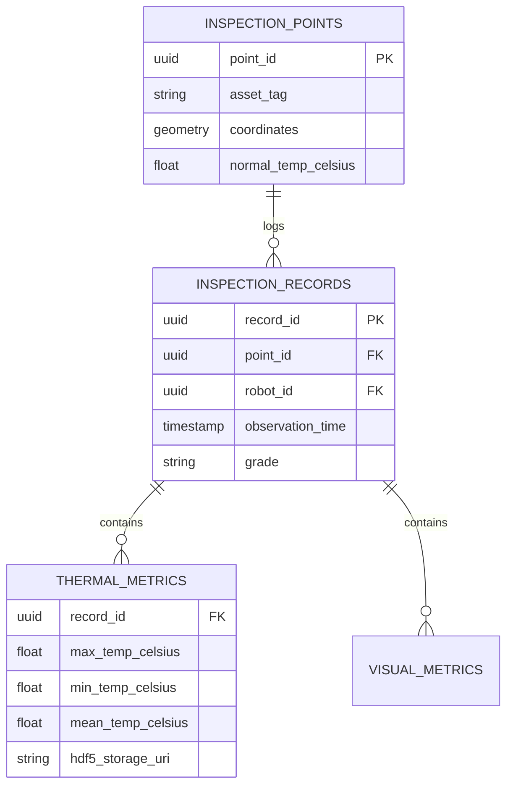

# Submodule 3.5.2: Inspection Database

## 1. Purpose
Stores structured inspection observations, physical measurements, thermal readings, and asset scorecards in a time-series optimized schema.

## 2. Responsibility
Persist inspection metrics ($T_{max}, T_{mean}$, crack length, gas concentration), index measurements by asset ID and timestamp, and support rapid trend queries.

## 3. Scope
### In-Scope
Inspection measurement tables, TimescaleDB / PostGIS hypertable configuration, time-series aggregation queries, and retention policies.

### Out-of-Scope
Large image blob storage (handled by Submodule 3.5.3).

## 4. System Architecture

## 5. Internal Submodules
- **Time-Series Observation Table**: Stores timestamped sensor observations optimized for fast time-range querying.
- **Trend Query Generator**: Computes moving averages and rate-of-change metrics (e.g. heating rate $dT/dt$) across historical inspections.

## 6. Functional Requirements
- **REQ-3.5-003**: Inspection measurements shall be queryable by asset ID over multi-year operational time spans in `[PROPOSED TARGET: < 50 ms]`.
- **REQ-3.5-004**: Database shall support automated calculation of rate-of-change ($dT/dt$) across consecutive inspections.

## 7. Technical Approach
Deploy TimescaleDB extension on PostgreSQL. Convert `inspection_records` table into a TimescaleDB hypertable partitioned by `observation_time`.

## 8. Open-Source Resources
### TimescaleDB
- **What it provides**: Time-series database engine built on PostgreSQL.
- **Why it is relevant**: Ultra-fast time-range queries and automatic continuous aggregates.
- **What we can reuse**: TimescaleDB hypertables.
- **What we must develop ourselves**: Asset temperature trend queries.

## 9. Prerequisites
Submodule 3.5.1 Mission Database, TimescaleDB.

## 10. Dependencies
- **Upstream Dependencies**: Submodule 3.5.1 Mission Database.
- **Downstream Dependencies**: Submodule 3.5.4 Report Generation.
- **Interfaces with Other Modules**: Database table `inspection_records`.

## 11. Development Phases
### Phase 1: TimescaleDB Setup
- **Objective**: Configure hypertable and write aggregation queries.
- **Activities**: Create hypertable, populate 10,000 synthetic inspection records, benchmark queries.
- **Required resources**: TimescaleDB, SQL.
- **Input**: Inspection measurement schema.
- **Output**: Optimized hypertable.
- **Dependencies**: Submodule 3.5.1.
- **Validation**: Query 6-month temperature trend for bearing #4; benchmark time.
- **Completion criteria**: Query executes in < 30 ms.

## 12. Interfaces
### SQL
- `schema/04_timeseries_inspection.sql`: TimescaleDB hypertable definition for inspection records.

## 13. Testing Strategy
Insert 100,000 inspection data points; verify continuous aggregate functions compute monthly temperature averages without performance degradation.

## 14. Known Challenges
- **Clock Drift in Time-Series Partitioning**: Robots with drifting hardware clocks could insert records with timestamps in the future; requires server-side ingress timestamping.

## 15. Implementation Status
`PLANNED`

## 16. References
- [TimescaleDB Documentation](https://docs.timescale.com)
