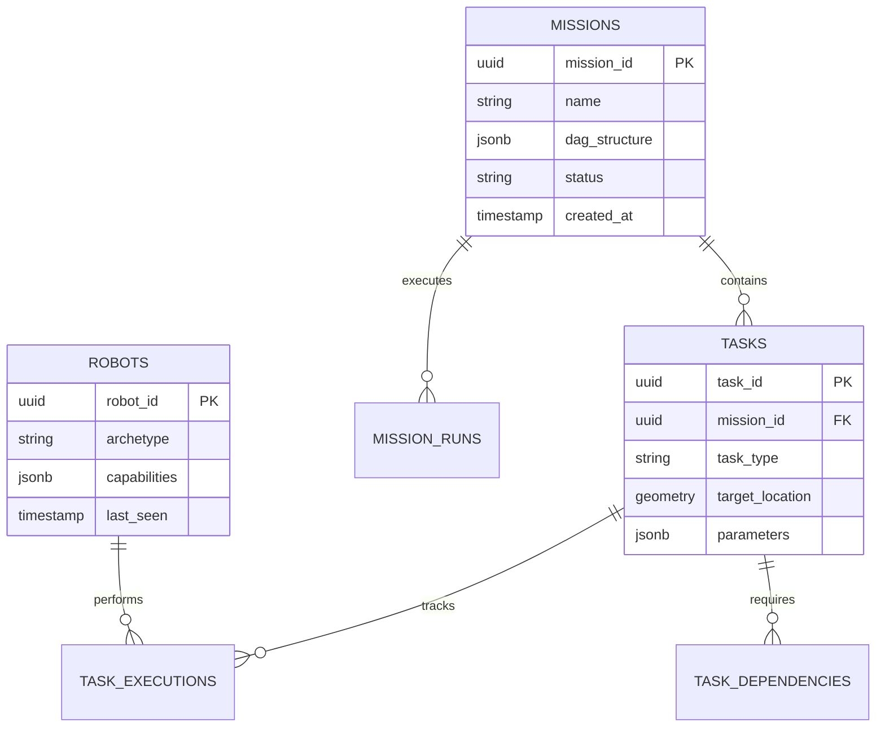

# Submodule 3.5.1: Mission Database

## 1. Purpose
Provides relational, acid-compliant data persistence for missions, task execution histories, robot fleet rosters, and operational milestones.

## 2. Responsibility
Maintain PostgreSQL database schemas, manage connection pooling, execute transactional writes, and provide indexed query endpoints.

## 3. Scope
### In-Scope
Relational schema definition (`missions`, `tasks`, `task_executions`, `robot_roster`), migrations (Flyway / Alembic), and connection pooling.

### Out-of-Scope
High-bandwidth binary blob storage (handled by Submodule 3.5.3).

## 4. System Architecture

## 5. Internal Submodules
- **Database Migration Manager**: Applies version-controlled SQL schema migrations automatically on startup.
- **Async Query Service**: High-throughput asynchronous connection pool (asyncpg / SQLModel) for API queries.

## 6. Functional Requirements
- **REQ-3.5-001**: Database shall enforce strict foreign key constraints and transactional integrity across missions and tasks.
- **REQ-3.5-002**: Database migrations shall be fully automated and idempotent.

## 7. Technical Approach
Deploy PostgreSQL 14+ with Alembic migrations. Use SQLAlchemy 2.0 / SQLModel in Python for type-safe ORM query authoring.

## 8. Open-Source Resources
### PostgreSQL 14 / SQLAlchemy 2.0
- **What it provides**: Enterprise ACID relational persistence.
- **Why it is relevant**: Standard robust database for structured mission metadata.
- **What we can reuse**: PostgreSQL core and SQLAlchemy ORM.
- **What we must develop ourselves**: Mission and robotics schema definitions.

## 9. Prerequisites
PostgreSQL 14+.

## 10. Dependencies
- **Upstream Dependencies**: None.
- **Downstream Dependencies**: All Layer 3 modules.
- **Interfaces with Other Modules**: PostgreSQL connection string `postgresql://...`.

## 11. Development Phases
### Phase 1: Database Schema Setup
- **Objective**: Define schema and Alembic migration scripts.
- **Activities**: Write SQL DDL, create initial migration, test rollback.
- **Required resources**: PostgreSQL, Alembic.
- **Input**: Entity-relationship model.
- **Output**: Database schema.
- **Dependencies**: None.
- **Validation**: Run alembic upgrade head; verify all tables created.
- **Completion criteria**: All tables and foreign keys valid.

## 12. Interfaces
### SQL
- `migrations/versions/001_initial_schema.py`: Initial Alembic migration script.

## 13. Testing Strategy
Insert complex mission with 50 tasks; execute concurrent updates from 10 client threads; verify ACID transaction isolation.

## 14. Known Challenges
- **Database Schema Versioning**: Evolving mission schemas across software versions requires backwards-compatible zero-downtime database migrations.

## 15. Implementation Status
`PLANNED`

## 16. References
- [PostgreSQL Documentation](https://www.postgresql.org/docs/14/)
